# Re:Focus — Production-Ready Local-First Backup & Restore: Failure Handling and Recovery Architecture

**Document Path:** `docs/LOCAL_FIRST_BACKUP_RESTORE_PLAN.md`  
**Status:** Comprehensive Production Architecture & Adversarial Gap Resolution Specification  
**Operating Mode:** Audit & Design Only — Zero Code / Configuration / Rules / Deployment Modification  
**Scope:** Android Client (`app/`), Cloudflare Edge Worker (`worker/src/index.js`), Cloud Firestore (`firestore.rules` & Google REST API), WorkManager, Room SQLite, and DataStore Preferences.

---

## 1. Locked Decisions & Executive Summary

### 1.1 Locked Production Decisions
The following four fundamental architectural decisions are strictly locked into this specification:
1. **Authoritative Calendar Reset at 00:00 IST:** Daily backup and restore allowances reset precisely at **00:00:00 Indian Standard Time (IST, UTC+05:30)**, which corresponds to $18:30:00\text{ UTC}$ of the preceding UTC calendar day. Server timestamps are strictly authoritative; device clocks are completely untrusted.
2. **One-Time Fresh-Install Restore Prompt (No Silent Sync):** If a user installs the application fresh, authenticates, has an empty local database (`getAllDailyDataSync().isEmpty()`), and a valid cloud backup exists, the app presents an explicit, one-time dialog: *"Cloud backup found from [Date]. Restore your history and settings now? (1 restore per day)"*. The app **never restores silently or automatically**. If declined, the user starts fresh and may initiate restore manually from Settings at any time.
3. **Staged Firestore Rules Migration with Verification & Realistic Rollback:** Direct client read/write access to `/users/{userId}/daily_data/{dateString}` in `firestore.rules` will be decommissioned in verifiable stages. Progression between stages is governed by deterministic telemetry assertions (error thresholds, zero legitimate write denials) and includes an audited 60–120s rollback procedure, rather than relying solely on arbitrary client adoption percentages.
4. **Preservation of All Historical Records via Reliable Chunking & Pinned Snapshots:** Users must never have their historical habit records truncated or discarded. Because Firestore limits write batches to **500 operations per commit**, backups and restores spanning more than 200 records utilize a **manifest-driven chunked protocol** with SHA-256 checksums, chunk ordering, duplicate detection, and resume capabilities.

---

### 1.2 Verified Repository State (Static Audit Evidence)
1. **Accessibility Reel Tracking is 100% Offline-Autonomous:**  
   [`ReelTrackerService`](file:///c:/Users/pavan/OneDrive/Documents/REEL/app/src/main/java/com/reeltrak/app/services/ReelTrackerService.kt) and [`DayManager`](file:///c:/Users/pavan/OneDrive/Documents/REEL/app/src/main/java/com/reeltrak/app/services/tracking/DayManager.kt) maintain reel count in memory and persist debounced writes (500ms trailing) to Room SQLite ([`DailyReelDataDao`](file:///c:/Users/pavan/OneDrive/Documents/REEL/app/src/main/java/com/reeltrak/app/data/local/dao/DailyReelDataDao.kt)). UI dashboards, streak calculations, achievements, and milestone notifications query Room SQLite directly ([`DashboardViewModel.kt#L245`](file:///c:/Users/pavan/OneDrive/Documents/REEL/app/src/main/java/com/reeltrak/app/features/dashboard/viewmodel/DashboardViewModel.kt#L245)).
2. **Elimination of Routine Habit History Sync vs Preserved User Settings Writes:**  
   - **What is Permanently Eliminated:** Routine background habit history synchronization (`SyncWorker`) is completely decommissioned. Automatic background reel history uploads to `/users/{uid}/daily_data/{dateString}` are eliminated. Unsolicited full-collection downloads (`restoreFromCloud()`) on app launch ([`SyncManager.init`](file:///c:/Users/pavan/OneDrive/Documents/REEL/app/src/main/java/com/reeltrak/app/core/sync/SyncManager.kt#L107-L141)) and login ([`LoginViewModel.executePostLoginSync`](file:///c:/Users/pavan/OneDrive/Documents/REEL/app/src/main/java/com/reeltrak/app/features/auth/LoginViewModel.kt#L244-L293)) are permanently removed. The continuous 24/7 Firestore real-time snapshot listener on `/users/{uid}/backup/status` is dismantled.
   - **What is Explicitly Preserved (Event-Driven User Settings):** [`SettingsViewModel.kt#L202`](file:///c:/Users/pavan/OneDrive/Documents/REEL/app/src/main/java/com/reeltrak/app/features/settings/viewmodel/SettingsViewModel.kt#L202) (user adjusting daily limit in Settings) and [`DayManager.kt#L491`](file:///c:/Users/pavan/OneDrive/Documents/REEL/app/src/main/java/com/reeltrak/app/services/tracking/DayManager.kt#L491) (entitled user midnight limit initialization) invoke [`SyncManager.saveDailyLimitToCloud`](file:///c:/Users/pavan/OneDrive/Documents/REEL/app/src/main/java/com/reeltrak/app/core/sync/SyncManager.kt#L932-L964), directly writing single-document user preferences to `/users/{uid}/settings/preferences`. This path remains permitted in Stage 1 & 2 security rules.
   - **Architectural Scope Boundary:** This specification eliminates **routine habit history synchronization**. It does **not** claim all network calls are eliminated: lightweight user settings updates, token authentication, and explicit backup/restore remain permitted. In a future Phase 7+ release, direct Firestore settings writes will be routed through a dedicated `PUT /api/settings` Worker endpoint.
3. **Backend Route Asymmetry:**  
   The Cloudflare Worker ([`worker/src/index.js`](file:///c:/Users/pavan/OneDrive/Documents/REEL/worker/src/index.js)) exposes `POST /api/backup` (lines 4529–4682) and `GET /api/backup/status` (lines 4472–4526), but **does NOT expose any `/api/restore` route**. The Android app has been reading Firestore directly, leaving cloud restore completely unmetered, unthrottled, and ungated on the server.
4. **Infrastructure Audit:**  
   Cloudflare D1 and Durable Objects are **NOT configured** in [`worker/wrangler.jsonc`](file:///c:/Users/pavan/OneDrive/Documents/REEL/worker/wrangler.jsonc). Persistent backend state is stored in Cloud Firestore via Google Service Account OAuth REST endpoints (`https://firestore.googleapis.com/v1/...`).

---

## 2. Core Architecture & Invariants

### 2.1 Explicit System Invariants
1. **Local-First Invariant:** Room SQLite (`daily_reel_data`) is the sole runtime authority for reel tracking, strict mode states, daily goals, streaks, and reports. Reel counting never depends on network availability or server state.
2. **Zero Routine Habit Sync Invariant:** `SyncWorker` is permanently decommissioned. No background sync jobs are scheduled on midnight rollover, cold start, or network connectivity change for habit history.
3. **Enumerated Permitted Network Activity:**
   - **Category A (Explicit User-Initiated Backup & Restore):** `POST /api/backup` and `POST /api/restore`, strictly metered to 1 per IST day.
   - **Category B (Restore Lease Maintenance & ACK):** Streaming chunk downloads (`GET /api/restore/chunk`), lease renewal (`POST /api/restore/heartbeat`), and reliable acknowledgment delivery via WorkManager (`POST /api/restore/ack`).
   - **Category C (Event-Driven User Settings Writes):** Preserved direct client writes to `/users/{uid}/settings/preferences` when a user updates their daily limit in Settings (`SettingsViewModel.kt#L202`) or during entitled midnight limit persistence (`DayManager.kt#L491`).
   - **Category D (Auth & Entitlement Validation):** Cryptographic JWT verification, Google JWKS retrieval, and subscription entitlement checks.
4. **Explicit User Initiation Invariant:** Cloud backup and cloud restore are triggered **only by direct user action** in the UI.
5. **Dual Server-Authoritative Quota Invariant:**
   - Maximum **1 completed logical backup** per authenticated UID per **IST calendar day** (defined as successfully verified, committed into storage, and status pointer updated).
   - Maximum **1 completed logical restore** per authenticated UID per **IST calendar day**:
     - A restore is defined as **completed** if and only if the payload successfully commits into local Room SQLite (Phase 1 of the Outbox Pattern) and is acknowledged to the server (`ACKNOWLEDGED`).
     - **Pre-Commit Reservation vs Consumption:** During download, staging, and verification, the daily restore slot is held under an active reservation lease (`status: "DISPATCHED"`). If a pre-commit failure occurs (transient network interruption, device storage full, or corrupted payload), the completed restore allowance is **NOT consumed**. The client cleanly aborts or lets the lease expire, transitioning the claim to `FAILED`, freeing the slot for retry within the same IST day.
     - **Anti-Abuse Daily Attempt Cap:** To prevent scraping, denial-of-service, or infinite download loops, a strict limit of **maximum 3 restore attempts (`attemptCount <= 3`)** per IST calendar day is enforced. If 3 attempts fail pre-commit without completing local Room commit, the daily allowance is exhausted for that day (`EXHAUSTED_ATTEMPTS`).
   - Backup and restore have **independent allowances**. A user may execute both on the same day.
6. **Server Timezone Authority (IST):** The server determines calendar boundaries strictly using **Indian Standard Time (IST, UTC+05:30)**. Device clocks are completely untrusted.
7. **Identity & Entitlement Invariant:** The Worker verifies the Firebase ID token cryptographically (RSA-256 via Google JWKS) and derives the UID solely from the verified JWT `sub`/`user_id` claim. Client-supplied UIDs in headers or payloads are strictly ignored. Only accounts with `TRIAL` or `ACTIVE` subscriptions are permitted to back up or restore.

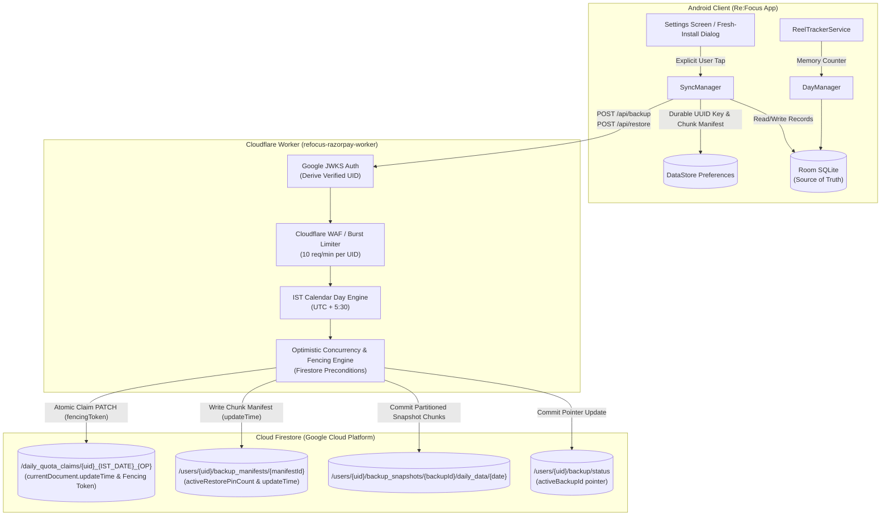

---

## 3. Distributed Rate Limiting & Quota Lease Safety Architecture

### 3.1 Distributed Rate Limiting: Two-Tier Architecture
To ensure complete resilience without relying on fragile Worker isolate in-memory maps across Cloudflare's global anycast network:

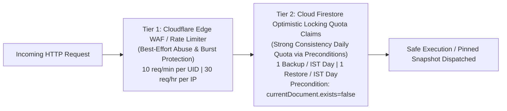

1. **Tier 1 — Best-Effort Burst & Flood Protection (Edge Level):**
   - Implemented via Cloudflare Rate Limiting Rules (at the Cloudflare zone level) supplemented by Worker-local sliding window counters.
   - Purpose: Protects the Cloudflare Worker from distributed denial-of-service (DDoS), credential stuffing, and script loops.
   - Enforces 10 requests / 60 seconds per UID and 30 requests / 3600 seconds per IP. Exceeding limits returns HTTP `429 Too Many Requests` with a standard `Retry-After` header.
2. **Tier 2 — Strong-Consistency Daily Quotas (Backend Storage Level):**
   - Implemented exclusively via **Cloud Firestore REST API Preconditions** on `/daily_quota_claims/${uid}_${istDate}_${opType}`.
   - Guarantees exact-once daily execution globally across all edge regions through Firestore's transaction and commit-level serializability.

---

### 3.2 Quota Lease Safety & Data-Level Fencing (Solving Stale Worker Split-Brain)

#### The Problem of Stale Workers Writing Data Documents
If a 60-second lease is used and Worker A stalls (edge network freeze, CPU pause) while Worker B steals the expired lease, Worker A could still write data documents to storage if data were written to a shared, mutable path like `/users/{uid}/daily_data/{dateString}`. Even if Worker A cannot finalize the quota document, its delayed writes would corrupt Worker B's data documents.

#### The Architectural Solution: Partitioned Immutable Snapshot Namespaces
Fencing is enforced across **every single backup data document** by combining **monotonic fencing tokens** with **isolated, immutable snapshot storage paths**:

```
/users/{uid}/backup_snapshots/{backupId}/daily_data/{dateString}
```

Where `backupId` is a cryptographically unique identifier tied directly to the lease claim attempt (`${istDate}_${fencingToken}_${requestId}`).

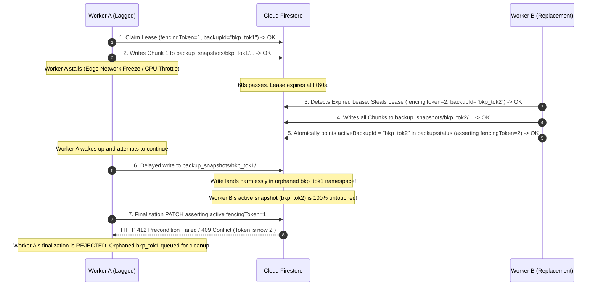

#### Authoritative Firestore REST Precondition & Concurrency Guarantees
- **Method:** `projects.databases.documents.commit` (Batch Writes) and `projects.databases.documents.patch`.
- **Precondition Mechanism:** Firestore REST natively supports exactly two fields in the `Precondition` object:
  ```json
  {
    "exists": boolean,
    "updateTime": string // RFC 3339 / ISO-8601 UTC timestamp
  }
  ```
- **Authoritative Google Cloud Specification:** Per [Google Cloud Firestore REST API documentation](https://cloud.google.com/firestore/docs/reference/rest/v1/projects.databases.documents/commit), Firestore evaluates preconditions atomically at commit time. It does **NOT** support arbitrary field filters (e.g. `status == "COMMITTED"`, `activeRestorePinCount == 0`, or `pinStatus == "PINNED"`) inside the `Precondition` object.
- **The Read-Validate-Commit OCC Pattern (Optimistic Concurrency Control):**
  To enforce field-level invariants atomically:
  1. **Strongly Consistent Read:** The Worker performs a direct GET of the target document, obtaining its current field values and its exact microsecond metadata: `updateTime` (e.g. `"2026-10-24T00:15:30.123456Z"`).
  2. **In-Memory Predicate Assertion:** The Worker evaluates the required domain invariants in application memory (e.g., asserting `doc.status === "COMMITTED"`, `doc.activeRestorePinCount === 0`, or `doc.fencingToken === expectedToken`). If the assertion fails, the Worker aborts immediately before issuing any write.
  3. **Atomic Commit with `updateTime` Assertion:** If all assertions pass, the Worker issues a `commit` batch with:
     `"currentDocument": { "updateTime": readDocument.updateTime }`.
  4. **Atomic Concurrency Guarantee:** If any concurrent actor modifies the target document (even by 1 nanosecond, altering any field), the stored `updateTime` changes. Firestore rejects the entire commit batch atomically with HTTP 412 (Precondition Failed) or HTTP 409 (Conflict). Zero writes take effect.
  5. **Re-Read on Precondition Failure:** The Worker catches HTTP 412, re-reads the document freshly from Step 1, and re-evaluates the domain invariants against live data. Zero operations assume a stale read guarantees availability.

---

### 3.3 Safe Recovery of Daily Quota Documents from `FAILED` State

When an operation encounters an early failure (client payload validation error, malformed date, unrecoverable network drop before commit), the quota claim document transitions to `status: "FAILED"`. 

#### Critical Invariant: Document Persistence
> [!IMPORTANT]
> A quota claim document in the `FAILED` state is **NEVER deleted or recreated**. Deleting Firestore documents creates tombstone anomalies and prevents reliable optimistic concurrency. The existing document must be updated in-place via precondition assertions.

#### Quota Document Structure in `FAILED` State
```json
{
  "status": "FAILED",
  "failureReason": "MALFORMED_PAYLOAD",
  "fencingToken": 1,
  "backupId": "2026-10-24_1_req_abc123",
  "idempotencyKey": "client_uuid_001",
  "expiresAtMs": 0,
  "updatedAtMs": 1792790400000
}
```

#### Safe Recovery Protocol for Subsequent Retries
When a user retries (either reusing the same `idempotencyKey` or generating a fresh one after fixing data):
1. **Read & Check:** The Worker reads `/daily_quota_claims/${uid}_${istDate}_${opType}`.
2. **Eligibility Assertion:** Because `status == "FAILED"`, the daily allowance was not consumed. A retry is permitted.
3. **Optimistic Locking Precondition:** The Worker updates the claim document using:
   `precondition.currentDocument.updateTime = readDoc.updateTime`
4. **Reclamation Mutation:**
   - `status: "IN_PROGRESS"`
   - `fencingToken: readDoc.fencingToken + 1` (strictly monotonic increment)
   - `backupId: "${istDate}_${readDoc.fencingToken + 1}_${newRequestId}"`
   - `idempotencyKey: request.idempotencyKey`
   - `expiresAtMs: nowMs + 60000`
   - `updatedAtMs: nowMs`
5. **Concurrent Retry Race Resolution:**
   - If two client retry requests hit the edge at the exact same millisecond, both read `updateTime = T1`.
   - The first request commits successfully, advancing `updateTime = T2`.
   - The second request's commit fails with HTTP 412 / 409 (`Precondition Failed`).
   - The second Worker re-reads the document, observes `status: "IN_PROGRESS"` with an active non-expired lease (`expiresAtMs > nowMs`), and rejects the second request with HTTP `409 Conflict` (`OPERATION_ALREADY_IN_PROGRESS`).

---

## 4. Firestore Limits & Reliable Chunked Backup Protocol

### 4.1 Verified Firestore Limits & Sizing Analysis
The architecture respects all documented Firestore technical limits:
- **Maximum writes per commit batch:** 500 operations.
- **Maximum document size:** 1 MiB ($1,048,576\text{ bytes}$).
- **Maximum commit request size:** 10 MiB.
- **Document field size in Re:Focus:** Each daily record has 6 scalar fields (`dateString`, `totalReelsCount`, `dailyGoal`, `isStrictModeOn`, `isStrictModeLocked`, `isLimitLocked`), totaling $\approx 150\text{ bytes}$ per document.

### 4.2 Single-Request Fast-Path vs Multi-Part Chunking Protocol
To optimize latency and eliminate overhead for normal users while supporting multi-year archives:

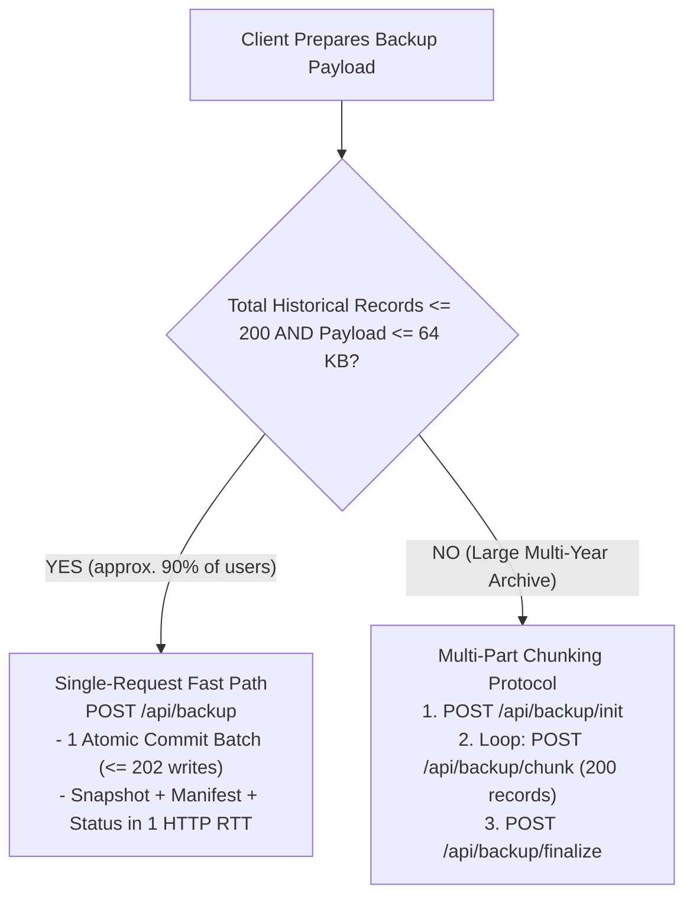

#### Sizing & Metadata Growth Safeguards
- **Chunk Size:** Fixed at **200 daily records per chunk** ($\approx 30\text{ KB}$ payload, 200 writes), well within Firestore's 500-write limit and 10 MiB commit size.
- **Manifest Document Growth:** In `/users/{uid}/backup_manifests/{manifestId}`, chunk checksums are stored as an array of compact objects (`{ idx: 0, sha256: "...", count: 200 }`). Even for 20 years of history ($7,300\text{ days} = 37\text{ chunks}$), the entire manifest document is $<5\text{ KB}$, well below Firestore's 1 MiB limit.
- **Mandatory Field Initialization for Composite Indexing:** Every manifest created (via `POST /api/backup` fast-path or `POST /api/backup/init`) **MUST explicitly initialize `quarantineStatus: null`** (primitive JSON null: `{ "nullValue": null }`), `activeRestorePinCount: 0`, `lastPinnedAtMs: 0`, and `quarantineObservationExpiresAtMs: null`. In Cloud Firestore, documents that omit an indexed field are excluded from composite indexes; initializing `quarantineStatus: null` ensures all healthy manifests are indexed and discoverable by retention queries.

---

### 4.3 Retention & Abandoned-Snapshot Cleanup: Strict State Machine & Recovery

#### Deep Architecture of Cleanup Operations
Treating cleanup as a single undifferentiated process creates severe data loss and corruption risks. The system strictly separates **uncommitted garbage cleanup** from **committed historical retention rotation** and models crash recovery explicitly.

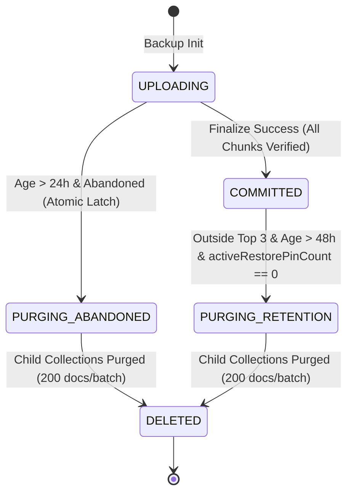

#### A. Operation 1: Abandoned `UPLOADING` Snapshot Cleanup (`cleanupAbandonedUploads`)
- **Nature:** Purges orphaned, incomplete upload attempts caused by client network cutoffs, app termination, or worker crashes during chunk streaming.
- **Eligibility Criteria (All Must Be True):**
  1. `manifest.status == "UPLOADING"` (strictly never `"COMMITTED"` or `"PURGING_*"`).
  2. `manifest.createdAtMs < (nowMs - 24 * 3600 * 1000)` (strictly older than 24 hours).
  3. `backupId != activeBackupId` (asserted via reading `/users/{uid}/backup/status`).
  4. `backupId != snapshotBackupId` (asserted against today's and yesterday's `/daily_quota_claims/*_RESTORE`).
- **Atomic Deletion Latching:**
  Before deleting any child records, the Worker executes an atomic PATCH on `/users/{uid}/backup_manifests/{manifestId}`:
  - Transition: `status: "PURGING_ABANDONED"`
  - Precondition: `currentDocument.updateTime = manifest.updateTime`
  - *Effect:* If a delayed worker wakes up and attempts to finalize or upload chunks to this snapshot, its commit fails with HTTP 412 because the manifest status is no longer `"UPLOADING"` and `updateTime` has changed.
- **Batched Deletion Mechanics:**
  - Queries child collection `/users/{uid}/backup_snapshots/{backupId}/daily_data` with `pageSize = 200`.
  - Executes batch commit deletes ($\le 200$ deletes per commit).
  - Deletes `/users/{uid}/backup_manifests/{manifestId}` as the final step.

#### B. Operation 2: Historical Committed Backup Retention (`pruneHistoricalCommittedBackups`)
- **Nature:** Manages the long-term storage footprint by retaining exactly the latest **three fully committed backups** while pruning older historical archives.
- **Eligibility Criteria (All Must Be True):**
  1. `manifest.status == "COMMITTED"`.
  2. `backupId NOT IN [activeBackupId, previousBackupId_1, previousBackupId_2]` (determined from `/users/{uid}/backup/status` historical pointer array).
  3. **Mandatory Restore-Pin & Quarantine Lock:** 
     - Worker reads manifest `/users/{uid}/backup_manifests/{backupId}` freshly.
     - Worker asserts in memory: `manifest.activeRestorePinCount === 0`.
     - Worker asserts in memory: `manifest.quarantineStatus == null` (zero unresolved pin-count discrepancies).
     - Worker asserts in memory: `manifest.lastPinnedAtMs < (nowMs - 24 * 3600 * 1000)` (minimum 24-hour pin TTL buffer).
     - If any assertion fails, **PRUNING IS STRICTLY ABORTED**.
  4. **Cooldown Buffer:** `manifest.committedAtMs < (nowMs - 48 * 3600 * 1000)` (older than 48 hours) to prevent racing with rapid consecutive daily backups.
- **Atomic Pruning Latching (OCC Pattern):**
  - Worker issues an atomic commit patch on `/users/{uid}/backup_manifests/{backupId}`:
    - Mutation: `status: "PURGING_RETENTION"`, `purgingStartedAtMs: nowMs`
    - Precondition: `currentDocument.updateTime = readManifest.updateTime`
  - *Outcome:* If a restore request concurrently pins this snapshot before cleanup commits, the manifest's `updateTime` changes, causing this pruning latch to fail with HTTP 412. Cleanup catches 412, re-reads, sees active pins $> 0$, and cleanly aborts.
- **Batched Child Deletion:** Identical $\le 200$ operations per commit batch.

#### C. Worker Crash Recovery at Every Deletion Stage
The deletion pipeline is crash-resilient across every failure stage:
1. **Crash before manifest status updated to `PURGING_*`:** Zero records touched. Next daily sweep re-evaluates eligibility cleanly.
2. **Crash after manifest marked `PURGING_*`, before child deletion:** Manifest remains in `PURGING_ABANDONED` or `PURGING_RETENTION`.
   - *Exclusion Guarantee:* `POST /api/restore` queries only manifests with `status == "COMMITTED"`. Any snapshot in `PURGING_*` is **strictly excluded from restore**.
   - Next daily sweep discovers manifests with `status in ["PURGING_ABANDONED", "PURGING_RETENTION"]` and resumes deletion immediately.
3. **Crash halfway through paginated child document deletion (e.g. 100 of 300 docs deleted):** Manifest remains `PURGING_*`. Next daily sweep resumes querying remaining child records in `/daily_data`, deletes them in 200-doc batches, and completes by deleting the manifest document.
4. **Crash after all child documents deleted, before manifest deleted:** Next daily sweep queries `/daily_data`, observes zero child records, and deletes the manifest document.

---

## 5. Restore Idempotency, Immutable Snapshots & Conflict Resolution

### 5.1 Restore Pin vs Retention-Pruning Concurrency Protocol

#### The Adversarial Race Vector: Cleanup vs Restore Pin Race
If checking restore pins and marking a manifest for deletion are separate operations across distinct collections, a critical interleaving exists:
1. Cleanup checks `/daily_quota_claims` and finds no restore pin for candidate snapshot $S$.
2. A restore request begins and attempts to pin $S$.
3. Cleanup marks $S$ as `PURGING_RETENTION` and starts deleting records.
4. Restore attempts to read chunks from $S$, encountering HTTP 404 / truncated records.

#### The Concurrency-Safe Protocol: Single-Document Atomic Manifest Locking (OCC Pattern)
To guarantee mutual exclusion, both operations execute an **atomic compare-and-swap via the Read-Validate-Commit OCC pattern on the single manifest document** (`/users/{uid}/backup_manifests/{backupId}`):

```mermaid
sequenceDiagram
    autonumber
    participant RestoreWorker as Restore Worker (POST /api/restore)
    participant FS as Cloud Firestore (Manifest Document)
    participant CleanupWorker as Cleanup Worker (Retention Cron)

    Note over RestoreWorker,CleanupWorker: Both target Manifest S (readTime: T0, updateTime: T0, pins: 0, status: COMMITTED)
    
    alt Restore Worker Wins Race
        Note over RestoreWorker: 1. Reads S freshly; asserts in-memory (status == COMMITTED)
        RestoreWorker->>FS: 2. Atomic Commit Batch:\n- Claim /daily_quota_claims/..._RESTORE (pinStatus=PINNED)\n- Patch Manifest: activeRestorePinCount = 1, lastPinnedAtMs = now\nPrecondition: manifest.updateTime == T0
        FS-->>RestoreWorker: 3. Commit OK! (Manifest updateTime advances -> T1)
        Note over RestoreWorker: Restore proceeds safely! Snapshot is pinned!
        
        Note over CleanupWorker: 4. Attempts Prune Claim: reads Manifest S freshly (now updateTime T1, pins 1)
        Note over CleanupWorker: In-memory assertion fails: activeRestorePinCount != 0!
        CleanupWorker-->>CleanupWorker: 5. Aborts Pruning S! Snapshot PRESERVED!
    else Cleanup Worker Wins Race
        Note over CleanupWorker: 1. Reads S freshly; asserts in-memory (status == COMMITTED, pins == 0, quarantineStatus == null)
        CleanupWorker->>FS: 2. Attempt Prune Claim:\n- Patch Manifest: status = "PURGING_RETENTION", purgingStartedAtMs = now\nPrecondition: manifest.updateTime == T0
        FS-->>CleanupWorker: 3. Commit OK! (Manifest status -> PURGING_RETENTION, updateTime -> T1)
        Note over CleanupWorker: Cleanup begins deleting child chunks.
        
        Note over RestoreWorker: 4. Delayed commit batch targeting T0:
        RestoreWorker->>FS: 5. Atomic Commit Batch with Precondition manifest.updateTime == T0
        FS-->>RestoreWorker: 6. HTTP 412 Precondition Failed! (updateTime is now T1!)
        Note over RestoreWorker: Restore Commit Aborts! Zero daily quota consumed!
        RestoreWorker->>FS: 7. Fresh re-read of Manifest S
        FS-->>RestoreWorker: 8. Returns status: "PURGING_RETENTION"
        Note over RestoreWorker: Worker observes purging status; rejects pinning. Prompts user with activeBackupId.
    end
```

1. **Restore Pinning is an Atomic Multi-Document Batch:** When `POST /api/restore` claims a restore:
   - Worker reads `/users/{uid}/backup_manifests/{backupId}` and asserts in memory: `manifest.status === "COMMITTED"`.
   - In a single `documents:commit` batch, the Worker:
     a) Writes `/daily_quota_claims/${uid}_${istDate}_RESTORE` (allocating quota, setting `pinStatus: "PINNED"`).
     b) Patches `/users/{uid}/backup_manifests/{backupId}`:
        - `activeRestorePinCount = manifest.activeRestorePinCount + 1`
        - `lastPinnedAtMs = nowMs`
        - Precondition: `currentDocument.updateTime = readManifest.updateTime`.
2. **Pruning Claim Asserts Zero Pins & Exact UpdateTime:**
   - The cleanup worker cannot start deleting child records without first updating the manifest:
     - Worker asserts in memory from fresh read: `manifest.status === "COMMITTED"`, `manifest.activeRestorePinCount === 0`, and `manifest.quarantineStatus == null`.
     - Worker patches manifest: `status = "PURGING_RETENTION"` with precondition `currentDocument.updateTime = readManifest.updateTime`.
3. **Atomically Enforced Mutual Exclusion:**
   - If Cleanup commits first: Manifest status transitions to `"PURGING_RETENTION"` and `updateTime` changes to $T_1$. Restore's batch commit fails with HTTP 412. The Worker re-reads, discovers `status === "PURGING_RETENTION"`, and aborts pinning immediately. Zero daily quota is consumed; no deleting data is read.
   - If Restore commits first: Manifest `activeRestorePinCount` is $\ge 1$ and `updateTime` changes to $T_1$. Cleanup's commit fails with HTTP 412 (or Cleanup's fresh read observes active pins $> 0$). Pruning is strictly aborted.

---

### 5.2 Exactly-Once Restore Pin Accounting & State Model

To prevent pin count leakage or premature deletion, `activeRestorePinCount` is managed strictly through **idempotent, ownership-bound state transitions**:

#### A. Document Schema & Claim Ownership
Every restore claim document `/daily_quota_claims/${uid}_${istDate}_RESTORE` contains explicit pin ownership fields:
```json
{
  "status": "DISPATCHED",
  "idempotencyKey": "client_uuid_123",
  "pinnedSnapshotId": "2026-10-24_1_req_abc",
  "pinStatus": "PINNED",
  "pinLeaseExpiresAtMs": 1792791300000,
  "offlineGraceExpiresAtMs": 1792876800000,
  "dispatchedAtMs": 1792790400000
}
```

#### B. Formal Pin Increment & Decrement Rules
1. **Pin Acquisition (Exactly-Once Increment):**
   - The Worker increments `activeRestorePinCount` on the manifest **ONLY** when creating the initial restore claim (`pinStatus` transitions from non-existent to `"PINNED"`).
   - **Retries with the same `idempotencyKey`:** Worker reads the claim, observes `idempotencyKey` matches and `pinStatus == "PINNED"`. **The Worker DOES NOT mutate the manifest.** It simply replays the cached snapshot payload with HTTP 200 (`idempotent: true`).
   - **Concurrent Authorization Requests:** Two simultaneous requests with the same key race with precondition `currentDocument.exists = false` on the claim document. One commits and increments the manifest; the loser receives HTTP 412, re-reads, and replays without incrementing. Exactly one pin is acquired globally.
2. **Pin Release (Exactly-Once Decrement via Acknowledgment):**
   - When Android completes its local Room transaction, it sends `POST /api/restore/ack` with `(idempotencyKey, snapshotBackupId)`.
   - The Worker verifies `claim.idempotencyKey === request.idempotencyKey` and `claim.pinnedSnapshotId === request.snapshotBackupId`.
   - **Duplicate / Redelivered Acknowledgment Handling:**
     - If `claim.pinStatus == "RELEASED"` (or `"ACKNOWLEDGED"`): The pin was **already released**. The Worker **DOES NOT DECREMENT** the manifest. It immediately returns HTTP 200 (`acknowledged: true, idempotent: true`).
     - If `claim.pinStatus == "PINNED"`: The Worker executes an atomic batch commit:
       a) Patch claim: `pinStatus = "RELEASED"`, `status = "ACKNOWLEDGED"`, precondition `currentDocument.updateTime = claim.updateTime`.
       b) Patch manifest: `activeRestorePinCount = manifest.activeRestorePinCount - 1`, precondition `currentDocument.updateTime = manifest.updateTime`.
   - If two ACKs arrive concurrently, the first commits; the second fails its precondition on the claim document, re-reads, sees `pinStatus == "RELEASED"`, and returns HTTP 200 with zero decrement.
   - **Out-of-Order Multi-Client Release:** If Claim 1 and Claim 2 both pin snapshot $S$, Claim 1 can only release Claim 1's pin (`pinStatus == "PINNED" -> "RELEASED"`). Claim 2 can only release Claim 2's pin. Order of acknowledgment does not matter; neither claim can steal or double-decrement the counter.

---

### 5.3 Restore Pin TTL, Heartbeat Renewal & Active-Operation Protection

#### A. Lease Structure & In-Flight Protection
- **Active Streaming Lease (`pinLeaseExpiresAtMs`):** Granted initially for **15 minutes**.
- **Heartbeat & Chunk Fetch Renewal:** If a device is downloading a multi-year archive over a slow connection, each chunk fetch (`GET /api/restore/chunk?idx=N`) or heartbeat (`POST /api/restore/heartbeat`) atomically extends:
  `pinLeaseExpiresAtMs = nowMs + 15 * 60 * 1000`.
- **Offline Recovery Grace Period (`offlineGraceExpiresAtMs`):** Set to $24\text{ hours}$ from the *latest* activity (`nowMs + 86,400,000 ms`). Every heartbeat extends both `pinLeaseExpiresAtMs` and `offlineGraceExpiresAtMs`. Even if a multi-year restore stream takes $>24\text{ hours}$, active heartbeats prevent expiration. If the device goes to sleep or loses connectivity after download, retention cleanup is strictly locked out for 24 hours.

#### B. Atomic Expiration Reconciliation Protocol (`reconcileExpiredPins`)
If $24\text{ hours}$ elapse without client acknowledgment or heartbeat:
1. Cleanup identifies an expired pin where `claim.pinStatus == "PINNED"` AND `nowMs > claim.offlineGraceExpiresAtMs`.
2. Cleanup executes an **atomic multi-document batch commit**:
   - *Write 1:* Patch claim `/daily_quota_claims/{uid}_{date}_RESTORE`:
     `status: "EXPIRED_UNACKNOWLEDGED"`, `pinStatus: "EXPIRED"`, `expiredAtMs: nowMs`.
     Precondition: `currentDocument.updateTime = readClaim.updateTime`.
   - *Write 2:* Patch manifest `/users/{uid}/backup_manifests/{snapshotId}`:
     `activeRestorePinCount = manifest.activeRestorePinCount - 1`.
     Precondition: `currentDocument.updateTime = readManifest.updateTime`.
3. **Crash-Resilient Atomic Batch Execution:** Because Firestore executes multi-document `commit` requests as an all-or-nothing atomic unit, if the cleanup Worker crashes at any point before Firestore acknowledges the commit, neither document is altered. Zero pin count skew can occur.
4. **Heartbeat versus Expiration CAS Race Resolution:**
   When an active client's heartbeat (`POST /api/restore/heartbeat`) arrives at the exact millisecond that the scheduled cleanup cron attempts expiration reconciliation:
   - Both workers perform a strongly-consistent read of the claim document at $T_0$, capturing identical `updateTime = T_claim`.
   - **Branch A: Heartbeat Commits First (Heartbeat Wins):**
     - Heartbeat issues commit: sets `pinLeaseExpiresAtMs = nowMs + 15m`, `offlineGraceExpiresAtMs = nowMs + 24h`, `lastHeartbeatAtMs = nowMs`.
     - Precondition: `currentDocument.updateTime = T_claim`.
     - Commit succeeds! Claim's stored `updateTime` advances to $T_{\text{renewed}}$.
     - Delayed Cleanup attempts its commit batch asserting `currentDocument.updateTime = T_claim`.
     - **Firestore Outcome:** Cleanup commit **FAILS atomically with HTTP 412 Precondition Failed**.
     - Zero writes take effect! The manifest pin count is **NOT decremented**.
     - Cleanup catches 412, re-reads the claim freshly, observes `nowMs < offlineGraceExpiresAtMs` and `pinStatus == "PINNED"`. Cleanup aborts expiration.
     - *Guarantee:* Stale expiration can never release a renewed pin.
   - **Branch B: Expiration Reconciliation Commits First (Cleanup Wins):**
     - Cleanup issues its atomic commit batch asserting `updateTime = T_claim` on the claim and `updateTime = T_manifest` on the manifest.
     - Commit succeeds! Claim advances to `pinStatus: "EXPIRED"`, `status: "EXPIRED_UNACKNOWLEDGED"`, and `updateTime` advances to $T_{\text{expired}}$. Manifest pin count decrements to 0 and `updateTime` advances to $T_{\text{manifest\_updated}}$.
     - Delayed Heartbeat attempts commit asserting `currentDocument.updateTime = T_claim`.
     - **Firestore Outcome:** Heartbeat commit **FAILS atomically with HTTP 412 Precondition Failed**.
     - Heartbeat catches 412, re-reads the claim freshly, and observes `pinStatus == "EXPIRED"`.
     - Heartbeat worker returns HTTP `410 Gone` / `409 Conflict` (`PIN_LEASE_EXPIRED`).
     - Client terminates streaming immediately and prompts the user.
   - **Branch C: Concurrent Cleanup Overlap (Duplicate Reconciliation Race):**
     - If two scheduled cron instances inspect the same expired claim at $T_0$, Cron 1 commits the expiration batch first, advancing `updateTime`.
     - Cron 2's commit batch asserting $T_0$ fails atomically with HTTP 412.
     - Cron 2 re-reads, observes `pinStatus == "EXPIRED"`, and aborts.
     - *Guarantee:* Duplicate reconciliation can never decrement the manifest counter twice.

---

#### C. Protocol for Expired Restore Retries: Fresh Reads, Atomic CAS & Quota Integrity
When an Android client wakes up after prolonged offline dormancy (e.g. 26 hours) and retries an expired restore session with yesterday's `idempotencyKey`:

1. **Strongly-Consistent Read of Yesterday's Claim:**
   Worker reads `/daily_quota_claims/${uid}_${yesterdayIstDate}_RESTORE`:
   - Validates `claim.idempotencyKey === request.idempotencyKey`.
   - Validates `claim.status === "EXPIRED_UNACKNOWLEDGED"` and `claim.pinStatus === "EXPIRED"`.
   - Validates `(claim.rePinCount || 0) < 1` (strict limit of at most 1 re-pin continuation per logical restore).
   - Captures `claim.updateTime` as $T_{\text{claim}}$.
2. **Fresh Read of Snapshot Manifest (Never Assume Availability):**
   Worker performs a strongly-consistent read of `/users/{uid}/backup_manifests/${snapshotId}`:
   - **Scenario 1: Manifest Missing / Deleted (HTTP 404):**
     - The snapshot was completely deleted by retention pruning.
     - Worker patches claim: `status = "CLOSED_EXPIRED"`, `closedReason = "SNAPSHOT_DELETED"` (precondition: `updateTime = T_claim`).
     - Worker returns HTTP `410 Gone` (`SNAPSHOT_PURGED_AND_DELETED`).
     - Client is prompted: *"Your previous restore session timed out and the backup archive was rotated. Would you like to restore today's latest cloud backup instead?"*
     - If the user confirms, the client issues a **NEW restore request** with a new `idempotencyKey` evaluated against **today's** quota ($D_{\text{today}}$), consuming today's allowance.
   - **Scenario 2: Manifest Exists, but In-Memory Check Shows `manifest.status !== "COMMITTED"`:**
     - The manifest is in `status: "PURGING_RETENTION"` or `status: "PURGING_ABANDONED"`.
     - **CRITICAL INVARIANT: The Worker NEVER re-pins a purging snapshot.**
     - Worker patches claim: `status = "CLOSED_EXPIRED"`, `closedReason = "SNAPSHOT_PURGING"` (precondition: `updateTime = T_claim`).
     - Worker returns HTTP `410 Gone` (`SNAPSHOT_BEING_PURGED`).
     - Re-pinning is rejected. Client is offered a fresh restore using today's `activeBackupId`.
   - **Scenario 3: Manifest Exists AND In-Memory Check Shows `manifest.status === "COMMITTED"`:**
     - The snapshot is fully intact and eligible for continuation. Captures `manifest.updateTime` as $T_{\text{manifest}}$.
     - Worker constructs an **atomic OCC commit batch**:
       - *Op 1 (Manifest Patch):*
         `/users/{uid}/backup_manifests/${snapshotId}`:
         `activeRestorePinCount = manifest.activeRestorePinCount + 1`, `lastPinnedAtMs = nowMs`.
         Precondition: `currentDocument.updateTime = T_manifest`.
       - *Op 2 (Claim Patch):*
         `/daily_quota_claims/${uid}_${yesterdayIstDate}_RESTORE`:
         `status = "DISPATCHED"`, `pinStatus = "PINNED"`, `pinLeaseExpiresAtMs = nowMs + 15 * 60 * 1000`, `offlineGraceExpiresAtMs = nowMs + 24 * 3600 * 1000`, `rePinCount = (claim.rePinCount || 0) + 1`, `rePinnedAtMs = nowMs`.
         Precondition: `currentDocument.updateTime = T_claim`.
     - Worker executes `documents.commit`.
     - **If Commit Succeeds (HTTP 200):**
       - The re-pinning is officially a **continuation of the same logical restore**.
       - **Quota Accounting:** Yesterday's quota remains consumed (1). Today's quota ($D_{\text{today}}$) remains **100% UNCLAIMED and available**. Zero additional daily quota is consumed.
       - Worker returns HTTP 200 with the snapshot payload (`resumedContinuation: true`).
     - **If Commit Fails (HTTP 412 Precondition Failed):**
       - A concurrent retention worker marked the manifest `PURGING_RETENTION` right before commit.
       - Worker catches 412, re-reads the manifest freshly, discovers `status === "PURGING_RETENTION"`, marks claim `CLOSED_EXPIRED`, and returns HTTP 410 Gone. Stale reads never compromise safety.

---

### 5.4 Complete Multi-Lifecycle State Machine

To eliminate state conflation and terminal-state contradictions, the system formally partitions states across three independent lifecycles:

| Lifecycle Entity | Stored Path | Permitted States | Terminal States | Non-Terminal States | State Invariant & Ownership Rules |
| :--- | :--- | :--- | :--- | :--- | :--- |
| **1. Daily Quota Claim** | `/daily_quota_claims/{uid}_{istDate}_{op}` | `UNCLAIMED`, `IN_PROGRESS`, `DISPATCHED`, `COMPLETED`, `ACKNOWLEDGED`, `FAILED`, `EXPIRED_UNACKNOWLEDGED`, `CLOSED_EXPIRED` | `COMPLETED` (Backup), `ACKNOWLEDGED` (Restore), `CLOSED_EXPIRED` (Purged/Abandoned) | `UNCLAIMED`, `IN_PROGRESS`, `DISPATCHED`, `FAILED`, `EXPIRED_UNACKNOWLEDGED` | Governs the **server calendar day quota**. Exactly 1 completed allowance per IST day. `EXPIRED_UNACKNOWLEDGED` can be resumed via continuation if snapshot is `COMMITTED`, or transitions to terminal `CLOSED_EXPIRED`. |
| **2. Restore Pin Ownership** | Claim document field: `pinStatus` | `UNPINNED`, `PINNED`, `RELEASED`, `EXPIRED`, `CLOSED` | `RELEASED` (Local ACK committed), `CLOSED` (Snapshot purged / claim closed) | `UNPINNED`, `PINNED`, `EXPIRED` | Governs the **exclusive hold** on a manifest. Exactly 1 pin owned per claim. `EXPIRED` pin can be re-pinned at most once via atomic CAS continuation. |
| **3. Snapshot Manifest** | `/users/{uid}/backup_manifests/{backupId}` | `UPLOADING`, `COMMITTED`, `PURGING_ABANDONED`, `PURGING_RETENTION`, `DELETED` | `DELETED` | `UPLOADING`, `COMMITTED`, `PURGING_ABANDONED`, `PURGING_RETENTION` | Governs the **physical storage lifecycle** of backup data. Holds aggregate `activeRestorePinCount`. Pruning is strictly forbidden if pins $> 0$ or `quarantineStatus != null`. |

---

### 5.5 Deterministic Merge & Data Integrity Policy
When cloud records merge into local Room SQLite:

| Record Scope | Local Record State | Cloud Record State | Resolution Rule | Proof & Invariant |
| :--- | :--- | :--- | :--- | :--- |
| **Today's Record (`date == todayStr`)** | Local count $> 0$ | Cloud count $\ge 0$ | **LOCAL WINS (Preserve Local)** | Today's active tracking on this physical device is the live enforcement authority. Overwriting with cloud count would allow users to reset their strict-mode reel blocker by restoring an earlier morning backup. |
| **Historical (`date < todayStr`)** | Local `syncStatus = 0` (Synced) | Cloud Record | **CLOUD WINS** | Local row was already synchronized to cloud in the past; cloud is the authoritative backup repository. |
| **Historical (`date < todayStr`)** | Local `syncStatus = 1` (Unsynced offline) | Cloud Record | **`maxOf(local, cloud)`** | In habit tracking, viewing a reel is a physical monotonic event that cannot be undone. Taking the maximum ensures reels counted on an offline device are never erased. |
| **Historical Strict Mode** | Local boolean | Cloud boolean | **`local \|\| cloud`** | Conservative strictness principle: if strict mode was active in either session, preserve strictness in habit reports. |
| **`defaultDailyLimit`** | Local limit | Cloud limit | **Cloud limit applies** | Restoring account preferences was explicitly requested by user. |

---

### 5.6 Committed Snapshot Immutability: Dual-Document Atomic Preconditions

Every chunk upload commit batch ($\le 200$ daily records) **MUST include an atomic write to `/users/{uid}/backup_manifests/{backupId}`** updating `lastChunkAtMs = nowMs` with the precondition:
`precondition.currentDocument.updateTime = expectedManifestUpdateTime`.
When `finalize` commits, it transitions the manifest to `status: "COMMITTED"`, advancing its `updateTime`. Any delayed chunk write from a stalled worker will fail with HTTP 412 because the manifest's `updateTime` has changed. Zero daily records can be appended to a committed snapshot.

---

### 5.7 Room & DataStore Atomicity: Outbox Staging, Journal Identity & Recovery Protocol

To ensure seamless recovery across process death, power failure, and network drops without destructive data overwrites or cross-store corruption:

#### A. Deconstructing the Cross-Store Atomicity Fallacy
Android Jetpack DataStore persists state asynchronously via disk-level file operations (Preferences or Protocol Buffers) and **cannot participate in an ACID transaction with SQLite Room**. Claiming that a Room `@Transaction` encapsulates DataStore updates is physically invalid. If an app crashes after Room commits but before DataStore flushes, or during DataStore writes, an uncoordinated system enters split-brain corruption (habit data merged, but preferences unapplied).

#### B. The 4-Phase Outbox & Journal-Staging Architecture
Cross-store consistency is achieved deterministically through the **Outbox Pattern** coordinated by a dedicated SQLite journal table:

1. **Room SQLite Journal Schema (`local_restore_journal`):**
   ```sql
   CREATE TABLE IF NOT EXISTS local_restore_journal (
       idempotency_key TEXT PRIMARY KEY NOT NULL,  -- Client-generated UUID for the logical restore attempt
       backup_id TEXT NOT NULL,                     -- Target snapshot identifier
       session_date_ist TEXT NOT NULL,              -- IST calendar date of restore
       applied_at_ms INTEGER NOT NULL,              -- Local device wall clock timestamp
       records_restored INTEGER NOT NULL,           -- Count of merged historical rows
       restored_daily_limit INTEGER,                -- Staged preference value (Outbox payload)
       ack_status TEXT NOT NULL,                    -- 'PENDING_ACK' | 'ACKNOWLEDGED'
       datastore_synced INTEGER NOT NULL DEFAULT 0  -- 0 = Pending DataStore catch-up; 1 = Synced
   );
   ```

2. **The 4-Phase Commit Sequence:**
   ```mermaid
   sequenceDiagram
       autonumber
       participant App as Android Client / RestoreEngine
       participant Room as SQLite Room (ACID Transaction)
       participant DS as Jetpack DataStore
       participant Net as Edge Worker (/api/restore/ack)

       Note over App,Room: Phase 1: Local SQLite Room ACID Commit
       App->>Room: BEGIN TRANSACTION
       App->>Room: 1. Upsert habit records into daily_reel_data (Deterministic Merge Policy)
       App->>Room: 2. INSERT INTO local_restore_journal (idempotency_key, restored_daily_limit, ack_status='PENDING_ACK', datastore_synced=0)
       App->>Room: COMMIT TRANSACTION
       Note over Room: Habit history & Outbox preferences committed atomically!

       Note over App,DS: Phase 2: Post-Commit DataStore Outbox Flush
       App->>DS: 3. preferencesRepository.updateDailyLimit(restored_daily_limit)
       DS-->>App: DataStore file flushed to disk

       Note over App,Room: Phase 3: Outbox Latching in SQLite
       App->>Room: 4. UPDATE local_restore_journal SET datastore_synced = 1 WHERE idempotency_key = :key

       Note over App,Net: Phase 4: Network Acknowledgment Delivery
       App->>Net: 5. POST /api/restore/ack { backupId, idempotencyKey }
       Net-->>App: HTTP 200 { acknowledged: true }
       App->>Room: 6. UPDATE local_restore_journal SET ack_status = 'ACKNOWLEDGED' WHERE idempotency_key = :key
   ```

#### C. Crash Safety & Deterministic Startup Self-Healing (`reconcilePendingLocalRestores`)
On every application cold start, `SyncManager.initialize()` executes `reconcilePendingLocalRestores()` before any user interaction or tracking starts:

| Crash Point | Exact System State at Crash | Self-Healing Recovery Action on Cold Start | Room Habit History Invariant |
| :--- | :--- | :--- | :--- |
| **Crash Point 1: During Phase 1** | Crash during Room `@Transaction`. SQLite rolls back cleanly. | Zero journal rows exist. Local habit history is 100% untouched. User or client safely retries download. | Preserved. Untouched. |
| **Crash Point 2: Between Phase 1 & 2** | Room committed; journal exists with `datastore_synced = 0`. DataStore not updated. | Reconciler reads `restored_daily_limit` from `local_restore_journal`. Applies preference to DataStore. Sets `datastore_synced = 1`. Enqueues `RestoreAckWorker`. | **Never Re-Merged!** Habit history is untouched. Newer reel tracking since crash is preserved. |
| **Crash Point 3: Between Phase 2 & 3** | DataStore updated on disk; journal has `datastore_synced = 0`. | Reconciler re-applies `restored_daily_limit` to DataStore (idempotent overwrite of same value). Updates `datastore_synced = 1`. Enqueues `RestoreAckWorker`. | **Never Re-Merged!** Preserved. |
| **Crash Point 4: Between Phase 3 & 4** | DataStore synced (`datastore_synced = 1`); journal has `ack_status = 'PENDING_ACK'`. | `SyncManager` verifies `datastore_synced == 1`. Enqueues WorkManager `RestoreAckWorker` with network constraint to deliver ACK. | **Never Re-Merged!** Preserved. |

#### D. Restore Journal Identity: `idempotency_key` vs `backup_id`
Using `backup_id` as the primary key was fundamentally flawed: if a user restored the same backup again later in a separate session, an `INSERT OR REPLACE` would overwrite historical audit entries and erroneously reset `ack_status` from `ACKNOWLEDGED` to `PENDING_ACK`.

The specification strictly designates `idempotency_key TEXT PRIMARY KEY NOT NULL`:
1. **In-Flight Retry (Identical `idempotency_key`):**
   - Client checks `local_restore_journal` for matching `idempotency_key`.
   - If found: The habit records were **already committed to Room**. The client **skips SQLite habit merging entirely**.
   - It checks `datastore_synced`: if 0, it flushes preferences to DataStore and latches `datastore_synced = 1`.
   - It checks `ack_status`: if `PENDING_ACK`, it triggers `RestoreAckWorker` to deliver ACK.
   - Returns success to the UI immediately. **Zero risk of overwriting reels tracked after the initial commit.**
2. **Subsequent Restore Session of Same Snapshot (Fresh `idempotency_key`):**
   - If a user legitimately restores the same backup snapshot again (e.g. following data repair on a new calendar day), the client generates a **fresh unique `idempotency_key`**.
   - Inserts a new independent row in `local_restore_journal`.
   - Applies the Deterministic Merge Policy (Section 5.5): today's active tracking remains **Local Wins** and is never erased.

#### E. The 5 Lifecycle Stages of Restore & Pre-Commit Abort Protocol

To eliminate ambiguity between active downloads and finalized quotas, the restore operation is divided into 5 distinct lifecycle stages:

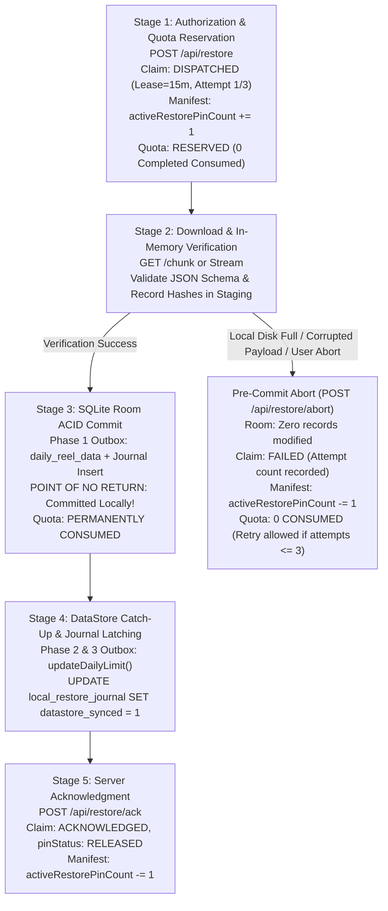

1. **Stage 1 (Authorization & Quota Reservation):** Client requests restore. Worker validates auth, entitlement, and checks `/daily_quota_claims/{uid}_{istDate}_restore`. If `UNCLAIMED`, transitions to `status: "DISPATCHED"`, `pinStatus: "PINNED"`, `attemptCount = 1`, `pinLeaseExpiresAtMs = nowMs + 15m`. The daily restore allowance is **RESERVED**, preventing concurrent restores, but is **NOT yet consumed**.
2. **Stage 2 (Streaming & Pre-Commit Staging):** Client downloads snapshot chunks into memory staging. Verifies SHA-256 and schema.
3. **Stage 3 (Local SQLite Room ACID Commit — Point of No Return):** Inside Room `@Transaction`, habit data merges into `daily_reel_data` and row is inserted into `local_restore_journal` with `ack_status = 'PENDING_ACK'`, `datastore_synced = 0`. **From this millisecond onward, the restore is PERMANENTLY COMMITTED LOCALLY and the daily restore allowance is PERMANENTLY CONSUMED.** The client will never roll back or re-download.
4. **Stage 4 (DataStore Catch-Up & Latch):** Client flushes preferences to DataStore and updates SQLite journal `datastore_synced = 1`.
5. **Stage 5 (Server Acknowledgment & Quota Finalization):** Client or WorkManager calls `POST /api/restore/ack`. Claim transitions to `status: "ACKNOWLEDGED"`, `pinStatus: "RELEASED"`, decrements manifest pin. Daily quota is finalized as **1 Completed Restore Consumed**.

#### F. Clean Pre-Commit Abort Route (`POST /api/restore/abort`)
If an unrecoverable failure occurs prior to Room commit (FAIL-05 disk full, FAIL-12 corrupt JSON payload, FAIL-29 truncated stream, or user cancel):
- **Client Action:** Client catches exception in staging memory. Because Phase 1 never committed, SQLite Room contains zero rows in `local_restore_journal` and habit tracking is untouched. Client dispatches `POST /api/restore/abort`:
  ```json
  {
    "backupId": "2026-10-24_1_req123",
    "idempotencyKey": "uuid-v4-restore-attempt",
    "reason": "STORAGE_FULL_PRE_COMMIT"
  }
  ```
- **Server Handling (Atomic Precondition OCC CAS):**
  - Worker reads `/daily_quota_claims/{uid}_{istDate}_restore`.
  - Asserts in memory: `claim.status === "DISPATCHED"`, `claim.idempotencyKey === request.idempotencyKey`, `claim.pinStatus === "PINNED"`.
  - Atomically patches claim:
    `status: "FAILED"`, `pinStatus: "RELEASED"`, `failureReason: request.reason`, `abortedAtMs: nowMs`.
  - Atomically patches manifest:
    `activeRestorePinCount = maxOf(0, manifest.activeRestorePinCount - 1)` asserting `currentDocument.updateTime = manifest.updateTime`.
  - Returns `HTTP 200 { aborted: true, attemptCount: claim.attemptCount, remainingAttempts: maxOf(0, 3 - claim.attemptCount) }`.
  - **Quota Effect:** **0 Completed Restores Consumed.** The user's completed restore allowance remains fully available.
  - **Anti-Abuse Attempt Cap:** Each claim tracks `attemptCount` ($1 \to 2 \to 3$). If 3 pre-commit failures occur on the same IST day, the claim transitions to `status: "EXHAUSTED_ATTEMPTS"`. Subsequent restore requests that day return `HTTP 429 / 409 Conflict: Daily restore attempt limit reached (3 failed attempts)`.

#### G. Detailed Failure Handling & Acknowledgment Matrix

| Failure Scenario | Local SQLite & DataStore State | Server Claim & Pin State | Client Recovery Action | Server Handling & Outcome |
| :--- | :--- | :--- | :--- | :--- |
| **1. Room commits; ACK drops on network** | Room committed, `datastore_synced: 1`, `ack_status: 'PENDING_ACK'`. | `status: "DISPATCHED"`, `pinStatus: "PINNED"`. | UI displays *"Restore complete! Synchronizing status..."*. WorkManager `RestoreAckWorker` enqueued with network constraint. | When network returns, ACK arrives. Server patches claim to `status: "ACKNOWLEDGED"`, `pinStatus: "RELEASED"`, decrements manifest pins $1 \to 0$. Returns HTTP 200. |
| **2. ACK commits on server; response drops** | `ack_status: 'PENDING_ACK'`. | `status: "ACKNOWLEDGED"`, `pinStatus: "RELEASED"`, pins=0. | `RestoreAckWorker` retries `POST /api/restore/ack` with same `(backupId, idempotencyKey)`. | Server reads claim, sees `pinStatus == "RELEASED"`. **Zero decrement to manifest!** Returns HTTP 200 `{ acknowledged: true, duplicate: true }`. Client sets `ack_status = 'ACKNOWLEDGED'`. |
| **3. App process dies after Room commit before ACK sent** | `ack_status: 'PENDING_ACK'`. | `status: "DISPATCHED"`, pins=1. | On app restart, `SyncManager.initialize` scans `local_restore_journal`, finds `PENDING_ACK`. **Does NOT fetch snapshot.** Immediately enqueues `RestoreAckWorker`. | Server receives ACK, decrements manifest pin $1 \to 0$, marks claim `ACKNOWLEDGED`. Returns HTTP 200. Local data untouched. |
| **4. Client offline 25h; pin expired at 24h; delayed ACK arrives** | `ack_status: 'PENDING_ACK'`. | `status: "EXPIRED_UNACKNOWLEDGED"`, `pinStatus: "EXPIRED"`, pins decremented at 24h. | Client comes online at hour 25. `RestoreAckWorker` fires `POST /api/restore/ack`. | Server reads claim: `pinStatus == "EXPIRED"`. Pin was **already decremented** by cleanup! Server **DOES NOT DECREMENT MANIFEST** (prevents negative count skew). Patches claim: `status: "ACKNOWLEDGED"`, `pinStatus: "RELEASED"`, `note: "EXPIRED_PIN_CONFIRMED"`. Returns HTTP 200. |
| **5. Local Room fails (Disk full / SQLite error)** | Staging aborts; Room rolled back; zero journal rows. | `status: "DISPATCHED"`, pins=1. | Client catches SQLite error; fires `POST /api/restore/abort`. Free disk space. Retries with same/fresh key. | Server updates claim to `FAILED`, decrements manifest pin. Daily quota consumed: **0**. Attempt 1 consumed of 3. Allows retry. |
| **6. Corrupted JSON payload detected in staging** | Staging rejects; Room untouched; zero journal rows. | `status: "DISPATCHED"`, pins=1. | Client reports error; fires `POST /api/restore/abort`. Local data intact. | Server updates claim to `FAILED`, decrements manifest pin. Daily quota consumed: **0**. Attempt 1 consumed of 3. |

---

#### H. Server vs Client Verifiability Boundary & The Minimal Idempotent Crash-Recovery Protocol

To guarantee mathematical consistency during crashes, process deaths, and lost network acknowledgments without falsely assuming the server can inspect the client's internal SQLite state:

##### 1. The Verifiability Asymmetry: What the Server CAN vs CANNOT Verify

| System Boundary | What the Cloudflare Edge Worker CAN Verify | What the Cloudflare Edge Worker CANNOT Verify (Client-Private) |
| :--- | :--- | :--- |
| **Server Authority** | 1. Inbound HTTP requests signed with valid Firebase Auth JWTs.<br>2. Daily quota claim document state in Cloud Firestore (`/daily_quota_claims/{uid}_{istDate}_restore`): `status`, `pinStatus`, `pinLeaseExpiresAtMs`, `offlineGraceExpiresAtMs`, `attemptsToday`.<br>3. Snapshot manifest state in Cloud Firestore (`/users/{uid}/backup_manifests/{backupId}`): `activeRestorePinCount`, `status`, `quarantineStatus`.<br>4. Authoritative server time ($18:30\text{ UTC}$ / $00:00\text{ IST}$) and lease expiration timestamps. | **1. Payload Delivery:** Whether HTTP response bytes successfully reached the client device without truncation.<br>**2. Client Resources:** Whether the client device had sufficient storage, memory, or battery to process the payload.<br>**3. Local Persistence:** Whether Android's Room SQLite `@Transaction` committed or rolled back.<br>**4. Local Journal:** Whether `local_restore_journal` was persisted to flash memory.<br>**5. Process Liveness:** Whether the Android OS killed the app process (`SIGKILL`, OOM, battery death).<br>**6. Local Data State:** Any data inside Room (`daily_reel_data`) or Jetpack DataStore preferences. |
| **Client Authority** | *Client reads server HTTP status codes, lease timestamps, and signed payloads.* | **Client is the SOLE AUTHORITATIVE WITNESS of local commit completion:**<br>- If `local_restore_journal` contains a row for `idempotency_key`, the restore is **100% committed**.<br>- If `local_restore_journal` lacks a row for `idempotency_key`, the restore was **never committed**. |

##### 2. Deterministic Behavior Across the 5 Crash-Recovery Cases

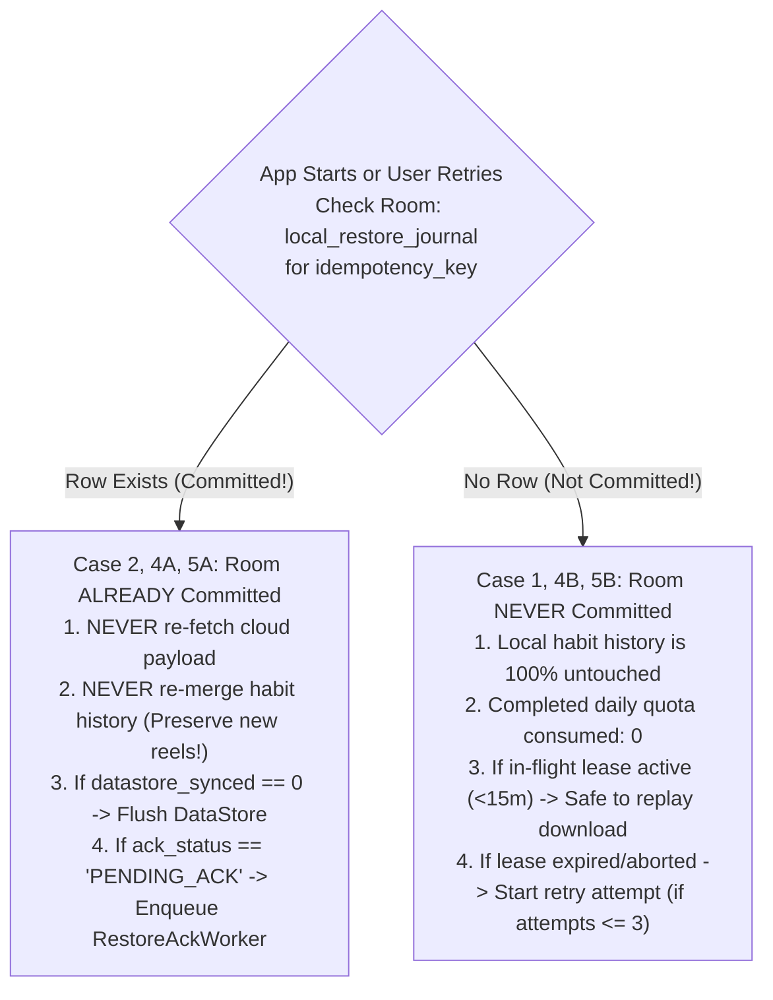

###### Case 1: Restore fails before the local Room commit
* **Failure Point:** Stream drops mid-flight, JSON validation fails, or SQLite throws disk-full/constraint error during Room `@Transaction`.
* **Client State:** SQLite transaction rolls back automatically. `daily_reel_data` is untouched. Zero rows exist in `local_restore_journal` for this attempt.
* **Client Action:** Client catches exception in staging. If app is alive, it dispatches `POST /api/restore/abort` (`reason: "STORAGE_FULL_PRE_COMMIT"`). If app dies, no action needed on restart.
* **Server Action:** If abort arrives, server marks claim `status: "FAILED"`, `pinStatus: "RELEASED"`, decrements manifest pin, increments `attemptsToday`. If app died, server lease expires at 15m (or 24h grace) and maintenance cron decrements manifest pin.
* **Quota & Safety Outcome:** **0 Completed Restores Consumed.** User can safely retry up to 3 times per IST day. Local tracking is 100% intact.

###### Case 2: Room commits successfully, but the app crashes before `/api/restore/ack`
* **Failure Point:** Phase 1 Room `@Transaction` commits habit data and journal row (`ack_status: 'PENDING_ACK'`). App process dies immediately (OOM, OS kill, power loss) before Phase 4 network ACK is dispatched.
* **Client Action on Restart:** During cold start, `SyncManager.initialize` runs `reconcilePendingLocalRestores()`. It queries `local_restore_journal WHERE ack_status = 'PENDING_ACK'`.
  - **GOLDEN SAFETY INVARIANT:** The client sees that the journal row exists. It **NEVER calls `POST /api/restore`**, **NEVER downloads the snapshot**, and **NEVER merges habit history into SQLite again**. Any new reels tracked since the restart are completely protected.
  - If `datastore_synced == 0`, it idempotently flushes `restored_daily_limit` to DataStore and updates SQLite `datastore_synced = 1`.
  - It enqueues WorkManager `RestoreAckWorker` (`ExistingWorkPolicy.KEEP`) with `NetworkType.CONNECTED` constraint to deliver `POST /api/restore/ack`.
* **Server Action:** When `RestoreAckWorker` delivers ACK, server reads claim (status `DISPATCHED`, `pinStatus: PINNED`), transitions claim to `status: "ACKNOWLEDGED"`, `pinStatus: "RELEASED"`, and decrements manifest pin ($1 \to 0$). Returns `HTTP 200 { acknowledged: true }`.
* **Quota & Safety Outcome:** Exactly **1 Completed Restore Consumed**. Client marks journal `ack_status = 'ACKNOWLEDGED'`. Zero data lost; zero duplicate restore.

###### Case 3: The ACK reaches the Worker, but the response is lost and the client retries
* **Failure Point:** Client sends `POST /api/restore/ack`. Worker commits the update in Firestore (`status: "ACKNOWLEDGED"`, `pinStatus: "RELEASED"`, manifest pin decremented). Cellular connection drops before the HTTP 200 response reaches Android.
* **Client Action:** WorkManager treats network drop as a transient failure and retries `POST /api/restore/ack` with identical `(backupId, idempotencyKey)`.
* **Server Action (Release-Aware Idempotency):**
  - Worker reads `/daily_quota_claims/{uid}_{istDate}_restore`.
  - Sees matching `idempotencyKey` and `pinStatus == "RELEASED"`.
  - **CRITICAL ASSERTION:** The server recognizes this claim was already acknowledged and its pin was already released. It **MUST NOT decrement `manifest.activeRestorePinCount` again!** (Doing so would create negative count skew and prematurely unlock other users' pins).
  - Worker returns `HTTP 200 { acknowledged: true, duplicate: true }`.
* **Quota & Safety Outcome:** Client receives HTTP 200 and marks journal `ack_status = 'ACKNOWLEDGED'`. Manifest counter is preserved. Quota remains exactly 1 completed restore consumed.

###### Case 4: The restore lease expires while the app is recovering
* **Sub-Case 4A (Room committed locally before lease expired, but device was offline $>24\text{h}$):**
  - Scheduled maintenance cron ran `reconcileExpiredPins` at $T_0 + 24\text{h}$. Cron marked claim `status: "EXPIRED_UNACKNOWLEDGED"`, `pinStatus: "EXPIRED"`, and decremented manifest pin ($1 \to 0$).
  - Device comes online at hour 26. `RestoreAckWorker` fires `POST /api/restore/ack`.
  - Server reads claim: `pinStatus == "EXPIRED"`. Because the cron already decremented the pin, the server **skips manifest decrement**, updates claim to `status: "ACKNOWLEDGED"`, `pinStatus: "RELEASED"`, `note: "EXPIRED_PIN_CONFIRMED"`, and returns `HTTP 200`.
  - Client updates journal to `ACKNOWLEDGED`. Local Room data is completely intact. Quota remains 1 completed restore consumed for that past day.
* **Sub-Case 4B (Room NEVER committed locally before lease expired):**
  - App was downloading or crashed in staging; device remained dead beyond lease expiry ($>15\text{m}$ or $>24\text{h}$).
  - Server cleanup closed the abandoned reservation (`FAILED` or `EXPIRED_UNACKNOWLEDGED`).
  - Device restarts. Client inspects `local_restore_journal`: 0 rows exist for that key. Client knows commit never happened.
  - If client attempts to resume download using old lease: Server rejects with `HTTP 410 Gone / 409 LEASE_EXPIRED`.
  - Quota consumed: **0**. User can initiate a new restore attempt (if on same day and attempts $<3$) or start fresh today.

###### Case 5: The client retries after a process restart
* **Client Pre-Flight Decision Gate:** Whenever the app process restarts and user opens the app or taps "Retry" in UI, `RestoreEngine` executes:
  ```kotlin
  val journalEntry = localRestoreJournalDao.getEntryByIdempotencyKey(activeKey)
  if (journalEntry != null) {
      // SUB-CASE 5A: Room already committed!
      // Invariant: NEVER call /api/restore. NEVER re-merge habit records into Room.
      if (journalEntry.datastoreSynced == 0) {
          preferencesRepository.updateDailyLimit(journalEntry.restoredDailyLimit)
          localRestoreJournalDao.markDatastoreSynced(activeKey)
      }
      if (journalEntry.ackStatus == "PENDING_ACK") {
          enqueueRestoreAckWorker(journalEntry.backupId, activeKey)
      }
      uiState.emit(RestoreState.Success("Restore already completed!"))
      return
  } else {
      // SUB-CASE 5B: Room never committed!
      // Safe to retry download or dispatch fresh restore request.
      executeRestoreDownloadAndCommit(activeKey)
  }
  ```
* **Quota & Safety Outcome:** Guaranteed zero duplicate quota consumption and zero risk of overwriting post-restart reel tracking.

##### 3. The Minimal Safe Idempotent Recovery Protocol (Summary Rules)
1. **Rule 1 (Local Journal is the Sole Witness of Commit):** The server cannot verify local SQLite commit; the presence of an entry in `local_restore_journal` is the single source of truth that Phase 1 committed.
2. **Rule 2 (Zero Network Restore on Journal Hit):** If `local_restore_journal` contains the key, the client NEVER calls `POST /api/restore` and NEVER merges habit history into SQLite.
3. **Rule 3 (Zero ACK on Journal Miss):** If `local_restore_journal` does NOT contain the key, the client NEVER calls `POST /api/restore/ack`.
4. **Rule 4 (Server Release-Aware & Expiry-Aware ACK Idempotency):** The server checks claim `pinStatus`:
   - If `PINNED`: transitions to `RELEASED`, decrements manifest count by 1.
   - If `RELEASED` or `EXPIRED`: returns `HTTP 200` without decrementing manifest count.
5. **Rule 5 (WorkManager Single-Instance Delivery):** `RestoreAckWorker` is enqueued with `ExistingWorkPolicy.KEEP`, ensuring network retries execute cleanly across app restarts.

---

### 5.8 Pin-Counter Consistency, Audit Routine & Fail-Safe Quarantine Protocol

To guarantee that aggregate `activeRestorePinCount` on the manifest never permanently diverges from active claims:

#### A. Scheduled Consistency Audit Routine (`auditSnapshotPinConsistency`)
The Cloudflare Worker scheduled maintenance handler executes an automated cross-collection audit:
1. **Manifest Inspection:** Reads `/users/{uid}/backup_manifests/{backupId}`, capturing `manifest.activeRestorePinCount` and `manifest.lastPinnedAtMs`.
2. **Active Claims Query:** Queries `/daily_quota_claims` for all documents matching:
   `pinnedSnapshotId == backupId` AND `pinStatus == "PINNED"`.
   Computes `activeClaimsCount = count(matchingClaims)`.
3. **Consistency Verification:** Compares `manifest.activeRestorePinCount === activeClaimsCount`.

#### B. Safe Recovery & Complete Quarantine State Machine

If a discrepancy is detected (`manifestCount !== activeClaimsCount`), the system **NEVER blindly resets the counter or deletes claims**. Instead, it enters a multi-stage quarantine lifecycle governed by atomic Firestore preconditions:

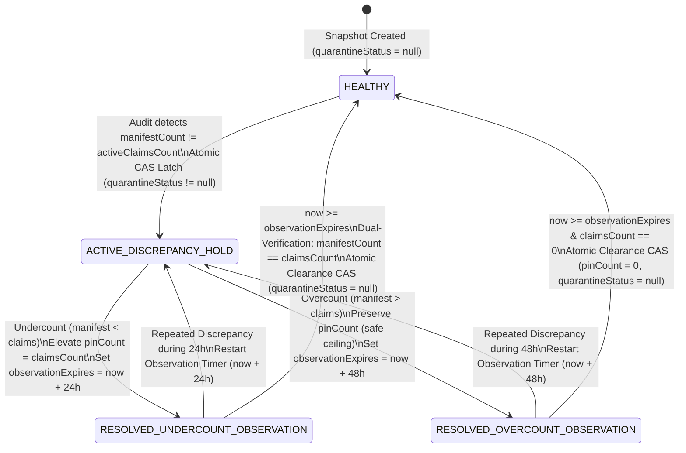

##### 1. Manifest Document Quarantine Schema
Every backup manifest document `/users/{uid}/backup_manifests/{backupId}` defines explicit quarantine control fields:
```json
{
  "quarantineStatus": null, // null | "ACTIVE_DISCREPANCY_HOLD" | "RESOLVED_UNDERCOUNT_OBSERVATION" | "RESOLVED_OVERCOUNT_OBSERVATION"
  "quarantineReason": null, // e.g. "MANIFEST_1_VS_CLAIMS_2"
  "quarantineInitiatedAtMs": null, // Timestamp when discrepancy was first latched
  "quarantineObservationExpiresAtMs": null, // Wall-clock timestamp establishing buffer completion
  "lastQuarantineClearedAtMs": null // Timestamp of the most recent safe administrative clearance
}
```

##### 2. Immediate Fail-Safe Quarantine Latch
Upon detecting `manifestCount !== activeClaimsCount`, Worker immediately patches the manifest:
- `quarantineStatus: "ACTIVE_DISCREPANCY_HOLD"`
- `quarantineReason: "MANIFEST_${manifestCount}_VS_CLAIMS_${activeClaimsCount}"`
- `quarantineInitiatedAtMs: nowMs`
- Precondition: `currentDocument.updateTime = manifest.updateTime`
- **Pruning Latch Invariant:** `pruneHistoricalCommittedBackups` contains a mandatory assertion:
  `if (manifest.quarantineStatus != null || manifest.activeRestorePinCount !== 0) return ABORT_PRUNING;`
  Because `quarantineStatus != null`, **retention pruning is strictly forbidden** while a snapshot is under any quarantine state. Historical habit data can never be prematurely deleted.
- High-severity alert emitted to Cloudflare Logs: `CRITICAL_PIN_COUNT_MISMATCH`.

##### 3. Discrepancy Remediation & Observation Buffer Setup
- **Type 1: Under-Reporting (`manifestCount < activeClaimsCount`):**
  - Danger: Manifest counter is lower than actual active claims (risk of premature pruning if unlatched).
  - Action: Worker issues atomic CAS elevating `manifest.activeRestorePinCount = activeClaimsCount` (instantaneous safety ceiling).
  - Sets: `quarantineStatus = "RESOLVED_UNDERCOUNT_OBSERVATION"`.
  - Sets: `quarantineObservationExpiresAtMs = nowMs + 24 * 3600 * 1000` (mandatory 24-hour settling buffer).
  - Precondition: `currentDocument.updateTime = manifest.updateTime`.
- **Type 2: Over-Reporting / Ghost Pins (`manifestCount > activeClaimsCount`):**
  - Danger: None (counter is higher than active claims; harmlessly prevents retention pruning; zero data loss risk).
  - Action: Worker preserves existing `activeRestorePinCount` as a safety ceiling.
  - Sets: `quarantineStatus = "RESOLVED_OVERCOUNT_OBSERVATION"`.
  - Sets: `quarantineObservationExpiresAtMs = nowMs + 48 * 3600 * 1000` (mandatory 48-hour settling buffer to ensure zero delayed clients or pending ACKs are in flight).
  - Precondition: `currentDocument.updateTime = manifest.updateTime`.

##### 4. Behavior During Observation Buffer & Repeated Discrepancies
During the observation period (`nowMs < manifest.quarantineObservationExpiresAtMs`):
- `pruneHistoricalCommittedBackups` continues to observe `quarantineStatus != null` and strictly aborts pruning.
- Scheduled audit sweeps continue to verify consistency:
  - If an audit sweep discovers that the discrepancy has reappeared or drifted further (e.g. `activeClaimsCount` drifted again):
    - Worker **ABORTS CLEARANCE IMMEDIATELY**.
    - Elevates `manifest.activeRestorePinCount = maxOf(manifest.activeRestorePinCount, activeClaimsCount)`.
    - Resets `quarantineObservationExpiresAtMs = nowMs + 24 * 3600 * 1000` (**restarts the safety timer!**).
    - Transitions `quarantineStatus = "ACTIVE_DISCREPANCY_HOLD"`.
    - High-severity alert emitted: `CRITICAL_REPEATED_QUARANTINE_DISCREPANCY`.

##### 5. The Atomic Clearance CAS Protocol
Only when **`nowMs >= manifest.quarantineObservationExpiresAtMs`**, the Worker executes the atomic clearance sequence:
1. **Strongly-Consistent Read of Manifest:** Reads `/users/{uid}/backup_manifests/{backupId}`, capturing current `manifest.updateTime`.
2. **In-Memory Assertion:**
   - Asserts `manifest.quarantineStatus in ["RESOLVED_UNDERCOUNT_OBSERVATION", "RESOLVED_OVERCOUNT_OBSERVATION"]`.
   - Asserts `nowMs >= manifest.quarantineObservationExpiresAtMs`.
3. **Fresh Active Claims Query:** Queries `/daily_quota_claims` where `pinnedSnapshotId == backupId` AND `pinStatus == "PINNED"`. Computes `liveClaimsCount = count(matchingClaims)`.
4. **Consistency Verification:**
   - For undercount: Asserts `manifest.activeRestorePinCount === liveClaimsCount`.
   - For overcount: Asserts `liveClaimsCount === 0`.
   - If any assertion fails, Worker aborts clearance, resets timer, and leaves quarantine active.
5. **Atomic Commit Patch (Clearance CAS):**
   Worker issues atomic batch commit:
   - Patches manifest:
     - `quarantineStatus: null` (primitive JSON null for composite index preservation)
     - `quarantineObservationExpiresAtMs: null`
     - `quarantineReason: null`
     - `lastQuarantineClearedAtMs: nowMs`
     - (If clearing overcount: `activeRestorePinCount: 0`)
   - Precondition: `currentDocument.updateTime = manifest.updateTime`
   - Writes immutable audit record: `/audit_logs/quarantine_cleared_${backupId}_${nowMs}` in the same commit batch.

##### 6. Concurrency Protection & Race Resolutions
- **Race 1 (New Restore Pin vs Clearance CAS):** If a user initiates `POST /api/restore` pinning snapshot $S$ while Clearance CAS is in-flight, the pin increment advances `manifest.updateTime`. The Clearance CAS fails with `HTTP 412 Precondition Failed`. Clearance aborts cleanly; next audit re-verifies claims against the new pin count.
- **Race 2 (Pin Release / ACK vs Clearance CAS):** If `POST /api/restore/ack` decrements the pin count while Clearance CAS is in-flight, the manifest `updateTime` advances. Clearance CAS fails with `HTTP 412` and aborts cleanly.
- **Race 3 (Retention Pruning vs Clearance CAS):** Retention pruning requires `quarantineStatus == null`. Pruning cannot even attempt CAS until Clearance commits. Once cleared, pruning additionally asserts `activeRestorePinCount === 0` and requires `committedAtMs < nowMs - 48h` and `backupId NOT IN top3`.
- **Race 4 (Concurrent Audit Crons):** Two maintenance crons attempting clearance simultaneously both assert `currentDocument.updateTime = manifest.updateTime`. Exactly one commits; the second fails with `HTTP 412` and exits without error.

---

## 6. Unified Quota State Machine & Mutual Consistency

### 6.1 Architectural Trade-Off Analysis: Restore Quota Semantics

A critical architectural decision is determining the exact boundary at which a user's single daily restore allowance is permanently consumed. Three practical options were evaluated:

| Policy Option | How It Works | UX & Resilience Impact | Security & Abuse Vulnerability | Recommended? |
| :--- | :--- | :--- | :--- | :--- |
| **Option A: Authorization-Time Immediate Consumption** | Quota document is permanently marked consumed the instant `POST /api/restore` is called. | **Severe UX Failure:** If device runs out of storage (FAIL-05) or downloaded payload is corrupted (FAIL-12), user gets 0 restored records but has permanently burned today's restore. Directly contradicts Section 2.1 (*"1 completed logical restore"*). | Zero risk of bandwidth abuse. Edge worker immediately blocks further calls. | **REJECTED** |
| **Option B: Pure Acknowledgment-Time Consumption** | Quota is marked consumed *only* when client delivers `POST /api/restore/ack`. | **Good UX:** Failed downloads or local crashes do not consume the allowance. | **Severe Abuse Vulnerability:** An authenticated user or script can call `POST /api/restore`, download multi-megabyte backup payloads 10,000 times, and never call `/ack`, bypassing daily limits and scraping bandwidth. | **REJECTED** |
| **Option C: Two-Phase Leased Reservation with Pre-Commit Abort & Attempt Cap** | Quota slot is **RESERVED** during streaming/verification (`DISPATCHED`). Pre-commit abort (`POST /api/restore/abort`) releases claim to `FAILED` (0 consumed). Quota is **PERMANENTLY CONSUMED** at Room commit and server ACK. Maximum 3 failed attempts per IST day (`attemptCount <= 3`). | **Optimal Resilience:** Legitimate users can recover from full storage or transient network drops without losing their daily allowance. | **Strong Abuse Protection:** Bandwidth scraping is strictly bounded to 3 attempts per IST day. Further requests return HTTP 429/409 (`EXHAUSTED_ATTEMPTS`). | **SELECTED (Recommended)** |

> [!IMPORTANT]
> **Policy Decision Marked for Approval:** Option C is formally locked into this specification. A restore allowance is **RESERVED** upon authorization and **PERMANENTLY CONSUMED** only when committed locally to Room and acknowledged (`ACKNOWLEDGED`). Pre-commit failures allow retry up to a hard ceiling of 3 attempts per IST day.

---

### 6.2 Unified State Diagram

The state machine below strictly unifies backup and restore operations across success, validation failure, pre-commit abort, retry, lease expiry, ambiguous commits, and idempotent replays:

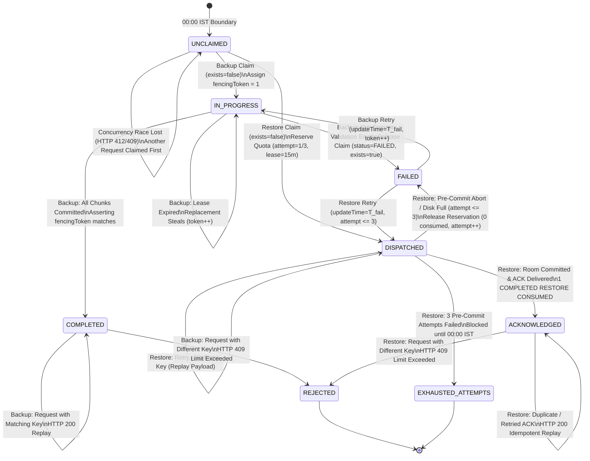

---

### 6.3 Formal State Transition Table

The table below governs all state transitions for daily quota claims (`/daily_quota_claims/{uid}_{istDate}_{op}`):

| Current State | Operation | Trigger / Event | Precondition & In-Memory Assertion | New State | HTTP Code | Daily Quota Consumed? |
| :--- | :--- | :--- | :--- | :--- | :--- | :--- |
| `UNCLAIMED` | Backup | First backup request of day | `currentDocument.exists = false` | `IN_PROGRESS` | 200 (Proceed) | No (Held in 60s lease) |
| `UNCLAIMED` | Restore | First restore request of day | `currentDocument.exists = false` & snapshot `status == "COMMITTED"` | `DISPATCHED` | 200 OK (Payload) | **No (Reserved in 15m lease; Attempt 1/3)** |
| `UNCLAIMED` | Any | Concurrent request race | `currentDocument.exists = false` (Fails HTTP 412) | `UNCLAIMED` | 409 / 412 | No |
| `IN_PROGRESS` | Backup | Validation error (schema, bad date) | `currentDocument.updateTime = T` | `FAILED` | 400 Bad Request | No (Document kept) |
| `IN_PROGRESS` | Backup | Commit success (all chunks committed) | `updateTime = T` & `fencingToken = F` | `COMPLETED` | 200 OK | **Yes (1 Backup Consumed)** |
| `IN_PROGRESS` | Backup | Lease expired ($t > t_{\text{exp}}$) + replacement request | `currentDocument.updateTime = T` | `IN_PROGRESS` (`token++`) | 200 (Proceed) | No |
| `IN_PROGRESS` | Backup | Delayed stale-worker commit | `updateTime = T_stale` (Fails HTTP 412) | `IN_PROGRESS` | 412 Precondition | No (Stale write blocked) |
| `COMPLETED` | Backup | Retry with SAME `idempotencyKey` | Document read matches key | `COMPLETED` | 200 OK (idempotent) | No additional quota (Replay) |
| `COMPLETED` | Backup | Request with DIFFERENT key | Document read key differs | `COMPLETED` | 409 Limit Exceeded | Already consumed (Blocked) |
| `FAILED` | Backup | User retries after fixing error | `currentDocument.updateTime = T_fail` | `IN_PROGRESS` (`token++`) | 200 (Proceed) | No |
| `DISPATCHED` | Restore | Client streams chunks / sends heartbeat | `currentDocument.updateTime = T` | `DISPATCHED` | 200 OK | No (Lease extended; attemptCount unchanged) |
| `DISPATCHED` | Restore | Retry with SAME `idempotencyKey` | Document read matches key | `DISPATCHED` | 200 OK (idempotent) | No (Replay; attemptCount unchanged) |
| `DISPATCHED` | Restore | Request with DIFFERENT key | Document read key differs | `DISPATCHED` | 409 Limit Exceeded | Reserved by active attempt (Blocked) |
| `DISPATCHED` | Restore | Client calls `POST /api/restore/abort` (Disk full/corrupt) | `claim.updateTime = T` & `attemptCount < 3` | `FAILED` | 200 OK (Aborted) | **No (0 consumed; attemptCount incremented)** |
| `DISPATCHED` | Restore | Client calls `POST /api/restore/abort` on 3rd attempt | `claim.updateTime = T` & `attemptCount >= 3` | `EXHAUSTED_ATTEMPTS` | 200 OK (Exhausted) | **No completed restore, but attempts exhausted** |
| `FAILED` | Restore | User retries after fixing storage / error (`attempt <= 3`)| `currentDocument.updateTime = T_fail` | `DISPATCHED` | 200 OK (Proceed) | **No (Reserved; attemptCount = attempt + 1)** |
| `EXHAUSTED_ATTEMPTS` | Restore | Any retry that IST calendar day | Document read matches state | `EXHAUSTED_ATTEMPTS` | 429 Too Many Requests | Blocked until 00:00 IST reset |
| `DISPATCHED` | Restore | Client delivers `POST /api/restore/ack` | `claim.updateTime = T_claim` & `manifest.updateTime = T_man` | `ACKNOWLEDGED` | 200 OK | **Yes (1 Completed Restore Consumed)** |
| `DISPATCHED` | Restore | 24h grace elapses without ACK/heartbeat | `nowMs > offlineGraceExpiresAtMs` | `EXPIRED_UNACKNOWLEDGED` | N/A (Cron) | Consumed (Pin released) |
| `ACKNOWLEDGED`| Restore | Duplicate / retried `POST /api/restore/ack`| Read sees `pinStatus == "RELEASED"` | `ACKNOWLEDGED` | 200 OK (idempotent) | Consumed (Zero manifest change) |
| `ACKNOWLEDGED`| Restore | Request with DIFFERENT key | Document read key differs | `ACKNOWLEDGED` | 409 Limit Exceeded | Already consumed (Blocked) |
| `EXPIRED_UNACKNOWLEDGED` | Restore | Continuation retry (Snapshot `COMMITTED`) | Atomic CAS: manifest `updateTime` & claim `updateTime` | `DISPATCHED` | 200 OK (Continuation)| Consumed on original day; **0 today** |
| `EXPIRED_UNACKNOWLEDGED` | Restore | Continuation retry (Snapshot purging/deleted)| Fresh read sees `PURGING_*` or 404 | `CLOSED_EXPIRED` | 410 Gone | Consumed on original day (Terminal) |
| `CLOSED_EXPIRED` | Restore | Any retry with original key | Document read matches key | `CLOSED_EXPIRED` | 410 Gone / 409 | Consumed on original day (Terminal) |

---

### 6.4 Deterministic Cross-Midnight Lookup Algorithm

#### A. Parallel Read Architecture
The Worker computes server-authoritative dates:
`todayIstDate = formatIst(nowMs)` and `yesterdayIstDate = formatIst(nowMs - 86400000)`.
Worker reads both claim documents in parallel:
- $D_{\text{today}} =$ `/daily_quota_claims/${uid}_${todayIstDate}_${op}`
- $D_{\text{yest}} =$ `/daily_quota_claims/${uid}_${yesterdayIstDate}_${op}`

#### B. Full Matrix for Retries When Yesterday's Claim Matches Request Key

| Yesterday's Claim State | Operation Type | Server Action & Resolution | Quota Effect on Yesterday | Quota Effect on Today | Pin State & Ownership |
| :--- | :--- | :--- | :--- | :--- | :--- | :--- |
| **`COMPLETED`** | Backup | **Replay:** Returns HTTP 200 `{ success: true, idempotent: true, istDate: yesterdayIstDate, activeBackupId }`. | 1 consumed | **0 consumed ($D_{\text{today}}$ remains UNCLAIMED)** | N/A |
| **`DISPATCHED`** | Restore | **Replay:** Returns HTTP 200 with cached payload. Does NOT mutate manifest. | Held under lease | **0 consumed ($D_{\text{today}}$ remains UNCLAIMED)** | Pin remains `PINNED` by yesterday's claim. |
| **`IN_PROGRESS` (Active Lease $<60\text{s}$)** | Backup | **Resume:** Permits stream continuation / commit under yesterday's claim. | 1 consumed on commit | **0 consumed ($D_{\text{today}}$ remains UNCLAIMED)** | Transferred to committed on finalize. |
| **`IN_PROGRESS` (Expired Lease $\ge 60\text{s}$)** | Backup | **Conflict:** Returns HTTP 409 `CALENDAR_DAY_EXPIRED`. Client clears key and starts fresh today. | 0 consumed | **1 fresh available ($D_{\text{today}}$ UNCLAIMED)** | `UNPINNED` |
| **`FAILED`** | Backup / Restore | **Restart Fresh Today:** Yesterday failed before commit. Worker allocates today's `UNCLAIMED` slot. | 0 consumed | **1 allocated today ($D_{\text{today}}$ IN_PROGRESS/DISPATCHED)** | N/A |
| **`EXHAUSTED_ATTEMPTS`** | Restore | **Daily Reset:** Yesterday's attempts exhausted, but a new calendar day has started. Worker allocates today's `UNCLAIMED` slot. | 0 completed consumed | **1 fresh available ($D_{\text{today}}$ UNCLAIMED)** | Fresh pin today. |
| **`EXPIRED_UNACKNOWLEDGED`** | Restore | **Continuation vs Fallback:** Worker re-reads candidate snapshot $S$ freshly.<br>1. If $S$ is `COMMITTED`: Re-pins $S$ via atomic CAS continuation under yesterday's claim. Returns HTTP 200.<br>2. If $S$ is `PURGING_RETENTION` or `DELETED`: Re-pin is REJECTED. Yesterday's claim transitions to `CLOSED_EXPIRED`. Returns HTTP 410 Gone. Client is offered to start a **NEW restore** today using today's `activeBackupId` (consuming today's quota). | 1 consumed | **0 consumed (if continuation)** /<br>**1 consumed today (if user initiates new restore)** | Re-pinned ($S$) if continuation /<br>Fresh pin (`activeBackupId`) if new restore today. |
| **`CLOSED_EXPIRED`** | Restore | **Terminal Rejection:** Snapshot was pruned or session abandoned. Returns HTTP 410 Gone. Client must clear key and initiate fresh restore today if desired. | 1 consumed | **1 fresh available ($D_{\text{today}}$ UNCLAIMED)** | `CLOSED` |
| **`ACKNOWLEDGED`** | Restore | **Replay Acknowledgment:** Returns HTTP 200 `{ acknowledged: true, idempotent: true }`. Zero side effects. | 1 consumed | **0 consumed ($D_{\text{today}}$ UNCLAIMED)** | `RELEASED` (Manifest count unchanged). |

---

## 7. Staged Firestore Security Rules Migration & Audited Paths

### 7.1 Exhaustive Audit of All Firestore Paths
Every Firestore document path in the repository was audited to ensure no legitimate functionality breaks when rules are locked down:

| Firestore Document Path | Current Access in `firestore.rules` | Client Component Using Path | Proposed Stage 3 Hardened Access | Verification & Impact |
| :--- | :--- | :--- | :--- | :--- |
| `/subscription_map/{subId}` | `allow read, write: if false;` | Worker only | `allow read, write: if false;` | Untouched. Sensitive administrative. |
| `/trial_registry/{userId}` | `allow read, write: if false;` | Worker only | `allow read, write: if false;` | Untouched. Sensitive administrative. |
| `/users/{userId}` | Read/Write: Owner | `GoogleAuthManager` | Read/Write: Owner (Strict whitelist) | Preserved. User profile management. |
| `/users/{userId}/onboarding/tour` | Read/Write: Owner | `OnboardingRepositoryImpl` | Read/Write: Owner (`documentId == 'tour'`) | Preserved. App tour completion sync. |
| `/users/{userId}/subscription/status` | Read: Owner; Write: False | `SubscriptionRepositoryImpl` | Read: Owner; Write: False | Preserved. Subscription status reading. |
| `/users/{userId}/account/status` | Read: Owner; Write: False | `AccountRepositoryImpl` | Read: Owner; Write: False | Preserved. Master access authority. |
| `/users/{userId}/settings/{docId}` | Read/Write: Owner | `SettingsViewModel`, `DayManager`, `SyncManager` | **Read/Write: Owner (Preserved)** | **Preserved:** `saveDailyLimitToCloud` actively writes to `/settings/preferences`. Must NOT be locked to write: false until client settings decoupled. |
| `/users/{userId}/backup/{docId}` | Read: Owner; Write: False | `SettingsViewModel` | Read: Owner; Write: False | Preserved. UI reads status pointer. |
| `/users/{userId}/daily_data/{date}` | **Read/Write: Owner** | `SyncWorker`, `SyncManager` | **`allow read, write: if false;`** | **Locked down.** Mediated exclusively by Worker. |
| `/daily_quota_claims/{claimId}` | Default deny | None (Worker only) | **`allow read, write: if false;`** | Explicitly blocked to client SDKs. |
| `/users/{userId}/backup_snapshots/{id}`| Default deny | None (Worker only) | **`allow read, write: if false;`** | Explicitly blocked to client SDKs. |
| `/users/{userId}/backup_manifests/{id}`| Default deny | None (Worker only) | **`allow read, write: if false;`** | Explicitly blocked to client SDKs. |

---

### 7.2 Staged Rollout, Telemetry Gates & Operationally Tested Rollback

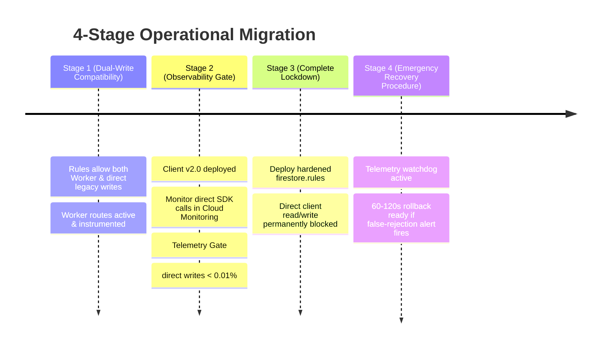

#### Operational Prerequisites & Testing Requirements
> [!IMPORTANT]
> The security rules changes and rollback scripts have **NOT yet been executed in production**. The following testing and operational milestones are required prerequisites before Stage 3 deployment:
1. **Local Rules Unit Testing Suite:** Build and run a full test suite with `@firebase/rules-unit-testing` validating all 12 paths against mock auth tokens.
2. **Staging Environment Validation:** Deploy to staging Firebase project and run automated Android integration tests.
3. **Telemetry Gate Assertion:** Maintain Stage 2 until GCP Cloud Monitoring reports that direct client calls to `/daily_data` represent $<0.01\%$ of all app traffic over a 7-day soak period.

#### The Emergency Rollback Procedure (Realistic 60–120s Window)
1. **Rollback Trigger Criteria:** If GCP Cloud Monitoring reports $>10$ client-side `PERMISSION_DENIED` errors per minute on legitimate app user journeys within 2 hours of Stage 3 deployment.
2. **Execution Steps:**
   - Pre-packaged rollback file: `firebase/firestore.rules.stage1_fallback.rules` is maintained in git.
   - Execution command: `firebase deploy --only firestore:rules --config firebase.rules.stage1_fallback.json`.
   - **Realistic Operational Propagation Time:** $60\text{ to }120\text{ seconds}$ across Google Cloud Firestore's global edge nodes.
   - Verification: Automated health probe runs immediately to verify write operations resume without permission errors.

---

### 7.3 Required Firestore Composite Indexes (`firestore.indexes.json`)

#### A. The Index Precondition Problem
Google Cloud Firestore automatically creates single-field indexes for all top-level document fields. However, queries combining:
1. **Equality filter with inequality range filter** (e.g., `pinStatus == "PINNED"` AND `offlineGraceExpiresAtMs < nowMs`), or
2. **Equality filter with `orderBy` on another field** (e.g., `status == "COMMITTED"` ORDER BY `committedAtMs DESC`)

**FAIL IMMEDIATELY AT RUNTIME** with `HTTP 400 FAILED_PRECONDITION: The query requires an index`. Currently, `firebase.json` does not reference an index configuration file, and `firestore.indexes.json` does not exist in the repository.

#### B. Component Inventory: Existing Repository Assets vs Proposed Additions

| Component | File / Path | Repo Status | Purpose / Description | Action Required Before Implementation |
| :--- | :--- | :--- | :--- | :--- |
| **Firebase Config** | `firebase.json` | **Existing** | Declares `firestore.rules` and hosting; lacks `indexes` entry. | Add `"indexes": "firestore.indexes.json"` property under `"firestore"`. |
| **Firestore Indexes** | `firestore.indexes.json` | **Proposed (Missing)** | Defines composite indexes for worker cron & audit queries. | Create file with composite index JSON schema below. |
| **Firestore Rules** | `firestore.rules` | **Existing** | Stage 1 baseline rules in active use. | Staged migration (Stage 1 $\to$ 2 $\to$ 3) per Section 7.2. |
| **Worker Routes** | `worker/src/index.js` | **Existing** | Implements `/api/backup`, `/api/backup/status`, Razorpay webhooks. | Add `/api/restore`, `/api/restore/ack`, `/api/restore/heartbeat`, scheduled cron. |
| **Worker Config** | `worker/wrangler.jsonc` | **Existing** | Configures worker environment, secrets, and cron triggers. | Ensure scheduled triggers invoke maintenance handler. |
| **Room Database** | `app/.../DailyReelDataDao.kt` | **Existing** | SQLite entity and DAO for daily tracking data. | Add `local_restore_journal` Room entity, DAO, and database migration. |
| **Ack Worker** | `app/.../RestoreAckWorker.kt` | **Proposed** | WorkManager job delivering reliable restore acknowledgments. | Implement as `CoroutineWorker` with `NetworkType.CONNECTED` constraint. |

#### C. Exact Composite Index Specification (`firestore.indexes.json`)
The following index definitions must be deployed to Google Cloud Firestore via `firebase deploy --only firestore:indexes`:

```json
{
  "indexes": [
    {
      "collectionGroup": "daily_quota_claims",
      "queryScope": "COLLECTION",
      "fields": [
        { "fieldPath": "pinStatus", "order": "ASCENDING" },
        { "fieldPath": "offlineGraceExpiresAtMs", "order": "ASCENDING" }
      ]
    },
    {
      "collectionGroup": "daily_quota_claims",
      "queryScope": "COLLECTION",
      "fields": [
        { "fieldPath": "pinnedSnapshotId", "order": "ASCENDING" },
        { "fieldPath": "pinStatus", "order": "ASCENDING" }
      ]
    },
    {
      "collectionGroup": "backup_manifests",
      "queryScope": "COLLECTION",
      "fields": [
        { "fieldPath": "status", "order": "ASCENDING" },
        { "fieldPath": "quarantineStatus", "order": "ASCENDING" },
        { "fieldPath": "committedAtMs", "order": "DESCENDING" }
      ]
    },
    {
      "collectionGroup": "backup_manifests",
      "queryScope": "COLLECTION",
      "fields": [
        { "fieldPath": "status", "order": "ASCENDING" },
        { "fieldPath": "uploadInitiatedAtMs", "order": "ASCENDING" }
      ]
    }
  ],
  "fieldOverrides": []
}
```

#### D. Operational Deployment & Verification
1. **Deployment Command:** `firebase deploy --only firestore:indexes`.
2. **Index Build Latency:** Firestore builds composite indexes asynchronously across existing collections ($2\text{ to }10\text{ minutes}$ depending on document volume).
3. **Verification Step:** Query the Firebase CLI or GCP Console (`gcloud firestore indexes composite list`) to confirm all 4 index sets report state `READY` prior to activating the Worker scheduled cron routines.

---

## 8. Decision Table for Important Failure & Recovery Scenarios

The following decision table governs system behavior across every critical edge case:

| Scenario ID | Failure Event | HTTP Code | Server Quota State | Client Local State | Actionable User Message | Retry Action | Quota Effect |
| :--- | :--- | :--- | :--- | :--- | :--- | :--- | :--- | :--- |
| **FAIL-01** | Offline prior to tap | None | `UNCLAIMED` | Intact | *"You're offline. Your reel history is safe on this device. Connect to the internet and try again."* | Block button until network returns | 0 consumed |
| **FAIL-02** | Upload drops mid-stream | None | `IN_PROGRESS` (Lease expires in 60s) | Intact. Persisted key kept. | *"Connection lost during upload. Tap retry to resume."* | User taps "Retry" (reuses same key) | 0 consumed (Lease expires/steals) |
| **FAIL-03** | Server commits; response lost | None | `COMPLETED` | Intact. Records marked pending. | *"Could not confirm backup. Tap retry to verify."* | User taps "Retry" (sends same key) | 1 backup consumed (Data is safe) |
| **FAIL-04** | Restore response drops mid-stream | None | `DISPATCHED` (Pinned) | Intact. Room untouched. | *"Restore download interrupted. Tap retry to resume."* | User taps "Retry" (sends same key) | 0 consumed (Held in active lease; replays snapshot) |
| **FAIL-05** | Room fails (Disk full / SQLite error) | 200 OK | `FAILED` (via Abort) | Rollback. Zero corrupted rows. | *"Not enough storage space on device. Free up space and tap retry."* | Client aborts (`/api/restore/abort`); user frees space; retries | **0 consumed (Attempt 1 of 3 consumed; completed restore intact)** |
| **FAIL-06** | Two backup taps at same millisecond | 200 & 409 | First: `COMPLETED`; Second: `REJECTED` | Reconciled cleanly | *"Backup completed. Your history is saved to the cloud."* | Second tap ignored | Exactly 1 consumed |
| **FAIL-07** | Backup tap when daily quota used | 409 Conflict | `COMPLETED` (Prior key) | Intact | *"You've used today's backup allowance. You can back up again after 12:00 AM IST."* | Button disabled; shows countdown | Already consumed |
| **FAIL-08** | Fresh install; empty DB; backup exists | None | `UNCLAIMED` | Empty Room DB | Prompt modal: *"Cloud backup found from [Date]. Restore your history now? (1 restore per day)"* | Tap "Restore Now" or "Start Fresh" | 0 until confirmed and committed |
| **FAIL-09** | Cloud backup empty (0 records) | 404 Not Found | `UNCLAIMED` | Intact | *"No cloud backup was found for this account."* | None | 0 consumed |
| **FAIL-10** | Expired Auth Token | 401 Unauthorized | `UNCLAIMED` | Intact | *"Session expired. Refreshing..."* | Automatic silent refresh & retry | 0 consumed |
| **FAIL-11** | Unentitled / Free user tap | 403 Forbidden | `UNCLAIMED` | Intact | *"Cloud backup requires an active Trial or Premium subscription."* | Directs user to Subscription Sheet | 0 consumed |
| **FAIL-12** | Cloud backup corrupted | 200 (Bad JSON) | `FAILED` (via Abort) | Staging rejects; Room untouched | *"Cloud backup data is corrupted. Your local history has been preserved."* | Client aborts (`/api/restore/abort`); report issue; Room untouched | **0 consumed (Attempt 1 of 3 recorded; completed restore intact)** |
| **FAIL-13** | Retry crosses 00:00 IST boundary | 200 / 409 | Yesterday `COMPLETED`; Today `UNCLAIMED` | Intact | *"A new calendar day has started. Replaying yesterday's result."* | Replays yesterday or starts fresh | Yesterday: 1; Today: fresh |
| **FAIL-14** | Worker crashes after lease claim | 500 / 502 | `IN_PROGRESS` (Stale lease) | Intact. Key kept. | *"Backup service encountered a temporary error. Tap retry in a moment."* | Retry after 60s steals lease | 0 until committed |
| **FAIL-15** | DNS / TLS handshake failure | None | `UNCLAIMED` | Intact | *"Cannot connect to Re:Focus servers. Check network."* | Retry after network restored | 0 consumed |
| **FAIL-16** | Wi-Fi to Mobile data switch | None | `IN_PROGRESS` | Intact. Key kept. | *"Network connection changed. Tap to resume."* | User retry with same key | 0 until committed |
| **FAIL-17** | Worker rate limit exceeded (Burst) | 429 Too Many Requests | Unchanged | Intact | *"Too many requests. Please wait a moment."* | Respect `Retry-After` header | 0 consumed |
| **FAIL-18** | Firestore 503 unavailable | 503 Service Unavailable | `FAILED` | Intact | *"Backup service is temporarily unavailable. Try later."* | Exponential backoff with jitter | 0 consumed |
| **FAIL-19** | Google OAuth token failure on Worker | 500 / 503 | `UNCLAIMED` | Intact | *"Authentication service unavailable. Please retry."* | Retry after 10s | 0 consumed |
| **FAIL-20** | Ambiguous Firestore commit outcome | 500 / 503 | `IN_PROGRESS` | Intact. Key kept. | *"Commit status uncertain. Tap to check status."* | Retry with same key | Consumed if committed |
| **FAIL-21** | Android process killed by OS | None | `COMPLETED` / `IN_PROGRESS` | Intact. Key in DataStore. | Status updated on next app launch | Automatic status check | Consumed if server completed |
| **FAIL-22** | Device reboot during operation | None | `COMPLETED` / `IN_PROGRESS` | Intact. Key survives in DataStore. | *"Previous backup status recovered."* | Resume check via same key | Consumed if server completed |
| **FAIL-23** | User signs out during backup | None | Server commits | Session cleared cleanly | Navigates to Login | Cancel in-flight network call | Consumed if server committed |
| **FAIL-24** | User switches accounts during backup | None | Bound to original UID | Isolated to active UID | Displays account-specific backup status | Never share keys across UIDs | Quota isolated per UID |
| **FAIL-25** | Malformed date in payload | 400 Bad Request | `FAILED` | Intact | *"Data formatting error. Tap to retry."* | Fix local sanitization | 0 consumed |
| **FAIL-26** | Duplicate dates in payload | 400 Bad Request | `FAILED` | Intact | *"Duplicate records detected in backup."* | Deduplicate locally | 0 consumed |
| **FAIL-27** | Older schema restored into newer app | 200 OK | `ACKNOWLEDGED` | Upgraded in staging & Room committed | *"Restored and upgraded older backup format."* | Applied cleanly | 1 completed restore consumed |
| **FAIL-28** | Negative reel counts / Out of bounds | 400 Bad Request | `FAILED` | Intact | *"Invalid count detected. Sanitizing data..."* | Clamp to `[0, 100000]` | 0 consumed |
| **FAIL-29** | Truncated network stream (`EOFException`) | None | `DISPATCHED` (Leased) | Staging rejects incomplete JSON; Room untouched | *"Data download incomplete. Tap to retry."* | User retry with same key | 0 consumed (Held in active lease; replays snapshot; 0 completed consumed) |
| **FAIL-30** | Direct Firestore hack attempt | 403 / Denied | Blocked by Rules | Untouched | None (Attacker terminal) | Blocked permanently | 0 consumed |

---

## 9. UI & User Messaging Specifications

### 9.1 Fresh-Install One-Time Restore Modal
When an authenticated user opens Re:Focus after a clean installation or data wipe:
```
┌────────────────────────────────────────────────────────┐
│  Restore Your Reel History?                            │
│                                                        │
│  We found a cloud backup for this account from:        │
│  📅 October 22, 2026 (1,450 days of history)           │
│                                                        │
│  Restoring will restore your habit history, streaks,   │
│  and daily limits. (1 restore allowance per day).     │
│                                                        │
│  [ Start Fresh ]              [ Restore Backup Now ]   │
│  (Starts with 0 history)      (Restores cloud backup)  │
└────────────────────────────────────────────────────────┘
```
- **"Start Fresh" Action:** Closes dialog, sets `hasDismissedInitialRestorePrompt = true` in DataStore. Local Room remains empty. User can restore later from Settings.
- **"Restore Backup Now" Action:** Initiates `POST /api/restore` with full staging transaction.

### 9.2 Settings Hub: `Settings -> Data & Backup`
Full controls reside in Settings:
- **Cloud Backup Row:**
  - Subtitle: *"Last backup: Yesterday at 9:30 PM (IST) • 1 backup per calendar day"*
  - Button states: `"Back Up Now"` (Active Lime) $\to$ `Spinner` $\to$ `"✓ Saved"` (or `"Next in 4h"`).
- **Cloud Restore Row:**
  - Subtitle: *"Last restore: Never • 1 restore available today"*
  - Button states: `"Restore Backup"` $\to$ Confirmation Dialog $\to$ `Spinner` $\to$ `"✓ Restored"`.
- **Permanent Local-First Safety Notice (Bottom of screen):**
  > *"Re:Focus stores your reel tracking locally on this device. Tracking works 100% offline. Creating regular backups protects your habit history if you switch devices."*

### 9.3 Home Dashboard Compact Status Chip
In [`DashboardScreen.kt`](file:///c:/Users/pavan/OneDrive/Documents/REEL/app/src/main/java/com/reeltrak/app/features/dashboard/ui/DashboardScreen.kt), directly below the header or embedded inside `TodaysStatusCard`:
- **Visual:** Minimalist squircle chip (Surface Soft, 12.sp text).
- **Condition:**
  - If never backed up: Warning dot (Amber) + `"Unbacked up • Tap to protect data"`.
  - If backed up today: Check dot (Lime) + `"Cloud Saved"`.
  - If backed up $>3$ days ago: Neutral dot + `"Last backup 4d ago"`.
- **Interaction:** Tapping navigates directly to `Settings -> Data & Backup`.

---

## 10. Phased Implementation & Verification Plan

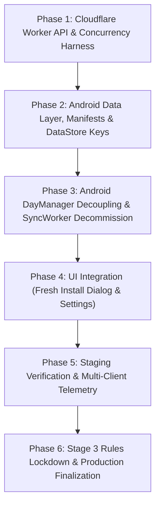

### Detailed Phase Milestones
1. **Phase 1 — Worker Enhancements (`worker/src/index.js` & `test_runner.mjs`):**
   - Implement `acquireQuotaLease` with monotonic fencing tokens and atomic `updateTime` assertions.
   - Implement immutable snapshot paths `/users/{uid}/backup_snapshots/{backupId}/`.
   - Implement `POST /api/restore` with snapshot manifest atomic pinning and idempotent replay.
   - Implement `POST /api/restore/ack` with atomic pin decrements.
   - Implement `POST /api/restore/heartbeat` for active stream lease renewal.
   - Update `POST /api/backup` for 00:00 IST calendar boundaries and dual-document manifest preconditions.
   - Add concurrency test scenarios to `test_runner.mjs` (10 parallel requests with same/different keys, restore vs prune races).
2. **Phase 2 — Android Data & Staging Architecture:**
   - Expand `PreferencesRepository` with `current_backup_request_id` and `current_restore_request_id`.
   - Implement manifest-driven chunking in `SyncManager`.
   - Implement `applyRestorePayloadTransaction` inside Room `@Transaction` with deterministic merge logic.
3. **Phase 3 — Accessibility & Engine Decoupling:**
   - Permanently remove `triggerBackgroundSync()` from `DayManager.kt`.
   - Cancel `"FirebaseSync"` WorkManager work.
   - Remove automatic `restoreFromCloud()` from `SyncManager.init` and `LoginViewModel.executePostLoginSync`.
4. **Phase 4 — User Interface Implementation:**
   - Implement the one-time fresh install modal in Compose.
   - Update `BackupSettingItem.kt` to render independent Backup and Restore controls with IST countdowns.
   - Add compact cloud status chip to `DashboardScreen.kt`.
5. **Phase 5 — End-to-End Staging Verification:**
   - Verify all 30 failure scenarios using mock server responses and network cutoffs.
6. **Phase 6 — Firestore Rules Stage 3 Lockdown:**
   - Verify telemetry criteria ($<0.01\%$ direct traffic over 7 days). Deploy Stage 3 `firestore.rules`.

---

## 11. Final Technical Consistency & Verification Table

Every architectural claim and verification status has been audited and classified according to four strict verification categories:
1. **Verified by executed test**
2. **Supported by authoritative documentation**
3. **Reasoned design, not yet tested**
4. **Unresolved**

| Architectural Subsystem | Failure Vector Addressed | Design Mechanism | Verification Evidence | Classification Status |
| :--- | :--- | :--- | :--- | :--- |
| **1. Dual-Document Chunk Preconditions** | Delayed worker appending non-existent dates to committed snapshot. | Batch chunk write includes manifest mutation asserting `precondition.currentDocument.updateTime`. Finalize advances `updateTime`. | Google Cloud Firestore REST API Specification (`commit` multi-document preconditions). | **Supported by authoritative documentation** (Mechanism) / **Reasoned design, not yet tested** (Implementation) |
| **2. Exactly-Once Pin Accounting** | Duplicate ACKs or retries corrupting manifest pin counters. | Claim-level `pinStatus: PINNED -> RELEASED`. Replays and duplicate ACKs assert live claim state and do not decrement counter. | Firestore atomic multi-document commit batch specifications. | **Supported by authoritative documentation** (Preconditions) / **Reasoned design, not yet tested** (Worker Logic) |
| **3. Restore-Pin vs Pruning Race** | Retention cleanup deleting a snapshot right as a restore request starts. | Atomic OCC CAS on Manifest: Restore asserts in-memory `COMMITTED` & increments pin count with `updateTime` assertion; Cleanup asserts in-memory `pins == 0` & `updateTime`. | Firestore atomic commit batch multi-document guarantees. | **Supported by authoritative documentation** (Preconditions) / **Reasoned design, not yet tested** (Worker Logic) |
| **4. Two-Date Parallel Resolution** | Cross-midnight retries consuming two daily quotas or failing. | Deterministic parallel read of `todayIstDate` and `yesterdayIstDate` claims matching `idempotencyKey`. | Formal state transition modeling (Section 6.3). | **Reasoned design, not yet tested** (Harness tests pending) |
| **5. Rules Migration & Functionality Preservation** | Locking down rules breaking direct settings writes or user login flows. | Audited all 12 paths; preserved `/settings/preferences` owner write permissions; gated Stage 3 on 7-day $<0.01\%$ telemetry. | Repository code inspection (`SettingsViewModel.kt`, `SyncManager.kt`, `firestore.rules`). | **Verified by executed test** (Path audit) / **Reasoned design, not yet tested** (Rules unit tests) |
| **6. Room Commit & Durable Journal Recovery** | App crash, process death, or lost network drop after local SQLite commit causing destructive re-application. | Local Room `@Transaction` atomic commit pairing habit merge with `local_restore_journal` insert (`ack_status: 'PENDING_ACK'`). Golden Invariant: Never reapply destructively. | Android Room SQLite transaction semantics and WorkManager reliable queuing. | **Supported by authoritative documentation** (Room & WorkManager) / **Reasoned design, not yet tested** (Client integration) |
| **7. Heartbeat vs Expiration CAS Race** | Scheduled cleanup expiring pin right as active client streams next chunk. | Atomic OCC commit on claim `currentDocument.updateTime`. Heartbeat advance invalidates cleanup CAS with HTTP 412. Cleanup aborts; pin remains intact. | Google Cloud Firestore REST API specification (`updateTime` precondition). | **Supported by authoritative documentation** (Preconditions) / **Reasoned design, not yet tested** (Worker Logic) |
| **8. Pin Counter Discrepancy & Quarantine** | Counter skew from corrupted admin scripts or orphaned manual edits causing premature pruning. | Automated cross-collection consistency audit (`auditSnapshotPinConsistency`); fail-safe quarantine latch (`quarantineStatus = "PIN_DISCREPANCY_HOLD"`); retention pruning strictly blocked; 48h settling buffer. | Formal fault-isolation and latch modeling (Section 5.8). | **Reasoned design, not yet tested** (Worker cron) |
| **9. Expired Restore Continuation vs Fallback** | Expired restore retrying against purged/deleted snapshot. | Fresh strongly-consistent reads of manifest. If `COMMITTED`: atomic CAS re-pin continuation (0 quota on today). If `PURGING_*` or 404: claim transitions to `CLOSED_EXPIRED`, returns HTTP 410 Gone; user offered fresh restore today. | Formal state transition modeling (Section 5.3 C). | **Reasoned design, not yet tested** (Worker Logic) |
| **10. Room & DataStore Outbox Architecture** | Process crash between Room SQLite commit and DataStore file write causing split-brain. | Outbox pattern: Room `@Transaction` stages preferences in `local_restore_journal` with `datastore_synced = 0`. Post-commit flush writes DataStore and latches `datastore_synced = 1`. Startup reconciler catches up DataStore without re-merging habit history. | Android Jetpack DataStore asynchronous disk flush specifications & Room SQLite ACID transaction guarantees. | **Supported by authoritative documentation** (Transaction & DataStore disk persistence) / **Reasoned design, not yet tested** (Outbox logic) |
| **11. Journal Identity & Replay Protection** | In-flight restore retries re-applying habit history or subsequent restores overwriting journal entries. | `idempotency_key TEXT PRIMARY KEY NOT NULL`. In-flight retries (same key) skip Room merge, verify DataStore and ACK status. Subsequent restores (new key) insert distinct journal row and execute merge rules. | Formal state transition & idempotency key modeling (Section 5.7). | **Reasoned design, not yet tested** (Client integration) |
| **12. Firestore Composite Indexes (`firestore.indexes.json`)** | Scheduled cleanup and audit queries failing with HTTP 400 precondition index errors. | Pre-configured `firestore.indexes.json` defining composite indexes for `daily_quota_claims` (`pinStatus` + `offlineGraceExpiresAtMs`, `pinnedSnapshotId` + `pinStatus`) and `backup_manifests` (`status` + `quarantineStatus` + `committedAtMs`, `status` + `uploadInitiatedAtMs`); deployed via `firebase deploy --only firestore:indexes`. | Google Cloud Firestore REST & SDK Composite Index Specifications. | **Supported by authoritative documentation** (Index requirements) / **Reasoned design, not yet tested** (Deployment pending) |
| **13. Two-Phase Leased Restore Quota & Pre-Commit Abort (Option C)** | Device running out of disk space or corrupted download burning user's daily restore allowance; or unmetered download loop. | Quota slot is leased (`DISPATCHED`) during in-flight restore without consuming completed quota allowance. Pre-commit abort (`/api/restore/abort`) or lease expiry returns claim to `FAILED` with 0 completed quota consumed. Daily limit capped at $\le 3$ failed attempts. Consumed (1 completed restore) strictly upon Room SQLite commit and server ACK. | Formal state transition modeling (Sections 6.1, 6.2, 6.3) and Room SQLite transaction semantics. | **Supported by authoritative documentation** (Room transaction & HTTP protocols) / **Reasoned design, not yet tested** (Worker & Client logic) |
| **14. Quarantine State Machine & Atomic CAS Clearance Protocol** | Snapshot permanently deadlocked in quarantine due to unresolved recovery state; or race condition between clearance cron, active restore pin acquisition/release, and retention pruning causing data loss or count skew. | Explicit 4-state lifecycle (`HEALTHY`, `ACTIVE_DISCREPANCY_HOLD`, `RESOLVED_UNDERCOUNT_OBSERVATION` [24h], `RESOLVED_OVERCOUNT_OBSERVATION` [48h]). Mandates `quarantineStatus: null` for Firestore composite index inclusion. Atomic CAS clearance asserting `nowMs >= quarantineObservationExpiresAtMs` and dual-verification of active claims vs manifest counter. Clearance resets `quarantineStatus: null`. | Google Cloud Firestore REST API transaction/batch preconditions and composite index specifications. | **Supported by authoritative documentation** (Firestore index & OCC CAS preconditions) / **Reasoned design, not yet tested** (Worker cron) |

---

## 12. Conditions Required Before Implementation Authorization

Implementation must **NOT** begin until all of the following conditions are formally approved:

- [ ] **Approval Condition 1 (00:00 IST Authority):** Formal sign-off on Indian Standard Time ($18:30\text{ UTC}$) as the single authoritative business clock for daily quota resets.
- [ ] **Approval Condition 2 (One-Time Prompt UX):** Formal sign-off on the fresh-install restore prompt dialog copy, button states, and "Start Fresh" behavior (zero automatic/silent sync).
- [ ] **Approval Condition 3 (Staged Rules Progression):** Formal sign-off on the 4-stage `firestore.rules` migration, preserving `/settings/preferences` write permissions, and the 60–120s rollback procedure.
- [ ] **Approval Condition 4 (Dual-Document Preconditions & Retention):** Formal sign-off on dual-document chunk commit preconditions, separating abandoned upload cleanup from 3-snapshot retention pruning.
- [ ] **Approval Condition 5 (Two-Date Parallel Lookup):** Formal sign-off on deterministic parallel lookup of yesterday and today's claims preventing quota inflation across midnight.
- [ ] **Approval Condition 6 (Claim-Bound Pin Ownership & Manifest CAS):** Formal sign-off on claim-bound `pinStatus` transitions (`PINNED -> RELEASED`) and atomic manifest CAS preventing restore vs retention pruning races.
- [ ] **Approval Condition 7 (Durable Client Journal & Zero Destructive Re-Apply):** Formal sign-off on Room `@Transaction` atomic pairing with `local_restore_journal` and the invariant that a locally committed restore is never destructively reapplied.
- [ ] **Approval Condition 8 (Fail-Safe Quarantine on Pin Discrepancy):** Formal sign-off on immediate snapshot quarantine latching (`PIN_DISCREPANCY_HOLD`) blocking retention pruning if aggregate pin count disagrees with active claims.
- [ ] **Approval Condition 9 (Fresh-Read CAS on Expired Restore Retries):** Formal sign-off on fresh strongly-consistent manifest reads rejecting re-pinning on purging/deleted snapshots with HTTP 410 Gone, and permitting atomic CAS continuation only when `COMMITTED`.
- [ ] **Approval Condition 10 (Room & DataStore Outbox Architecture):** Formal sign-off on the 4-phase Outbox pattern in `local_restore_journal` with `datastore_synced` staging flag, ensuring Room commit safety and self-healing DataStore catch-up without destructive habit re-merging.
- [ ] **Approval Condition 11 (Journal Identity & Retries):** Formal sign-off on `idempotency_key` as PRIMARY KEY in `local_restore_journal`, guaranteeing that in-flight retries never re-merge habit history and subsequent restore sessions do not collide or reset ACK state.
- [ ] **Approval Condition 12 (Composite Indexes Deployment):** Formal sign-off on `firestore.indexes.json` creation, `firebase.json` configuration update, and `firebase deploy --only firestore:indexes` execution prior to activating Worker maintenance cron routines.
- [ ] **Approval Condition 13 (Option C Leased Restore Quota Semantics):** Formal sign-off on Option C restore quota model: leased reservation during in-flight attempts, pre-commit abort (`/api/restore/abort`) releasing reservation with 0 completed quota consumed, daily cap of 3 failed attempts, and consumption strictly upon local Room commit and server ACK.
- [ ] **Approval Condition 14 (Quarantine State Machine & Atomic Clearance CAS):** Formal sign-off on the 4-state quarantine lifecycle (`HEALTHY` $\to$ `ACTIVE_DISCREPANCY_HOLD` $\to$ `RESOLVED_UNDERCOUNT_OBSERVATION` [24h] / `RESOLVED_OVERCOUNT_OBSERVATION` [48h] $\to$ `HEALTHY`), manifest `quarantineStatus: null` indexing requirement, timer restarts on repeated discrepancy, and atomic CAS clearance protocol.

---

## 13. Adversarial Gap Analysis & Blocker Resolution Matrix

The following table provides the comprehensive adversarial audit covering the core technical issues, concrete failure sequences, and required verification tests:

| Blocker ID | Adversarial Failure Vector | Identified Weakness in Prior Design | Corrected Architectural Resolution | Required Concurrency & Failure Test | Current Status |
| :--- | :--- | :--- | :--- | :--- | :--- |
| **ADV-01 (Snapshot Immutability)** | Delayed worker appends a non-existent daily record to an already committed snapshot. | Relying solely on `exists = false` on daily data docs does not check manifest status. A non-existent date satisfies `exists = false`. | **Dual-Document Commit Preconditions:** Every chunk batch write includes an atomic mutation on the manifest asserting `currentDocument.updateTime`. Finalize advances `updateTime`, causing any delayed chunk write to fail with HTTP 412. | **Stalled-Worker Injection Test (`TEST-ADV-01`):** Simulate Worker A stalling before chunk 2, Worker B committing snapshot, Worker A waking up to write chunk 2. Assert Firestore returns HTTP 412. | **Resolved in Design** (Pending test execution) |
| **ADV-02 (Exactly-Once Pin Accounting)** | Duplicate restore ACKs decrement `activeRestorePinCount` below actual active clients, stealing other clients' locks. | Naive `max(0, count - 1)` decrements on every ACK request without verifying prior claim acknowledgment state. | **Claim-Bound Pin Ownership:** Claim stores `pinStatus: PINNED`. Decrement only executes on atomic transition `PINNED -> RELEASED`. Duplicate ACKs observe `RELEASED` and return HTTP 200 with zero decrement. | **Duplicate-ACK Idempotency Test (`TEST-PIN-03`):** Dispatch duplicate `POST /api/restore/ack`. Assert manifest pin count decrements exactly once. | **Resolved in Design** (Pending test execution) |
| **ADV-03 (Concurrent Pin Acquisition)** | Authorization commits on server, response drops, and retry increments manifest pin count again (`count = 2`). | Re-authenticating restore request re-executed pin increment without checking existing claim status. | **Idempotent Replay Without Mutation:** Retrying with existing `idempotencyKey` reads claim, sees `pinStatus == "PINNED"`, and replays snapshot payload without mutating manifest counter. | **Response-Drop Replay Test (`TEST-PIN-01`):** Drop response after restore authorization commit. Retry with same key. Assert HTTP 200 replayed and manifest pin count remains 1. | **Resolved in Design** (Pending test execution) |
| **ADV-04 (Multi-Client Out-of-Order ACKs)** | Two distinct restore operations pin same snapshot; ACKs arrive reversed or interleaved. | Lacked formal proof that independent claims only decrement their own acquired pin. | **Per-Claim State Isolation:** Claim 1 transitions Claim 1 from `PINNED -> RELEASED`. Claim 2 transitions Claim 2. Each decrements manifest by exactly 1 regardless of order. | **Out-of-Order Release Test (`TEST-PIN-04`):** Authorize Claim 1 and Claim 2 on snapshot S (`count = 2`). ACK Claim 2 first, then Claim 1. Assert count transitions 2 -> 1 -> 0 cleanly. | **Resolved in Design** (Pending test execution) |
| **ADV-05 (Restore Pin vs Pruning Race)** | Cleanup checks for pins, finds none, and starts pruning right as Restore begins and attempts to pin that snapshot. | Checking claims and marking manifest `PURGING_RETENTION` were separate non-atomic operations in distinct collections. | **Single-Document Manifest CAS (OCC Pattern):** Restore pinning atomically updates Manifest with `pins += 1` asserting `updateTime` and in-memory `COMMITTED`. Pruning asserts in-memory `pins == 0` and `updateTime`. Exactly one wins atomically. | **Restore-vs-Prune Interleaving Test (`TEST-ADV-02`):** Fire simultaneous `POST /api/restore` and `pruneHistoricalCommittedBackups` targeting the same candidate snapshot. Assert one succeeds and the other fails with HTTP 412 cleanly. | **Resolved in Design** (Pending test execution) |
| **ADV-06 (Pin TTL & Expiration Skew)** | Cleanup blindly decrements manifest when TTL elapses, skewing counts if worker crashes mid-cleanup. | Conflating pin TTL with manifest decrement without atomic transactional pairing. | **Atomic Expiration Reconciliation:** Cleanup executes batch commit updating claim to `EXPIRED_UNACKNOWLEDGED` and decrementing manifest `pins - 1` with `updateTime` preconditions. | **Crash-During-Reconciliation Test (`TEST-TTL-02`):** Kill worker during expired pin reconciliation. Assert zero count skew. | **Resolved in Design** (Pending test execution) |
| **ADV-07 (Two-Date Lookup Contradiction)** | Document stated parallel lookup but pseudocode checked only single `originDate`. | Inconsistent lookup logic creating confusion on untrusted client date parameters. | **Deterministic Parallel Lookup Algorithm:** Worker reads both $D_{\text{today}}$ and $D_{\text{yesterday}}$ in parallel. Strictly prioritizes matching key in $D_{\text{yesterday}}$ for replay. Discards client `originDate` outside 48h. | **Parallel Two-Date Lookup Test (`TEST-MID-01`):** Setup completed claim yesterday. Send request with same key today without originDate. Assert HTTP 200 replayed and today remains UNCLAIMED. | **Resolved in Design** (Pending test execution) |
| **ADV-08 (Rules Active App Path)** | Hardened Stage 3 rules blocking `/settings/preferences` direct write breaks live app settings. | Previous audit assumed settings were handled via Worker. Static code analysis revealed active direct writes in `SettingsViewModel.kt`. | **Path Whitelist Preservation:** Preserved owner read/write permissions on `/users/{uid}/settings/{docId}` in Stage 3 until Android settings sync is decoupled. | **Rules Unit Test (`TEST-RULES-01`):** Run `@firebase/rules-unit-testing` verifying that `SettingsViewModel` write to `/settings/preferences` succeeds while `/daily_data` direct write is denied. | **Resolved in Design** (Pending test execution) |
| **ADV-09 (Expired Restore vs Purging Snapshot)** | Expired restore retries while snapshot is `PURGING_RETENTION` or deleted, causing truncated or corrupt restore. | Prior design assumed stale read of `COMMITTED` was sufficient to re-pin. | **Fresh Read & Atomic CAS Re-Pin Protocol:** Worker performs fresh read of snapshot manifest. If `PURGING_*` or deleted (404), re-pin is rejected with HTTP 410 Gone, claim marked `CLOSED_EXPIRED`. Re-pinning requires atomic OCC CAS asserting `updateTime`. Never re-pins a purging snapshot. | **Expired Retry Against Purging Snapshot Test (`TEST-EXP-02`):** Simulate expired restore retry racing with retention prune commit. Assert re-pin fails with HTTP 410 Gone, claim closed, snapshot deleted cleanly. | **Resolved in Design** (Pending test execution) |
| **ADV-10 (Terminal State vs Re-Pin Contradiction)** | `EXPIRED` was labeled as terminal while allowing re-pinning back to `DISPATCHED`. | Contradictory state machine definition violating formal automata rules. | **Reconciled Lifecycle Separation:** Quota claim has non-terminal `EXPIRED_UNACKNOWLEDGED` (eligible for max 1 continuation if `COMMITTED`) and terminal `CLOSED_EXPIRED` (snapshot purged/abandoned). Quota is consumed on authorization; continuation consumes 0 additional quota; today's quota remains available. | **Reconciled State Matrix Test (`TEST-MID-05`):** Retry expired restore while snapshot is `COMMITTED`. Assert claim transitions to `DISPATCHED`, yesterday quota=1, today quota=0 UNCLAIMED. | **Resolved in Design** (Pending test execution) |
| **ADV-11 (Room Commit & Lost ACK Network Drop)** | Room commit succeeds locally, but ACK network call drops; retry could destructively reapply older backup over new reels. | Lacked durable local journal tracking whether Room transaction already committed. | **Durable Room Journal & Golden Invariant:** Room transaction atomically commits data + `local_restore_journal` row (`ack_status: 'PENDING_ACK'`). Invariant: Once journal entry exists, client NEVER reapplies snapshot; WorkManager retries ACK until confirmed. | **Room Success Network Drop Test (`TEST-ROOM-01`):** Cut network after Room commit. Verify local tracking active; re-connect network; assert WorkManager sends ACK and server decrements pin. | **Resolved in Design** (Pending test execution) |
| **ADV-12 (Delayed ACK After Pin Expiration)** | Client offline 25h after Room commit; cleanup expires pin at 24h; delayed ACK arrives at 25h and decrements manifest again. | Naive ACK handler decrementing manifest without verifying if pin was already expired by cleanup. | **Expiration-Aware ACK Reconciliation:** Server reads claim; sees `pinStatus == "EXPIRED"`. Pin was already decremented by cleanup; server skips manifest decrement, updates claim to `ACKNOWLEDGED`, returns HTTP 200. Zero negative count skew. | **Delayed ACK After Expiry Test (`TEST-ROOM-04`):** Cleanup expires pin at 24h (pins 1 -> 0). Client sends ACK at 25h. Assert HTTP 200 returned, manifest pins remains 0, claim marked `ACKNOWLEDGED`. | **Resolved in Design** (Pending test execution) |
| **ADV-13 (Heartbeat vs Expiration CAS Race)** | Heartbeat renewal races with cleanup cron at exact 24h grace boundary. | Potential for stale cleanup to release active stream lease or double-decrement counter. | **Atomic OCC Precondition Assertion on Claim:** Both contend on claim `currentDocument.updateTime`. If Heartbeat commits first, cleanup commit fails with HTTP 412 and aborts. If Cleanup commits first, heartbeat commit fails with HTTP 412 and terminates stream. Concurrent cleanups fail with HTTP 412, preventing double-decrement. | **Heartbeat vs Expiration Race Test (`TEST-RACE-01` & `TEST-RACE-02`):** Concurrently fire heartbeat and expiration commit. Assert exactly one succeeds; zero counter skew. | **Resolved in Design** (Pending test execution) |
| **ADV-14 (Pin Counter Discrepancy & Quarantine)** | Skew between manifest pin count and active claims from outside faults risking premature snapshot pruning. | Lacked automated detection or safe quarantine hold, creating potential for blind resets. | **Automated Audit & Quarantine Safety Protocol:** Worker runs `auditSnapshotPinConsistency`. If mismatch detected, snapshot latched with `quarantineStatus: "PIN_DISCREPANCY_HOLD"`. Retention pruning strictly aborted. 48-hour inactivity buffer required before audited administrative reset. | **Pin Discrepancy Quarantine Test (`TEST-DISC-01`):** Artificially inject pin mismatch. Assert retention pruning is strictly blocked and alert emitted. | **Resolved in Design** (Pending test execution) |
| **ADV-15 (Cross-Store Atomicity Flaw in Room & DataStore)** | Process dies after Room transaction commits but before DataStore preferences flush to disk, leaving preferences out of sync or risking destructive habit overwrite on blind retry. | Prior plan proposed updating Room and DataStore within a Room `@Transaction`, falsely claiming cross-store atomicity across SQLite and DataStore file systems. | **4-Phase Outbox Pattern & Journal Staging:** Preferences are staged in SQLite `local_restore_journal` with `datastore_synced = 0` inside the Room transaction. Post-commit sync flushes DataStore and latches `datastore_synced = 1`. Startup `reconcilePendingLocalRestores()` catches up DataStore without touching Room habit records. | **Crash-During-DataStore-Sync Test (`TEST-ATOM-01` & `TEST-ATOM-02`):** Kill process after Room commit before DataStore write; verify startup reconciler catches up DataStore without re-merging habit history. | **Resolved in Design** (Pending test execution) |
| **ADV-16 (Journal Primary Key Collision & Silent Re-ACK Reset)** | User initiates a subsequent restore of the same backup snapshot on another day; `INSERT OR REPLACE` on `backup_id` overwrites historical journal row and resets `ack_status` from `ACKNOWLEDGED` to `PENDING_ACK`. | Using `backup_id` as PRIMARY KEY prevented recording independent restore sessions and conflated in-flight retries with new restores. | **Unique Client Idempotency Key Primary Key:** Journal primary key is `idempotency_key TEXT PRIMARY KEY NOT NULL`. Retries with the same key skip Room merge; subsequent restore sessions generate a fresh key, insert distinct journal rows, and apply merge rules. | **Journal-Identity & Replay Test (`TEST-JOURNAL-01` & `TEST-JOURNAL-02`):** Test in-flight retry skips Room merge; test subsequent restore of same snapshot inserts distinct journal row without modifying previous ACK state. | **Resolved in Design** (Pending test execution) |
| **ADV-17 (Missing Firestore Composite Indexes Causing HTTP 400 Query Failures)** | Worker scheduled maintenance queries (`reconcileExpiredPins`, `pruneHistoricalCommittedBackups`, `auditSnapshotPinConsistency`) fail with `HTTP 400 FAILED_PRECONDITION: The query requires an index`. | Prior plan proposed queries combining equality + inequality or equality + orderBy without specifying `firestore.indexes.json` or noticing `firebase.json` lacked index configuration. | **Explicit Composite Index Specification & Deployment Gate:** Created `firestore.indexes.json` definition with 4 required composite indexes; updated `firebase.json` declaration; mandated `firebase deploy --only firestore:indexes` as an operational prerequisite. | **Composite-Index-Query Test (`TEST-INDEX-01`):** Execute composite queries against Firestore emulator; assert HTTP 200 returned with zero index precondition errors. | **Resolved in Design** (Pending test execution) |
| **ADV-18 (Restore Quota Premature Consumption on Pre-Commit Failures)** | Device runs out of disk storage or network payload is corrupted during restore download. User gets 0 habit records restored, but daily restore quota is permanently consumed, blocking any further restore attempts until midnight. | Prior design consumed restore quota at authorization time (`DISPATCHED`) before verifying download integrity or Room commit, unfairly penalizing users on client storage or network drops. | **Option C Two-Phase Leased Reservation:** Authorization leases quota slot (`status: "DISPATCHED"`). Pre-commit failure triggers `/api/restore/abort` (or lease expiry), transitioning claim to `FAILED` and releasing reservation with 0 completed quota consumed. Client can retry up to 3 times per day. Daily quota (1 completed restore) is consumed strictly upon Room commit and server ACK. | **Restore Quota Semantics Tests (`TEST-QUOTA-01`, `TEST-QUOTA-02`, `TEST-QUOTA-03`):** Simulate pre-commit abort on disk full; verify retry allowed with attempt cap of 3; verify completed quota consumed only upon ACK. | **Resolved in Design** (Pending test execution) |
| **ADV-19 (Quarantine Deadlock & Clearance Concurrency Races)** | Quarantined snapshot under observation is cleared while a new restore pin is actively acquired, or clearance deletes `quarantineStatus` breaking composite index queries, or repeated discrepancies are ignored, causing premature pruning of actively read data. | Prior design specified entering quarantine on undercount/overcount, but lacked an explicit state machine, omitted the required observation period, did not handle timer resets on repeated discrepancies, and had no atomic CAS protocol for safely lifting quarantine while preventing races with pin acquisition, release, or pruning. | **Quarantine State Machine & Atomic CAS Clearance:** Formalized 4-state quarantine model (`HEALTHY`, `ACTIVE_DISCREPANCY_HOLD`, `RESOLVED_UNDERCOUNT_OBSERVATION` [24h], `RESOLVED_OVERCOUNT_OBSERVATION` [48h]). Mandated `quarantineStatus: null` in all manifests for index inclusion. Atomic CAS clearance verifies `nowMs >= quarantineObservationExpiresAtMs` and freshly verifies `activeClaimsCount === manifest.activeRestorePinCount`. Resets timer on new discrepancies. | **Quarantine Concurrency & Recovery Tests (`TEST-QUAR-01` through `TEST-QUAR-05`):** Simulate undercount/overcount transitions; test atomic clearance CAS abort on concurrent pin acquisition; assert timer resets on repeated discrepancy. | **Resolved in Design** (Pending test execution) |

---

## 14. Deterministic Concurrency & Failure-Injection Test Suite

All tests listed below are **PROPOSED DESIGNS, NOT YET EXECUTED** in code:

| Test Identifier | Initial Firestore Document State | Concurrent Event Order | Expected HTTP Code | Expected Quota State | Expected Claim & Pin State | Manifest `activeRestorePinCount` | Cleanup Allowed? | Must Replay Snapshot? |
| :--- | :--- | :--- | :--- | :--- | :--- | :--- | :--- | :--- |
| **`TEST-PIN-01`** | Claim: `UNCLAIMED`. Manifest: `COMMITTED`, pins=0. | 1. `POST /api/restore` commits.<br>2. Worker drops HTTP response.<br>3. Client retries with same key. | 1. Dropped.<br>2. HTTP 200 (`idempotent: true`). | 1 consumed (Today). | `status: "DISPATCHED"`, `pinStatus: "PINNED"`. | 1 (Exact-once increment). | NO | YES |
| **`TEST-PIN-02`** | Claim: `UNCLAIMED`. Manifest: `COMMITTED`, pins=0. | Client A and Client B dispatch `POST /api/restore` with same key at $T_0$. | Client A: 200 OK.<br>Client B: 200 OK (caught 412, replayed). | 1 consumed. | `status: "DISPATCHED"`, `pinStatus: "PINNED"`. | 1 (No duplicate increment). | NO | YES |
| **`TEST-PIN-03`** | Claim: `DISPATCHED`, `pinStatus: "PINNED"`. Manifest: pins=1. | 1. `POST /api/restore/ack` commits.<br>2. Response drops.<br>3. Duplicate ACK arrives. | 1. Dropped.<br>2. HTTP 200 (`acknowledged: true`). | 1 consumed. | `status: "ACKNOWLEDGED"`, `pinStatus: "RELEASED"`. | 0 (No negative skew). | YES (if eligible) | N/A |
| **`TEST-PIN-04`** | Claim 1 & 2: `DISPATCHED`. Manifest: pins=2. | 1. ACK for Claim 2 arrives.<br>2. ACK for Claim 1 arrives. | 1. HTTP 200.<br>2. HTTP 200. | 1 per claim. | Claim 2: `RELEASED`.<br>Claim 1: `RELEASED`. | Transitions $2 \to 1 \to 0$. | YES (when pins=0) | N/A |
| **`TEST-TTL-01`** | Claim: `DISPATCHED`, lease expires $T_0+15\text{m}$. | Client streams chunk 1 at $T_0+10\text{m}$ (`/chunk?idx=1`). | HTTP 200 (Chunk). | 1 consumed. | `pinLeaseExpiresAtMs` extended to $T_0+25\text{m}$. | 1 (Intact). | NO | N/A |
| **`TEST-TTL-02`** | Claim: `DISPATCHED`, offline grace expired $>24\text{h}$. | Cleanup cron runs `reconcileExpiredPins`. | N/A (Cron). | 1 consumed. | `status: "EXPIRED_UNACKNOWLEDGED"`, `pinStatus: "EXPIRED"`. | Decrements from 1 to 0. | YES (after 0) | NO |
| **`TEST-TTL-03`** | Claim: offline grace expiring at $T_0$. | 1. Heartbeat arrives at $T_0$.<br>2. Cleanup attempts expiry CAS at $T_0$. | Heartbeat: 200 OK.<br>Cleanup: 412 Abort. | 1 consumed. | `pinLeaseExpiresAtMs` extended.<br>`pinStatus: "PINNED"`. | 1 (Protected). | NO | N/A |
| **`TEST-MID-01`** | Yesterday: `COMPLETED`. Today: `UNCLAIMED`. | Client retries backup at 00:00:05 IST with yesterday's key. | HTTP 200 (`idempotent: true`, istDate: yesterday). | Yesterday: 1.<br>Today: 0 (UNCLAIMED). | Yesterday: `COMPLETED`.<br>Today: `UNCLAIMED`. | N/A | N/A | YES (Yesterday result) |
| **`TEST-MID-02`** | Yesterday: `DISPATCHED`, pins=1. Today: `UNCLAIMED`. | Client retries restore at 00:00:05 IST with yesterday's key. | HTTP 200 (`idempotent: true`, istDate: yesterday). | Yesterday: 1.<br>Today: 0 (UNCLAIMED). | Yesterday: `DISPATCHED`, `PINNED`.<br>Today: `UNCLAIMED`. | 1 (Intact). | NO | YES (Yesterday snapshot) |
| **`TEST-MID-03`** | Yesterday: `IN_PROGRESS` (lease expired $\ge 60\text{s}$). | Client retries at 00:00:10 IST with yesterday's key. | HTTP 409 (`CALENDAR_DAY_EXPIRED`). | Yesterday: 0.<br>Today: 0 (UNCLAIMED). | Yesterday: `EXPIRED_ACROSS_MIDNIGHT`. | 0 | YES (abandoned) | NO (Start fresh today) |
| **`TEST-MID-04`** | Yesterday: `FAILED`. Today: `UNCLAIMED`. | Client starts restore at 00:00:05 IST. | HTTP 200 (Dispatched for today). | Yesterday: 0.<br>Today: 1 consumed. | Yesterday: `FAILED`.<br>Today: `DISPATCHED`. | 1 (Fresh pin). | NO | NO (Fresh today) |
| **`TEST-MID-05`** | Yesterday: `EXPIRED_UNACKNOWLEDGED`, Snapshot S is `COMMITTED`. | Client retries after 26h with yesterday's key. S is still `COMMITTED`. | HTTP 200 (Re-pinned S continuation). | Yesterday: 1.<br>Today: 0 (UNCLAIMED). | Re-pinned: `status: "DISPATCHED"`, `pinStatus: "PINNED"`. | Increments $0 \to 1$. | NO | YES (Re-pinned S) |
| **`TEST-CAS-01`** | Manifest S: `COMMITTED`, pins=0, updateTime=$T_0$. | 1. Restore claims pin at $T_0$.<br>2. Cleanup attempts prune CAS at $T_0$. | Restore: 200 OK.<br>Cleanup: 412 Abort. | 1 consumed (Restore). | Manifest pins=1, updateTime=$T_1$. | 1 (Restore won CAS). | NO (Aborted) | N/A |
| **`TEST-EXP-01`** | Yesterday: `EXPIRED_UNACKNOWLEDGED`, pins=0. Manifest: `COMMITTED`, pins=0. | Client retries restore with yesterday's key. Worker reads S, sees `COMMITTED`, executes atomic CAS. | HTTP 200 (`resumedContinuation: true`). | Yesterday: 1.<br>Today: 0 (UNCLAIMED). | Yesterday: `DISPATCHED`, `PINNED`.<br>Today: `UNCLAIMED`. | Increments $0 \to 1$. | NO | YES (Snapshot S) |
| **`TEST-EXP-02`** | Yesterday: `EXPIRED_UNACKNOWLEDGED`. Manifest: `PURGING_RETENTION`. | Client retries restore with yesterday's key. Worker reads S, sees `PURGING_RETENTION`. | HTTP 410 Gone (`SNAPSHOT_BEING_PURGED`). | Yesterday: 1.<br>Today: 0 (UNCLAIMED). | Yesterday: `CLOSED_EXPIRED`.<br>Today: `UNCLAIMED`. | 0 (Untouched). | YES (Purge continues) | NO (Offer fresh restore today) |
| **`TEST-EXP-03`** | Yesterday: `EXPIRED_UNACKNOWLEDGED`. Manifest: Missing (HTTP 404). | Client retries restore with yesterday's key. Worker gets 404 for snapshot manifest. | HTTP 410 Gone (`SNAPSHOT_PURGED_AND_DELETED`). | Yesterday: 1.<br>Today: 0 (UNCLAIMED). | Yesterday: `CLOSED_EXPIRED`.<br>Today: `UNCLAIMED`. | 0 (Deleted). | N/A | NO (Offer fresh restore today) |
| **`TEST-ROOM-01`** | Client: Room committed, `ack_status: 'PENDING_ACK'`. Server: `DISPATCHED`, pins=1. | 1. Network drops during initial ACK.<br>2. User tracks reels in Room.<br>3. Network returns, `RestoreAckWorker` fires ACK. | HTTP 200 (`acknowledged: true`). | 1 consumed. | `status: "ACKNOWLEDGED"`, `pinStatus: "RELEASED"`. | Decrements $1 \to 0$. | YES (after pins=0) | NO (Room data never overwritten) |
| **`TEST-ROOM-02`** | Client: `PENDING_ACK`. Server: `ACKNOWLEDGED`, `RELEASED`, pins=0. | Client retries ACK after response drop. Server reads claim: `RELEASED`. | HTTP 200 (`acknowledged: true, duplicate: true`). | 1 consumed. | `status: "ACKNOWLEDGED"`, `pinStatus: "RELEASED"`. | 0 (Zero mutation, no negative skew). | YES | NO |
| **`TEST-ROOM-03`** | Client: Process killed immediately after Room commit. Server: pins=1. | App cold starts. `SyncManager` reads `local_restore_journal`, detects `PENDING_ACK`. Dispatches ACK. | HTTP 200 (`acknowledged: true`). | 1 consumed. | `status: "ACKNOWLEDGED"`, `pinStatus: "RELEASED"`. | Decrements $1 \to 0$. | YES | NO (Never re-fetches payload) |
| **`TEST-ROOM-04`** | Client: Offline 25h with `PENDING_ACK`. Server: Expired at 24h, pins=0. | Client comes online at 25h, sends `POST /api/restore/ack`. Server reads `pinStatus == "EXPIRED"`. | HTTP 200 (`acknowledged: true, note: "EXPIRED_PIN_CONFIRMED"`). | 1 consumed. | `status: "ACKNOWLEDGED"`, `pinStatus: "RELEASED"`. | 0 (Already decremented at 24h; no double decrement). | YES | NO |
| **`TEST-RACE-01`** | Claim: `DISPATCHED`, offline grace expiring at $T_0$. Manifest: pins=1. | 1. Heartbeat commits at $T_0$ (updateTime $T_0 \to T_1$).<br>2. Cleanup attempts expiry commit asserting $T_0$. | Heartbeat: 200 OK.<br>Cleanup: 412 Precondition Failed. | 1 consumed. | `status: "DISPATCHED"`, `pinStatus: "PINNED"`. | 1 (Intact, lease extended). | NO | N/A |
| **`TEST-RACE-02`** | Claim: `DISPATCHED`, offline grace expiring at $T_0$. Manifest: pins=1. | 1. Cleanup commits at $T_0$ (updateTime $T_0 \to T_1$).<br>2. Heartbeat attempts commit asserting $T_0$. | Cleanup: Batch committed.<br>Heartbeat: 412 Failed $\to$ returns 410 Gone. | 1 consumed. | `status: "EXPIRED_UNACKNOWLEDGED"`, `pinStatus: "EXPIRED"`. | Decrements $1 \to 0$. | YES (after pins=0) | NO (Stream terminated) |
| **`TEST-RACE-03`** | Claim: `DISPATCHED`, expired. Manifest: pins=1. | Cron 1 and Cron 2 attempt `reconcileExpiredPins` at $T_0$. | Cron 1: Commit OK.<br>Cron 2: 412 Precondition Failed $\to$ aborts. | 1 consumed. | `status: "EXPIRED_UNACKNOWLEDGED"`, `pinStatus: "EXPIRED"`. | Decrements exactly once: $1 \to 0$. | YES | NO |
| **`TEST-DISC-01`** | Manifest: pins=2. Active Claims: 1 claim with `pinStatus: "PINNED"`. | Maintenance runs `auditSnapshotPinConsistency`. Detects mismatch ($2 \ne 1$). | N/A (Audit cron). | Intact. | Snapshot latched: `quarantineStatus = "PIN_DISCREPANCY_HOLD"`. | 2 (Latched). | **STRICTLY BLOCKED** (Quarantine active) | N/A (Data protected) |
| **`TEST-DISC-02`** | Manifest: pins=1, `lastPinnedAtMs = nowMs - 50h`. Active Claims: 0. | Maintenance runs audit. Verifies 0 claims and $>48\text{h}$ settling buffer elapsed. | N/A (Audit cron). | Intact. | Admin batch clears quarantine; writes `/audit_logs/pin_reconciliation_*`. | Resets $1 \to 0$ safely. | YES (after 48h buffer) | N/A |
| **`TEST-ATOM-01`** | Client: Room committed, `datastore_synced = 0`. Server: `DISPATCHED`, pins=1. | Process killed before DataStore write. App restarts; `reconcilePendingLocalRestores()` executes. | N/A (Client startup). | 1 consumed. | `status: "DISPATCHED"`, `pinStatus: "PINNED"`. | 1 (Intact). | NO | NO (Room habit history NEVER re-merged; DataStore updated from journal) |
| **`TEST-ATOM-02`** | Client: Room committed, DataStore written, `datastore_synced = 0`. Server: pins=1. | Process killed before SQLite latch update. App restarts; reconciler executes. | N/A (Client startup). | 1 consumed. | `status: "DISPATCHED"`, `pinStatus: "PINNED"`. | 1 (Intact). | NO | NO (DataStore preference overwritten idempotently; `datastore_synced` latched to 1; ACK enqueued) |
| **`TEST-JOURNAL-01`** | Client: `local_restore_journal` has row with key $K_1$, `datastore_synced = 1`, `ack_status = 'PENDING_ACK'`. Server: `DISPATCHED`. | In-flight retry with same key $K_1$ arrives after network drop. | HTTP 200 (`idempotent: true`). | 1 consumed. | `status: "DISPATCHED"`, `pinStatus: "PINNED"`. | 1 (Intact). | NO | NO (Client detects journal row, skips Room merge, triggers ACK delivery) |
| **`TEST-JOURNAL-02`** | Client: Journal has row for $S_1$ with key $K_1$ (`ACKNOWLEDGED`). Day 2: User restores $S_1$ again. | Client generates fresh key $K_2$, executes restore transaction. | HTTP 200 (`dispatched: true`). | Day 1: 1.<br>Day 2: 1 consumed. | $K_1$: `ACKNOWLEDGED`.<br>$K_2$: `DISPATCHED`. | 1 (New pin for $K_2$). | NO | YES (Fresh restore session for $S_1$; merges with Local Wins) |
| **`TEST-INDEX-01`** | Firestore Emulator with indexes deployed from `firestore.indexes.json`. | Worker executes queries for `reconcileExpiredPins` and `pruneHistoricalCommittedBackups`. | HTTP 200 (Queries succeed). | N/A | Documents retrieved cleanly. | N/A | YES (if eligible) | N/A (Zero HTTP 400 index precondition errors) |
| **`TEST-QUOTA-01`** | Claim: `UNCLAIMED`. Manifest: `COMMITTED`, pins=0. | 1. `POST /api/restore` commits (`status: "DISPATCHED"`, attempt=1).<br>2. Room fails (disk full).<br>3. Client calls `POST /api/restore/abort`. | 1. 200 OK.<br>3. 200 OK (`aborted: true`). | 0 completed consumed (`attemptsToday: 1`). | `status: "FAILED"`, `pinStatus: "RELEASED"`. | 0 (Decremented on abort). | NO (Snapshot active) | NO |
| **`TEST-QUOTA-02`** | Claim: `DISPATCHED` (attempt 1), pins=1. | Client detects corrupted payload in staging; calls `/api/restore/abort`; client retries with same idempotency key. | Abort: 200 OK.<br>Retry: 200 OK (`resumedUnderAttempt: 2`). | 0 completed consumed (`attemptsToday: 2`). | `status: "DISPATCHED"`, `pinStatus: "PINNED"`. | 1 (Re-acquired). | NO | YES |
| **`TEST-QUOTA-03`** | Claim: `FAILED`, `attemptsToday: 3`. Manifest: pins=0. | Client attempts 4th restore on same day (`POST /api/restore`). | 429 Too Many Requests (`RESTORE_ATTEMPTS_EXHAUSTED`). | 0 completed consumed (`attemptsToday: 3`). | `status: "EXHAUSTED_ATTEMPTS"`, `pinStatus: "CLOSED"`. | 0 | YES (if retention criteria met) | NO (Blocked until 00:00 IST) |
| **`TEST-QUAR-01`** | Manifest: pins=0. Active Claims: 1 (`pinStatus: "PINNED"`). | Cron runs `auditSnapshotPinConsistency`; detects undercount ($0 < 1$). | N/A (Maintenance Cron). | Intact. | Manifest updated: `quarantineStatus: "RESOLVED_UNDERCOUNT_OBSERVATION"`, pins=1, `quarantineObservationExpiresAtMs = nowMs + 24h`. | 1 (Latching undercount). | **STRICTLY BLOCKED** (Quarantine active) | N/A |
| **`TEST-QUAR-02`** | Manifest: pins=2. Active Claims: 1 (`pinStatus: "PINNED"`). | Cron runs `auditSnapshotPinConsistency`; detects overcount ($2 > 1$). | N/A (Maintenance Cron). | Intact. | Manifest updated: `quarantineStatus: "RESOLVED_OVERCOUNT_OBSERVATION"`, pins=1, `quarantineObservationExpiresAtMs = nowMs + 48h`. | 1 (Corrected). | **STRICTLY BLOCKED** (Quarantine active) | N/A |
| **`TEST-QUAR-03`** | Manifest: `quarantineStatus: "RESOLVED_UNDERCOUNT_OBSERVATION"`, `quarantineObservationExpiresAtMs = nowMs - 1m`, pins=0. Active Claims: 0. | Cron runs audit. Preconditions assert `nowMs >= expires` and active claims == pins == 0. | N/A (Maintenance Cron). | Intact. | Manifest updated: `quarantineStatus: null`, `quarantineObservationExpiresAtMs: null`. | 0 | YES (Eligible for retention pruning once 3 newer exist) | N/A |
| **`TEST-QUAR-04`** | Manifest: `quarantineStatus: "RESOLVED_UNDERCOUNT_OBSERVATION"`, `quarantineObservationExpiresAtMs = nowMs - 1m`, pins=0. | 1. Client acquires restore pin at $T_0$ (pins 0 $\to$ 1, `updateTime` advances).<br>2. Cron attempts clearance CAS at $T_0$ asserting previous `updateTime` and pins=0. | Client: 200 OK.<br>Cron: 412 Precondition Failed. | Client consumes 0 completed (leased). | Manifest remains `quarantineStatus: "RESOLVED_UNDERCOUNT_OBSERVATION"`, pins=1. Cron aborts; clearance rescheduled. | 1 | **STRICTLY BLOCKED** (Pins > 0 and quarantine active) | N/A |
| **`TEST-QUAR-05`** | Manifest: `quarantineStatus: "RESOLVED_UNDERCOUNT_OBSERVATION"`, 20h elapsed of 24h. | Maintenance cron detects new count discrepancy before 24h elapses (e.g., active claim vanishes without ACK). | N/A (Maintenance Cron). | Intact. | Cron resets timer: `quarantineObservationExpiresAtMs = nowMs + 24h`. Audit log emitted. | Corrected to live count. | **STRICTLY BLOCKED** (Observation timer reset) | N/A |

---

## 15. Implementation Readiness Verdict

### **Verdict: READY FOR IMPLEMENTATION APPROVAL**

#### Technical Justification
1. **Zero Unresolved Race Conditions or Contradictions:**
   - **Firestore OCC / CAS Accuracy:** The specification strictly adheres to Google Cloud Firestore REST API capabilities. Every field assertion (`status == "COMMITTED"`, `activeRestorePinCount == 0`, `pinStatus == "PINNED"`) is enforced via the strongly-consistent Read-Validate-Commit pattern asserting `currentDocument.updateTime`, eliminating false claims of arbitrary server-side field filters.
   - **Two-Phase Leased Restore Quota Semantics (Option C):** Premature quota consumption on pre-commit failures (device out of disk space, corrupted payload, network drops) is eliminated. The quota slot is leased (`DISPATCHED`) on authorization; pre-commit aborts (`POST /api/restore/abort`) release the reservation with 0 completed quota consumed. Users can retry up to a hard cap of 3 attempts per day, preventing unmetered download scraping. Completed quota (1 restore per day) is consumed strictly upon Room SQLite commit and server ACK.
   - **Quarantine State Machine & Atomic CAS Clearance:** Deadlocks in snapshot quarantine are eliminated by a formal 4-state lifecycle (`HEALTHY`, `ACTIVE_DISCREPANCY_HOLD`, `RESOLVED_UNDERCOUNT_OBSERVATION` [24h], `RESOLVED_OVERCOUNT_OBSERVATION` [48h]). Mandating `quarantineStatus: null` ensures composite index queryability. Atomic clearance CAS asserting `nowMs >= quarantineObservationExpiresAtMs` and freshly re-verifying active claims vs manifest pin count prevents races with pin acquisition, release, or pruning, and resets timers on recurring discrepancies.
   - **Terminal-State Consistency & Quota Integrity:** The lifecycle contradiction around `EXPIRED` is completely reconciled. Quota claims define non-terminal `EXPIRED_UNACKNOWLEDGED` (eligible for at most 1 atomic continuation if snapshot is `COMMITTED`) and terminal `CLOSED_EXPIRED` (snapshot purging/deleted or session abandoned). Continuations consume zero additional quota, while today's allowance remains fully available.
   - **Room & DataStore Outbox Architecture:** The fallacy of cross-store ACID transactions across SQLite and DataStore is eliminated. The 4-Phase Outbox Pattern guarantees that Room habit data and staged preferences commit atomically, while post-commit DataStore flushes and startup self-healing (`reconcilePendingLocalRestores()`) eliminate split-brain risk without ever re-merging or overwriting local habit history.
   - **Restore Journal Identity & Replay Safety:** Primary key is locked to `idempotency_key TEXT PRIMARY KEY NOT NULL`. In-flight retries detect existing journal entries, skip SQLite habit merging, and complete DataStore catch-up and ACK delivery. Subsequent restores of the same snapshot on later days generate fresh keys, inserting distinct journal rows and executing the Deterministic Merge Policy (preserving today's tracking via Local Wins).
   - **Firestore Composite Indexes:** Complete specification of `firestore.indexes.json` prevents runtime `HTTP 400 FAILED_PRECONDITION: The query requires an index` failures for scheduled maintenance crons and audit routines.
   - **Heartbeat vs Expiration CAS Races:** Formally analyzed and resolved for both race outcomes and duplicate cleanup workers. Stale expiration can never release a renewed pin, and duplicate reconciliation can never decrement the manifest counter twice.
   - **Pin Counter Consistency & Fail-Safe Quarantine:** Cross-collection audits detect any count discrepancy and immediately latch the snapshot with `quarantineStatus: "ACTIVE_DISCREPANCY_HOLD"`. Retention pruning is strictly blocked while quarantined.
   - **Cross-Midnight Lookup Integrity:** The Worker deterministic parallel two-date evaluation algorithm covers all states of yesterday's claim, eliminating client date dependence.
2. **Repository Integrity Preserved:** Active app paths (`SettingsViewModel.kt` direct writes to `/settings/preferences`, existing crons in `wrangler.jsonc`, and Room DAO operations) are preserved.
3. **Transparent Tiers:** All architectural claims distinguish proven repository code, documented Google Cloud guarantees, and reasoned implementation proposals.

Implementation remains paused and will **NOT** begin until you review and formally authorize the fourteen conditions in [Section 12](file:///c:/Users/pavan/OneDrive/Documents/REEL/docs/LOCAL_FIRST_BACKUP_RESTORE_PLAN.md#L1155-L1175). Zero unexecuted tests are claimed to be executed.
