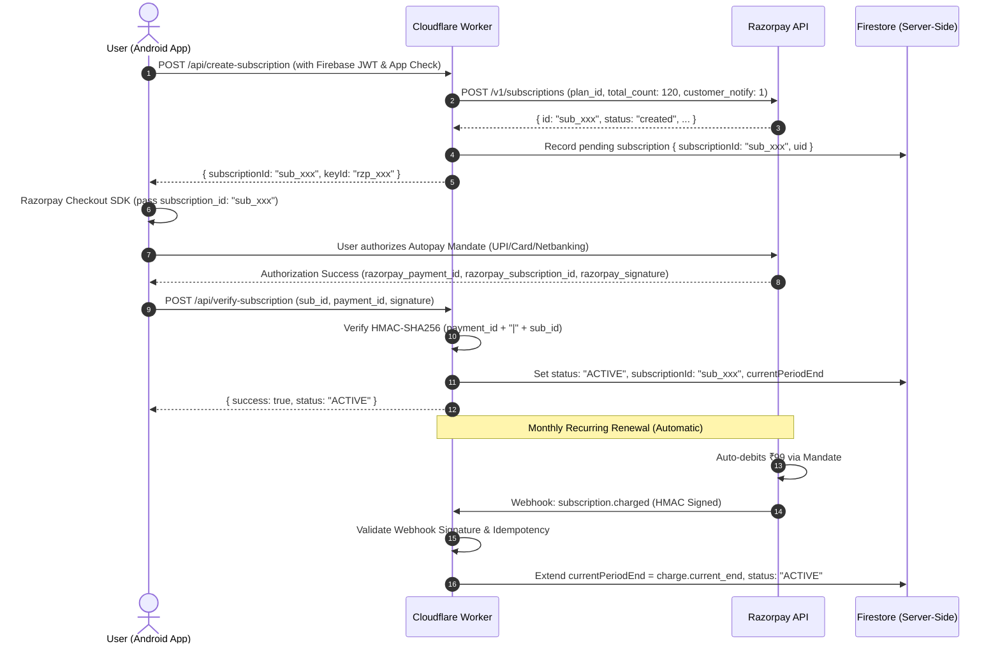
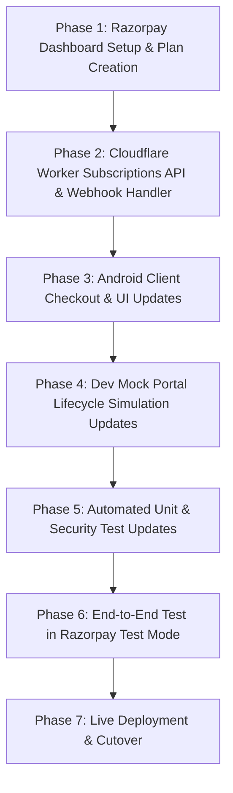

# RE:FOCUS — ₹99/Month Autopay Recurring Subscription Architecture & Migration Plan
**Document Version:** 1.0  
**Status:** ARCHITECTURE SPECIFICATION & MIGRATION PLAN (READ-ONLY)  
**Target:** Transition from One-Time ₹99/28-day Access to ₹99/Month Recurring Autopay (Razorpay Subscriptions & Plans API)

---

## Executive Summary

Re:Focus is transitioning its commercial subscription model from a **one-time payment of ₹99 for 28 days of access** to a **true monthly recurring autopay subscription of ₹99/month**.

| Dimension | Previous Architecture | Target Recurring Architecture |
|---|---|---|
| **Commercial Model** | One-time ₹99 payment $\to$ 28 days access | ₹99 INR / month recurring autopay |
| **Razorpay API Used** | Orders API (`/v1/orders`) | Subscriptions & Plans API (`/v1/plans`, `/v1/subscriptions`) |
| **Renewal Mechanism** | Manual repurchasing by user every 28 days | Automated recurring debit (UPI Autopay / e-Mandate / SI Cards) |
| **Client Checkout** | Opens Razorpay checkout with `order_id` | Opens Razorpay checkout with `subscription_id` |
| **Primary Webhook Trigger** | `payment.captured` / `order.paid` | `subscription.activated` / `subscription.charged` |
| **Authority & Security** | Server-authoritative via Cloudflare Worker | Server-authoritative via Cloudflare Worker (preserved) |
| **Trial Model** | 7-day server-side free trial | 7-day server-side free trial $\to$ recurring autopay mandate setup |

---

## A. Current Implementation Audit

The current codebase enforces strict server authority over entitlements, but is hardcoded to an **Orders (one-time payment)** paradigm:

1. **Android Client (`RazorpaySubscriptionPurchaseServiceImpl.kt`)**:
   - Calls `POST /api/create-order` requesting a one-time order for 9900 paise.
   - Passes `order_id: "order_xxx"` to Razorpay Android Checkout SDK.
   - On payment success, calls `POST /api/verify-payment` sending `order_id`, `payment_id`, and `signature`.
2. **Cloudflare Worker (`worker/src/index.js`)**:
   - `/api/create-order`: Calls Razorpay `POST /v1/orders` (`amount: 9900`, `currency: "INR"`).
   - `/api/verify-payment`: Validates HMAC-SHA256 of `order_id + "|" + payment_id`. Computes `currentPeriodEnd = now + 28 days (2,419,200,000 ms)`.
   - `/api/ensure-subscription`: Initializes 7-day trial (`trialEnd = now + 7 days`).
   - `/api/razorpay-webhook`: Listens to `order.paid`, `payment.captured`, `payment.failed`, `refund.created`, `refund.processed`.
3. **Data Model (`CloudSubscriptionDto.kt` & Firestore `/users/{uid}/subscription/status`)**:
   - Fields: `orderId`, `paymentId`, `status: "ACTIVE" | "TRIAL" | "EXPIRED" | "CANCELLED"`, `currentPeriodEnd`.
   - Assumes each payment adds a discrete 28-day validity window.
4. **Mock Infrastructure (`DevMockSubscriptionPurchaseServiceImpl.kt` & `DebugViewModel.kt`)**:
   - Simulates adding 28 days to `currentPeriodEnd` upon mock payment.

---

## B. Correct New Business Model

1. **Price & Interval:** ₹99 INR per month (inclusive of applicable taxes).
2. **Mandate Authorization:** User authorizes recurring autopay on first setup (via UPI Autopay, e-Mandate / Netbanking, or Debit/Credit Card standing instruction).
3. **7-Day Free Trial:**
   - New users receive 7 days of full premium access upon sign-up.
   - User can authorize the recurring subscription mandate at any time during or after the trial.
   - *Option A (Immediate Mandate with Delayed First Charge):* Subscription created with `start_at` = trial end timestamp.
   - *Option B (Trial First, In-App Upgrade at Day 7):* 7 days server-granted trial; mandate authorized to unlock ongoing monthly access.
4. **Automated Billing:** Every month, Razorpay automatically initiates the recurring charge.
5. **Subscription Continuity:** Remains active until explicitly cancelled by the user or halted due to payment failures after grace periods.

---

## C. Razorpay Subscription Architecture

### 1. Razorpay Plan Configuration
A reusable Plan is created once in Razorpay (via Dashboard or Worker initialization script):
```json
{
  "period": "monthly",
  "interval": 1,
  "item": {
    "name": "Re:Focus Monthly Premium",
    "amount": 9900,
    "currency": "INR",
    "description": "Monthly recurring access to Re:Focus premium features"
  }
}
```
*Generated Plan ID format:* `plan_xxxxxxxxxxxxxx`.

### 2. Subscription Lifecycle Flow


---

## D. Required Android Changes

### 1. Purchase Service (`RazorpaySubscriptionPurchaseServiceImpl.kt`)
- **Replace Endpoint:** Call `/api/create-subscription` instead of `/api/create-order`.
- **Checkout Payload:**
  ```kotlin
  val options = JSONObject().apply {
      put("name", "Re:Focus")
      put("description", "Monthly Premium Subscription (₹99/mo)")
      put("subscription_id", subscriptionId) // Replaces "order_id"
      put("currency", "INR")
      put("amount", 9900)
      put("prefill", JSONObject().apply {
          put("email", userEmail)
      })
  }
  ```
- **Verification Call:** Call `/api/verify-subscription` sending `subscription_id`, `payment_id`, and `signature`.

### 2. Subscription UI (`SubscriptionBottomSheet.kt` & Paywall)
- **Billing Terms Copy:** Update copy to: *"₹99 / month • Auto-renews monthly • Cancel anytime"*.
- **Mandate Notice:** Explicitly disclose RBI recurring mandate compliance notice (*"You are authorizing an automatic monthly charge of ₹99"*).
- **Manage Subscription:** Add a "Manage / Cancel Subscription" button in Settings that allows users to cancel their active autopay mandate.

---

## E. Required Cloudflare Worker Changes

### 1. New Endpoints
1. `POST /api/create-subscription`:
   - Validates Firebase ID token & App Check.
   - Calls Razorpay `POST https://api.razorpay.com/v1/subscriptions`.
   - Body:
     ```json
     {
       "plan_id": "plan_xxxxxxxxxxxxxx",
       "total_count": 120,
       "quantity": 1,
       "customer_notify": 1,
       "notes": { "uid": "FIREBASE_UID" }
     }
     ```
   - Returns `{ subscriptionId: "sub_xxx", keyId: "..." }`.

2. `POST /api/verify-subscription`:
   - Validates client signature: `HMAC_SHA256(razorpay_payment_id + "|" + razorpay_subscription_id, RAZORPAY_KEY_SECRET)`.
   - Fetches authoritative subscription state from Razorpay (`GET /v1/subscriptions/sub_xxx`).
   - Writes `status: "ACTIVE"`, `subscriptionId`, `currentPeriodEnd` into Firestore `/users/{uid}/subscription/status`.

3. `POST /api/cancel-subscription`:
   - Validates user auth.
   - Calls Razorpay `POST /v1/subscriptions/{sub_id}/cancel` with `{ "cancel_at_cycle_end": 1 }`.
   - Updates Firestore document: `cancelAtPeriodEnd: true`.

### 2. Webhook Handler Overhaul
- Update signature verification and event dispatching for subscription-specific lifecycle events.

---

## F. Required Firestore Data Model Changes

Path: `/users/{uid}/subscription/status`

```typescript
interface SubscriptionDocument {
  // Core Status
  status: "TRIAL" | "ACTIVE" | "PENDING" | "HALTED" | "CANCELLED" | "EXPIRED";
  
  // Trial Fields
  trialStartDate: number;       // Epoch ms
  trialEndDate: number;         // Epoch ms (now + 7 days)
  
  // Subscription / Mandate Fields
  subscriptionId: string;       // "sub_xxxxxxxxxxxxxx"
  planId: string;               // "plan_xxxxxxxxxxxxxx"
  latestPaymentId: string;      // "pay_xxxxxxxxxxxxxx"
  
  // Period & Lifecycle
  currentPeriodStart: number;   // Epoch ms
  currentPeriodEnd: number;     // Epoch ms (cycle end)
  cancelAtPeriodEnd: boolean;   // true if user cancelled but cycle is running
  nextBillingDate: number | null; // Epoch ms of upcoming debit
  
  // Metadata & Audit
  updatedAt: number;            // Epoch ms
  lastWebhookEventId: string;   // For idempotency tracking
}
```

---

## G. Required Webhook Events Matrix

The current 5 one-time payment webhook events must be replaced/extended with Razorpay Subscription lifecycle events:

| Webhook Event | Trigger Condition | Worker Action & Entitlement State |
|---|---|---|
| `subscription.authenticated` | Autopay mandate authenticated by bank/UPI | Mark mandate valid. Awaiting first charge. |
| `subscription.activated` | Initial charge successful, subscription active | `status = "ACTIVE"`, set `currentPeriodEnd = current_end`, unlock premium. |
| `subscription.charged` | Recurring auto-debit succeeded each month | `status = "ACTIVE"`, advance `currentPeriodEnd = current_end`, grant +1 month. |
| `subscription.pending` | Recurring charge failed; Razorpay retrying | `status = "PENDING"`, maintain access during grace period (3-5 days). |
| `subscription.halted` | All auto-debit retries failed | `status = "HALTED"`, revoke premium access immediately. |
| `subscription.cancelled` | User or admin cancelled subscription | `cancelAtPeriodEnd = true`. If cycle ended, `status = "CANCELLED"`. |
| `subscription.completed` | Total cycle count reached (120 months) | Set `status = "EXPIRED"`. |
| `payment.failed` | Specific payment attempt failed | Log failure, alert user to update payment method. |
| `refund.processed` | Payment refunded | If latest cycle refunded, set `status = "CANCELLED"`, revoke entitlement. |

---

## H. Trial Architecture

1. **New User Registration:**
   - Client calls `/api/ensure-subscription`.
   - Worker writes `trialStartDate = now`, `trialEndDate = now + 7 days`, `status = "TRIAL"`.
2. **Trial Expiration without Autopay:**
   - When `now > trialEndDate` and no `subscriptionId` exists, `SubscriptionRepository` resolves status as `EXPIRED`.
3. **Mandate Authorization during Trial:**
   - User can authorize autopay during the trial. Razorpay subscription starts immediately or at trial conclusion, unlocking uninterrupted recurring access.

---

## I. Cancellation Architecture

1. **User-Initiated Cancellation:**
   - User triggers "Cancel Subscription" in App Settings.
   - Worker calls `POST /v1/subscriptions/{sub_id}/cancel` with `cancel_at_cycle_end = 1`.
2. **Entitlement Rule on Cancellation:**
   - **Fairness Guarantee:** User paid for the current month; access MUST NOT be revoked immediately.
   - Firestore sets `cancelAtPeriodEnd: true`, keeping `status: "ACTIVE"` until `now >= currentPeriodEnd`.
   - Once `currentPeriodEnd` passes, client & server evaluate status as `CANCELLED` / `EXPIRED`.
   - Razorpay issues no further charges.

---

## J. Payment Failure & Dunning/Retry Architecture

1. **Auto-Debit Fails at Billing Cycle:**
   - Razorpay sends `subscription.pending` and `payment.failed`.
   - Razorpay automatically retries according to retry settings (typically 3 retries over 3–7 days).
2. **Grace Period Access:**
   - During `subscription.pending`, the user is granted a **3-day grace period** to avoid abrupt disruption.
   - UI displays a warning banner: *"Recurring payment failed. Please update your payment method to retain access."*
3. **Halt Condition:**
   - If retries fail completely, Razorpay sends `subscription.halted`.
   - Worker updates Firestore `status = "HALTED"`. Entitlement check returns false; app locks premium features.

---

## K. Refund Architecture

1. **Refund Triggered (Razorpay Dashboard or Support):**
   - Razorpay emits `refund.processed`.
2. **Entitlement Revocation:**
   - Worker identifies associated `subscriptionId` and `uid`.
   - Worker cancels the subscription on Razorpay (`/cancel`) to prevent future auto-debits.
   - Worker updates Firestore `status = "CANCELLED"`, `currentPeriodEnd = now` (immediate access revocation).

---

## L. Security Invariants

1. **Client Cannot Modify Subscription State:**
   - Firestore security rules strictly block `create`, `update`, `delete` on `/users/{uid}/subscription/status` for `request.auth.uid`.
2. **Server-Side Signature & UID Binding:**
   - Mandate checkout payload bound to Firebase UID via Razorpay notes.
   - Worker verifies `HMAC-SHA256(payment_id + "|" + subscription_id, secret)`.
3. **Webhook Signature Verification:**
   - Every webhook payload validated with `HMAC-SHA256(rawBody, RAZORPAY_WEBHOOK_SECRET)`.
4. **Idempotency & Replay Protection:**
   - Worker tracks `x-razorpay-event-id` in Firestore to ignore duplicate webhook deliveries.
5. **Clock-Tampering Immunity:**
   - Client uses trusted time delta against server clock.

---

## M. Mock Subscription Portal Changes

The DEBUG-only mock subscription system (`DevMockSubscriptionPurchaseServiceImpl.kt`, `DebugViewModel.kt`, and `SubscriptionDebugView.kt`) must be updated to simulate the full recurring autopay lifecycle:

1. **Simulate Mandate Authorization:** Emulate `subscription.activated` with `sub_mock_xxx`.
2. **Simulate Recurring Monthly Renewal:** Trigger simulated `subscription.charged` extending `currentPeriodEnd` by +30 days.
3. **Simulate Payment Failure & Grace Period:** Set status to `PENDING` with 3-day grace window.
4. **Simulate Dunning Halt:** Set status to `HALTED` (immediate lock).
5. **Simulate End-of-Cycle Cancellation:** Set `cancelAtPeriodEnd = true` while preserving access until period end.
6. **Simulate Refund / Revocation:** Set `status = "CANCELLED"` and period end to `now`.

---

## N. Tests That Must Be Added / Updated

1. **`Phase1PaymentSecurityTest.kt`:**
   - Update verification tests to assert `subscription_id` validation rather than `order_id`.
   - Test mandate signature verification failure modes.
2. **`SubscriptionRepositoryTest.kt`:**
   - Test recurring cycle renewal logic (`currentPeriodEnd` rollover).
   - Test `cancelAtPeriodEnd` remaining active until epoch expiration.
   - Test `PENDING` grace period evaluation vs `HALTED` lock.
3. **Worker Test Suite (Mock Webhooks):**
   - Test `subscription.activated`, `subscription.charged`, `subscription.pending`, `subscription.halted`, `subscription.cancelled` payloads.

---

## O. Razorpay Dashboard & KYC Requirements

To enable recurring payments on Razorpay:
1. **Business Banking / KYC Verification:** Live recurring payments require complete Razorpay KYC approval.
2. **Subscriptions Feature Activation:** Ensure "Subscriptions" product is enabled in Razorpay Dashboard.
3. **Payment Methods for Subscriptions:**
   - Enable **UPI Autopay** (highest conversion in India).
   - Enable **e-Mandate (Netbanking / Debit Card)**.
   - Enable **Cards with Recurring Support (RBI e-mandate compliant)**.
4. **Plan Creation:**
   - Create Plan `plan_refocus_monthly_99` (₹99.00 / month).
5. **Webhook Updates:**
   - Add the 9 subscription lifecycle events in Razorpay Dashboard Webhooks settings.

---

## P. Exact Migration Sequence



### Detailed Execution Steps:
1. **Phase 1 — Razorpay Dashboard:**
   - Create Plan for ₹99/month.
   - Configure Subscriptions webhook events pointing to Worker URL.
2. **Phase 2 — Cloudflare Worker:**
   - Implement `create-subscription`, `verify-subscription`, `cancel-subscription`.
   - Update webhook handler to process all subscription events.
   - Deploy worker with `npx wrangler deploy`.
3. **Phase 3 — Android Client:**
   - Update `RazorpaySubscriptionPurchaseServiceImpl.kt` for `subscription_id`.
   - Update `SubscriptionBottomSheet.kt` copy and disclosures.
   - Add cancellation endpoint call in Account / Settings.
4. **Phase 4 — Dev Mock Portal:**
   - Update mock simulator with recurring cycle, cancellation, and retry controls.
5. **Phase 5 — Test Verification:**
   - Update all unit and security test suites and verify 100% pass rate.
6. **Phase 6 — Test Mode E2E:**
   - Verify complete cycle in Razorpay Test Mode with UPI Autopay test handles.
7. **Phase 7 — Live Release.**
