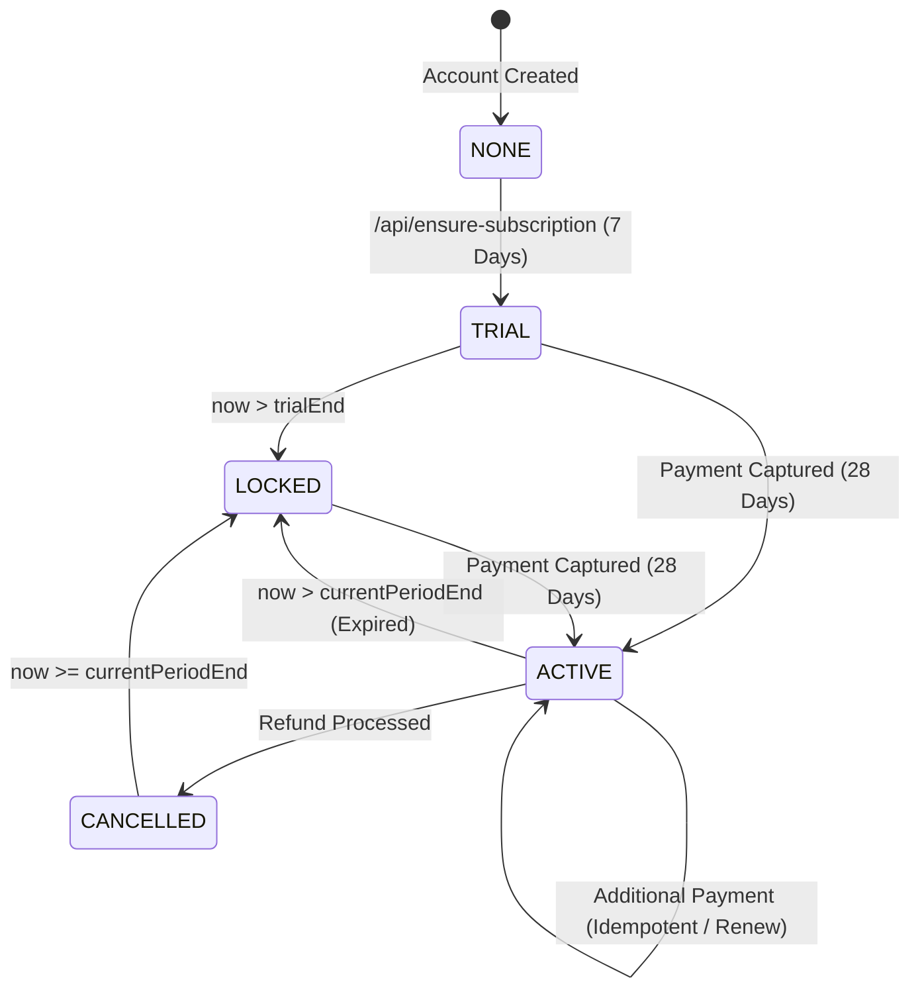

# RE:FOCUS — PAYMENT & SUBSCRIPTION FLOW: SOURCE OF TRUTH
**Document Version:** 1.0.0-PAYMENT-TRUTH  
**Audit Date:** September 19, 2026  
**Scope:** Complete End-to-End Audit of Android Client Checkout, Cloudflare Worker Endpoints, Firestore Subscriptions, Webhooks, and Security Guarantees.  
**Mode:** READ-ONLY AUDIT (Zero code, rules, or configuration modified)

---

## A. ACTUAL IMPLEMENTED BUSINESS MODEL (FROM SOURCE CODE)

Direct inspection of the Android client and Cloudflare Worker codebase reveals the **actual implemented commercial and access architecture**:

1. **Whole-App Access Gate (No Tier Splitting):**
   - There is **no feature-restricted "Free tier"** with partial analytics.
   - The entire application (tracking, overlay, strict mode, dashboard, analytics, calendar) is either **UNLOCKED** or **LOCKED** based on the central `AccessState` enum (`TRIAL`, `ACTIVE`, `LOCKED`).
   - When `LOCKED`, core tabs render `LockedAppScreen`; only **Settings** and the **Subscription Sheet** remain open for account management and purchase.

2. **Commercial Pricing & Billing Nature:**
   - **Model:** **One-Time Upfront Digital Access Fee** (Non-recurring in current Razorpay Standard Checkout integration).
   - **Price in Code:** `₹99.00 INR` (`9900 paise`).
   - **Duration Granted per Purchase:** Exactly **28 Calendar Days** calculated server-side from midnight UTC of the purchase day:
     $$\text{currentPeriodEnd} = \text{startOfToday} + (28 \times 24 \times 60 \times 60 \times 1000)\text{ ms}$$
   - **Razorpay Plan API Usage:** **NONE**. Razorpay Subscriptions/Plans API (which requires recurring mandates/e-mandates) is **not used**. Instead, standard Razorpay Orders API (`POST /v1/orders`) is used to generate a 1-time order of 9900 paise, and entitlement duration is calculated and persisted authoritatively on the server in Firestore.
   - **The `plan_monthly` Identifier:** In the client and worker code, `plan_monthly` is an internal string tag representing the 28-day access SKU; it does **not** bind to a recurring subscription ID on Razorpay.

---

## B. TRIAL RULES & LIFECYCLE

1. **Duration & Eligibility:**
   - **Length:** Exactly **7 Calendar Days** ($7 \times 24 \times 60 \times 60 \times 1000\text{ ms}$).
   - **Trigger:** Initialized via `POST /api/ensure-subscription` when an authenticated user first connects.
   - **Who Receives It:** Any newly registered Google account with no existing `/users/{uid}/subscription/status` record.
2. **Anti-Restart & Persistence:**
   - Trial timestamps (`trialStart`, `trialEnd`, `subscriptionStatus: "TRIAL"`) are written to the user's permanent Firestore document by the backend.
   - Logging out and logging back in with the same Google account **preserves the original `trialEnd` timestamp**.
   - If the current time exceeds `trialEnd`, the DTO automatically evaluates `isTrialActive = false` $\to$ `AccessState.LOCKED`.
   - The client **cannot reset or re-grant the trial** because client writes to `/subscription/*` are blocked by Firestore security rules (`allow write: if false;`).

---

## C. PAYMENT RULES & LIFECYCLE

1. **Order Creation (`POST /api/create-order`):**
   - Requires valid Firebase ID token in `Authorization: Bearer <token>`.
   - Worker verifies user is not `RESTRICTED`, `PENDING_DELETION`, or `DELETED`.
   - Worker calls `https://api.razorpay.com/v1/orders` using server secret:
     - Amount: `9900`
     - Currency: `"INR"`
     - Notes: `{ "firebase_uid": uid, "plan_id": "plan_monthly" }`
   - Returns `{ order_id, amount, currency, key_id }`.
2. **Client Standard Checkout:**
   - `RazorpaySubscriptionPurchaseServiceImpl.kt` opens Razorpay Standard Checkout SDK (`Checkout.open(activity, options)`).
   - Collects payment from user (UPI, Card, NetBanking).
3. **Dual Confirmation Pipeline (Client Verification + Server Webhook):**
   - **Path 1 (Immediate Client Verification):** On `onPaymentSuccess`, client POSTs `{ razorpay_order_id, razorpay_payment_id, razorpay_signature }` to `/api/verify-payment`. Worker validates HMAC-SHA256 signature, verifies payment state with Razorpay, and activates 28-day entitlement.
   - **Path 2 (Authoritative Server Webhook):** Razorpay server sends `payment.captured` or `order.paid` to `/api/razorpay-webhook`. Worker validates `X-Razorpay-Signature`, records idempotency record in `/razorpay_events/{eventId}`, and updates Firestore.

---

## D. ENTITLEMENT STATE MACHINE



| Current State | Trigger Event | Resulting State | App Access | Notes |
| :--- | :--- | :--- | :---: | :--- |
| **NONE** | `/api/ensure-subscription` | **`TRIAL`** | **UNLOCKED** | 7-day initial grace period |
| **TRIAL** | Time $> \text{trialEnd}$ | **`LOCKED`** | **LOCKED** | Paywall displayed on core tabs |
| **TRIAL / LOCKED** | `payment.captured` | **`ACTIVE`** | **UNLOCKED** | 28 days granted from today |
| **ACTIVE** | Time $> \text{currentPeriodEnd}$ | **`EXPIRED`** $\to$ **`LOCKED`** | **LOCKED** | Access locked until next payment |
| **ACTIVE** | `refund.processed` | **`CANCELLED`** $\to$ **`LOCKED`** | **LOCKED** | `currentPeriodEnd` set to now, locked immediately |

---

## E. WEBHOOK EVENT BEHAVIOR IN SOURCE CODE

| Webhook Event Name | Worker Handler Logic | Firestore Mutation | Impact on User |
| :--- | :--- | :--- | :--- |
| **`payment.captured`** | Validates amount == 9900 INR, checks idempotency, resolves UID from notes | `subscriptionStatus = "ACTIVE"`, `premium = true`, `currentPeriodEnd = +28d` | Unlocks app immediately |
| **`order.paid`** | Same reconciliation logic as `payment.captured` | `subscriptionStatus = "ACTIVE"`, `premium = true`, `currentPeriodEnd = +28d` | Unlocks app immediately |
| **`refund.processed`** | Validates payment ID matches active subscription | `subscriptionStatus = "CANCELLED"`, `premium = false`, `currentPeriodEnd = now` | Locks app immediately |
| **`refund.created`** | Immediate revocation trigger | `subscriptionStatus = "CANCELLED"`, `premium = false`, `currentPeriodEnd = now` | Locks app immediately |
| **`payment.failed`** | Logs failure safely | **No state change** (Preserves existing trial/active state if valid) | User notified in UI |
| *Other Events* | Returns HTTP 200 `{"status": "ignored_unhandled_type"}` | **No state change** | None |

---

## F. SECURITY GUARANTEES & DEFENSE-IN-DEPTH

1. **Zero Client Authority:**
   - [`firestore.rules`](file:///c:/Users/pavan/OneDrive/Documents/REEL/firestore.rules) contains:
     ```
     match /subscription/{documentId} {
       allow read: if isOwner(userId);
       allow write: if false;
     }
     ```
   - It is cryptographically impossible for a modified Android client to forge premium status or write directly to Firestore.
2. **Cryptographic Signature Verification:**
   - `/api/verify-payment` computes HMAC-SHA256(`${orderId}|${paymentId}`) using `RAZORPAY_KEY_SECRET` via Web Crypto API.
   - `/api/razorpay-webhook` computes HMAC-SHA256(rawBody) using `RAZORPAY_WEBHOOK_SECRET`.
3. **Cross-User Injection Protection:**
   - Order creation embeds the authenticated Firebase `uid` in Razorpay order `notes.firebase_uid`.
   - Webhook resolves `uid` strictly from `notes.firebase_uid` attached by the server, preventing User A from paying for User B's order.
4. **Out-of-Order & Replay Protection:**
   - Every webhook event is stored in Firestore collection `/razorpay_events/{eventId}` with `currentDocument.exists=false`. Duplicate events return `already_processed`.
   - If a late `payment.captured` arrives for an already `CANCELLED` subscription, `reconcileEntitlementActivation` detects the previous cancellation and rejects reactivation.
5. **Debug / Mock Code Isolation:**
   - The developer debug simulator screen is strictly wrapped in `if (BuildConfig.DEBUG)` in [`SettingsScreen.kt`](file:///c:/Users/pavan/OneDrive/Documents/REEL/app/src/main/java/com/reeltrak/app/features/settings/ui/SettingsScreen.kt#L236) and completely stripped in release builds.

---

## G. ACCOUNT LIFECYCLE & ISOLATION

- **Logout:**
  - Client unregisters Firestore listeners, clears cached in-memory profile, and executes `database.dailyReelDataDao.clearHistoricalDataExcept(todayStr)`.
  - Today's device-local reel count and limits are retained on the physical phone (to prevent quota bypass by logging out).
- **Account Switching (User A $\to$ User B):**
  - User B connects with a distinct Firebase UID $\to$ listens to `/users/{userB_uid}/subscription/status`.
  - User B receives User B's independent subscription and trial status; User A's past cloud history is inaccessible.
- **Account Deletion:**
  - Initiates 7-day grace period in `/users/{uid}/account/status` (`PENDING_DELETION`).
  - Worker `/api/create-order` and `/api/verify-payment` explicitly reject requests for accounts marked `PENDING_DELETION` or `DELETED`.

---

## H. SOURCE VS. DOCUMENTATION DISCREPANCIES

| Topic | Old Narrative Documentation Claim | Actual Source Code Reality | Status |
| :--- | :--- | :--- | :---: |
| **Recurring Billing** | Some early docs referred to "Monthly Recurring Subscription". | Code implements **One-Time Checkout (₹99 for 28 Days)**. No recurring auto-debit. | **CLARIFIED** |
| **Razorpay Plans** | Early docs mentioned configuring a Plan ID in Razorpay Dashboard. | **No Plan ID needed in Razorpay.** Code uses Standard Orders API (`/v1/orders`) with internal tag `plan_monthly`. | **CLARIFIED** |
| **Trial Length** | Fully aligned across code and docs. | **7 Calendar Days** (Enforced server-side via `trialEnd`). | **ALIGNED** |
| **Worker Base URL** | Some docs had `refocus-api.pavan-yarakala.workers.dev`. | Canonical live URL is `https://refocus-razorpay-worker.refocus-razorpay-worker.workers.dev`. | **RESOLVED** |

---

## I. CHECKLIST BEFORE LIVE RAZORPAY ACTIVATION

Before flipping Razorpay from Test mode to Live mode:

- [x] Cloudflare Worker deployed and responding at `https://refocus-razorpay-worker.refocus-razorpay-worker.workers.dev`.
- [x] All 4 Cloudflare secrets configured (`FIREBASE_SERVICE_ACCOUNT_KEY`, `RAZORPAY_KEY_ID`, `RAZORPAY_KEY_SECRET`, `RAZORPAY_WEBHOOK_SECRET`).
- [x] Razorpay Dashboard Webhook URL created with the 5 required events (`payment.captured`, `order.paid`, `refund.processed`, `refund.created`, `payment.failed`) and active status.
- [ ] **Complete Razorpay Business KYC & Activation** in Razorpay Dashboard (to enable live INR transactions).
- [ ] **Ensure Live Key ID and Secret** are uploaded to Cloudflare via `npx wrangler secret put RAZORPAY_KEY_ID` and `RAZORPAY_KEY_SECRET` when switching from test keys to live keys.
