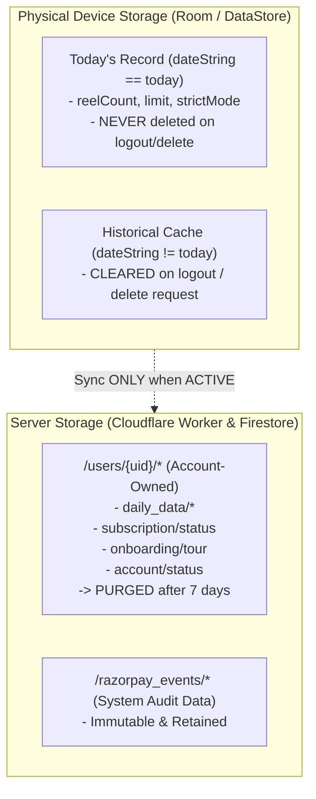

# PHASE 2 — ACCOUNT LIFECYCLE & DATA DELETION SECURITY REMEDIATION REPORT
**VULNERABILITIES ADDRESSED:** `VULN-05` (Missing In-App Account Deletion) & `VULN-14` (Account Deletion Recovery / Soft-Delete Grace Period)

---

## 1. Executive Summary

In Phase 2, we implemented the complete, server-authoritative account deletion and lifecycle recovery system for Re:Focus.

The implementation strictly preserves the core product requirement from Phase 0 and Phase 1:
1. **Device-Local Today Enforcement:** Today's daily reel/Shorts tracking record (`dateString == today`) remains permanently device-local and is **NEVER** deleted or reset during logout, account deletion requests, or account switching.
2. **Account-Owned Historical Cache:** Historical Room records (`dateString != today`) and account-specific preferences are cleared upon deletion request / logout.
3. **Server-Authoritative Grace Period:** A 7-day soft-delete grace period (`PENDING_DELETION`) is computed, scheduled, and validated by the backend Cloudflare Worker using server time.
4. **Permanent Purge:** Upon expiration, all account-owned Firestore documents under `/users/{uid}/*` and the Firebase Auth user record are permanently purged via the Google Identity Toolkit / Firestore REST API. System audit events under `/razorpay_events/*` remain intact for financial/legal compliance.

---

## 2. Exact Files Changed

| File Path | Description of Changes |
| :--- | :--- |
| [`worker/src/index.js`](file:///c:/Users/pavan/OneDrive/Documents/REEL/worker/src/index.js) | Implemented `POST /api/account/request-deletion`, `POST /api/account/cancel-deletion`, `GET /api/account/status`, `purgeAccountData(uid, env)`, and `deleteFirebaseAuthUser(uid, env)`. Added lifecycle status checks to prevent subscription/order creation on pending/deleted accounts. |
| [`app/src/main/java/com/reeltrak/app/domain/models/AccountStatus.kt`](file:///c:/Users/pavan/OneDrive/Documents/REEL/app/src/main/java/com/reeltrak/app/domain/models/AccountStatus.kt) | Added `PENDING_DELETION` and `DELETED` enum entries with parsing support. |
| [`app/src/main/java/com/reeltrak/app/domain/models/AccountAccessInfo.kt`](file:///c:/Users/pavan/OneDrive/Documents/REEL/app/src/main/java/com/reeltrak/app/domain/models/AccountAccessInfo.kt) | Added `deletionScheduledFor`, `deletionRequestedAt`, `isPendingDeletion`, `isDeleted`, and `isAllowedAccess` properties. |
| [`app/src/main/java/com/reeltrak/app/domain/repository/AccountRepository.kt`](file:///c:/Users/pavan/OneDrive/Documents/REEL/app/src/main/java/com/reeltrak/app/domain/repository/AccountRepository.kt) | Added `requestAccountDeletion(): Result<Long>` and `cancelAccountDeletion(): Result<Unit>`. |
| [`app/src/main/java/com/reeltrak/app/data/repository/AccountRepositoryImpl.kt`](file:///c:/Users/pavan/OneDrive/Documents/REEL/app/src/main/java/com/reeltrak/app/data/repository/AccountRepositoryImpl.kt) | Added real-time listening & snapshot parsing for deletion timestamp fields, and implemented network requests to Worker deletion endpoints. |
| [`app/src/main/java/com/reeltrak/app/core/sync/SyncManager.kt`](file:///c:/Users/pavan/OneDrive/Documents/REEL/app/src/main/java/com/reeltrak/app/core/sync/SyncManager.kt) | Added `isAccountEligibleForSync(uid)` checks to `backupToCloud`, `backupSpecificDay`, `restoreFromCloud`, and `performLegacyMigration` to prevent data resurrection for non-ACTIVE accounts. |
| [`app/src/main/java/com/reeltrak/app/core/sync/SyncWorker.kt`](file:///c:/Users/pavan/OneDrive/Documents/REEL/app/src/main/java/com/reeltrak/app/core/sync/SyncWorker.kt) | Added `AccountRepository` injection and account status check in `doWork()` to abort background uploads if account is not `ACTIVE`. |
| [`app/src/main/java/com/reeltrak/app/data/repository/OnboardingRepositoryImpl.kt`](file:///c:/Users/pavan/OneDrive/Documents/REEL/app/src/main/java/com/reeltrak/app/data/repository/OnboardingRepositoryImpl.kt) | Added `AccountRepository` injection, `isAccountEligibleForWrite(uid)` check, and mid-flight auth UID validation in `setAppTourCompleted()` to prevent unauthorized writes when account is `PENDING_DELETION`, `DELETED`, or `RESTRICTED` (Fix for Finding F-01). |
| [`app/src/main/java/com/reeltrak/app/features/settings/viewmodel/SettingsViewModel.kt`](file:///c:/Users/pavan/OneDrive/Documents/REEL/app/src/main/java/com/reeltrak/app/features/settings/viewmodel/SettingsViewModel.kt) | Added `requestAccountDeletion()` and state management. |
| [`app/src/main/java/com/reeltrak/app/features/settings/ui/SettingsScreen.kt`](file:///c:/Users/pavan/OneDrive/Documents/REEL/app/src/main/java/com/reeltrak/app/features/settings/ui/SettingsScreen.kt) | Added "Delete Account" button and high-consequence confirmation dialog requiring typing `"DELETE"`. |
| [`app/src/main/java/com/reeltrak/app/features/auth/LoginViewModel.kt`](file:///c:/Users/pavan/OneDrive/Documents/REEL/app/src/main/java/com/reeltrak/app/features/auth/LoginViewModel.kt) | Added `PendingDeletion` and `AccountDeleted` state handling, explicit recovery method `restoreAccount()`, and `keepScheduledDeletion()`. |
| [`app/src/main/java/com/reeltrak/app/features/auth/ui/LoginScreen.kt`](file:///c:/Users/pavan/OneDrive/Documents/REEL/app/src/main/java/com/reeltrak/app/features/auth/ui/LoginScreen.kt) | Added dedicated recovery dialog for accounts in `PENDING_DELETION` and blocked dialog for `DELETED`. |
| [`app/src/test/java/com/reeltrak/app/security/Phase2AccountDeletionSecurityTest.kt`](file:///c:/Users/pavan/OneDrive/Documents/REEL/app/src/test/java/com/reeltrak/app/security/Phase2AccountDeletionSecurityTest.kt) | Created comprehensive unit test suite covering all Phase 2 test requirements, including F-01 onboarding write eligibility and UID race protection. |

---

## 3. Data Ownership & Storage Architecture



---

## 4. State Machine & Endpoint Specifications

### Account State Machine
```
   [ACTIVE] ------------(POST /api/account/request-deletion)------------> [PENDING_DELETION]
      ^                                                                         |
      |                                                                         |
      +---(POST /api/account/cancel-deletion within 7 days)                     |
                                                                                | (7 days elapse)
                                                                                v
                                                                            [DELETED]
                                                                                |
                                                                                v
                                                                     [purgeAccountData(uid)]
                                                                     + [deleteAuthUser(uid)]
```

### Endpoints
1. **`POST /api/account/request-deletion`**:
   - **Auth:** Requires valid Firebase ID token (`Bearer <token>`).
   - **UID Source:** Derived solely from verified JWT payload (`payload.uid`).
   - **Deadline:** Server computes `deletionScheduledFor = server_now + 7 days`.
   - **Idempotency:** If already `PENDING_DELETION`, retains existing deadline without extending it.
2. **`POST /api/account/cancel-deletion`**:
   - **Auth:** Requires valid Firebase ID token.
   - **Server Time Check:** Validates `now <= deletionScheduledFor`.
   - **Success:** Restores status to `ACTIVE`.
   - **Expired:** Transitions to `DELETED`, triggers immediate purge, and returns `HTTP 410 Gone`.
3. **`GET /api/account/status`**:
   - Returns authoritative state. If `PENDING_DELETION` deadline has passed, lazily executes purge and returns `HTTP 410 Gone`.

---

## 5. Security & Race Condition Defenses

1. **Delete Request vs Sync:** `SyncManager` and `SyncWorker` evaluate account status before performing writes. If status is `PENDING_DELETION` or `DELETED`, all uploads and cloud restore operations immediately abort.
2. **Data Resurrection Protection:** No initialization flow (onboarding, subscription ensure, sync) can write to Firestore for accounts that are not `ACTIVE`.
3. **No Android Service Account Credentials:** Android uses only Firebase client tokens. The server performs all privileged Firestore mutations and Firebase Auth Identity Toolkit calls.
4. **Audit Data Immunity:** `purgeAccountData(uid, env)` explicitly targets only `/users/{uid}/*` and preserves `/razorpay_events/*`.

---

## 6. Verification & Build Results

### Automated Unit Tests
```
$ ./gradlew testDebugUnitTest
BUILD SUCCESSFUL in 33s
32 actionable tasks: 11 executed, 21 up-to-date
```
- `Phase0SecurityRemediationTest`: **PASS**
- `Phase1PaymentSecurityTest`: **PASS**
- `Phase2AccountDeletionSecurityTest`: **PASS**

### Release Build
```
$ ./gradlew assembleRelease
BUILD SUCCESSFUL in 2m 8s
51 actionable tasks: 10 executed, 41 up-to-date
```
- Merged Manifest Verification: **PASS**
- ProGuard / R8 Shrinking & Minification: **PASS**
- Output: `app/build/outputs/apk/release/app-release-unsigned.apk`
