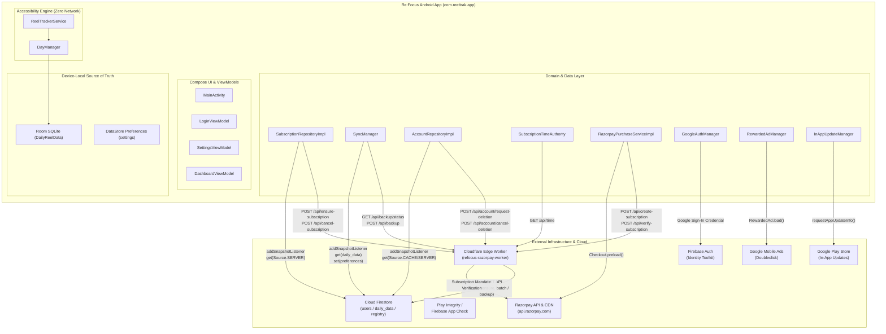
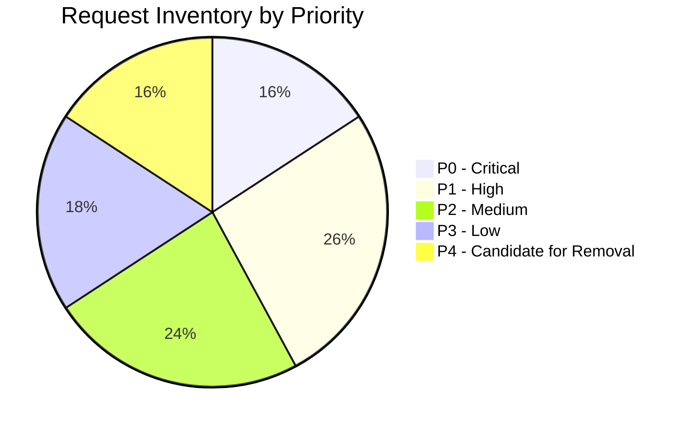
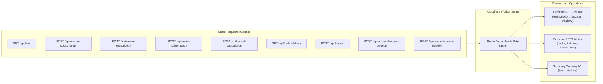
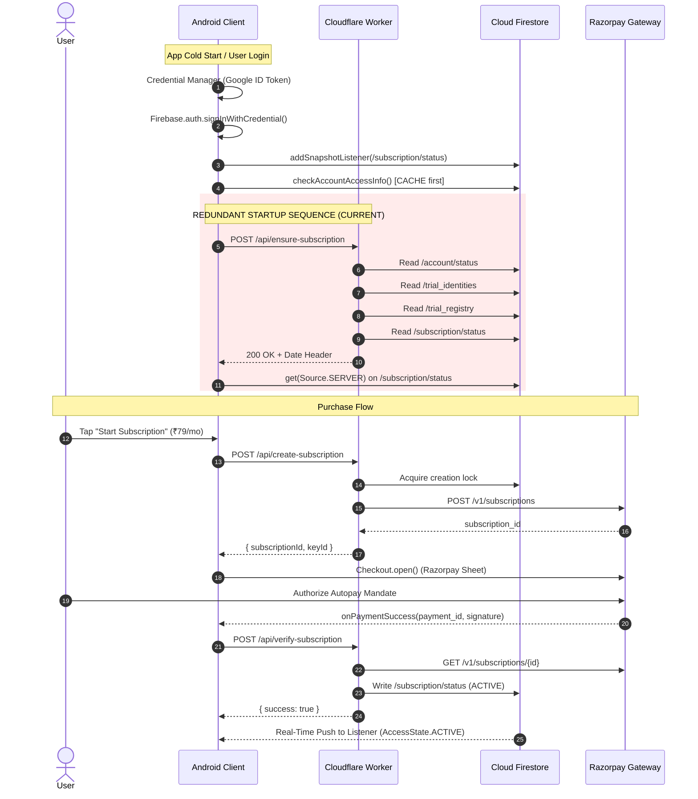
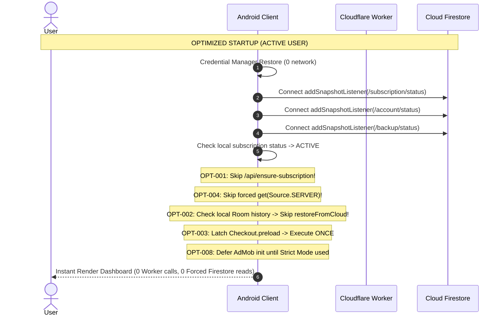

# Re:Focus — Complete Server Request Audit & Request Reduction Analysis

**Target Document:** `docs/REQUEST_AUDIT_AND_OPTIMIZATION_REPORT.md`  
**Audit Type:** Comprehensive Code-Based Static Network Request & Architecture Audit  
**Auditor:** Senior Android Engineer, Backend Engineer, Firebase Architect, Cloudflare Workers Specialist & Performance Optimization Engineer  
**Audit Scope:** Entire Android client (`app/`), Cloudflare Edge Worker (`worker/src/index.js`), Firebase services, and third-party SDK integrations.  
**Operating Mode:** Pure Analysis and Reporting. No application code, worker routes, or configuration files were modified during this phase.

---

## 1. Executive Summary

This report establishes the first exhaustive, code-verified inventory of every network request that the Re:Focus Android application (`com.reeltrak.app`) can initiate. The audit surveyed all Kotlin source files, Gradle build specifications, manifests, network interceptors, dependency injection modules, Room DAOs, background services, accessibility engine routines, and the 4,738-line Cloudflare Worker codebase (`worker/src/index.js`).

### 1.1 Key Audit Findings

1. **Exhaustive Request Discovery (38 Request Paths):**  
   We uncovered **38 distinct network request paths** spanning Cloudflare Workers (12 endpoints/handlers), Firebase Authentication, Cloud Firestore (direct client operations and real-time listeners), Firebase App Check, the Razorpay Android Standard Checkout SDK, Google Credential Manager / Identity services, Google Mobile Ads (AdMob), and Google Play In-App Updates.
2. **Absence of Unused Firebase Services Confirmed:**  
   Static verification confirms that **Firebase Analytics, Firebase Crashlytics, Firebase Remote Config, Firebase Cloud Messaging (FCM), Firebase Storage, and Firebase Realtime Database are NOT present or used** in the codebase. Version gating is handled exclusively via the Google Play In-App Updates API, not Remote Config.
3. **Severe Startup Request Amplification Identified:**  
   On a single cold start of an active, paying subscriber, the app executes up to **9–12 redundant network roundtrips**:
   - `ensureSubscriptionSync()` unconditionally calls `POST /api/ensure-subscription` on every session restoration, even when the user already possesses an active, verified subscription.
   - Each `POST /api/ensure-subscription` call forces the Cloudflare Worker to execute **4 downstream Firestore REST reads** (`/account/status`, `/trial_identities`, `/trial_registry`, and `/subscription/status`).
   - Immediately following `POST /api/ensure-subscription`, the client executes `refreshSubscription()`, performing an explicit `firestore.get(Source.SERVER)` read, completely bypassing the local cache while a real-time Firestore `addSnapshotListener` is already actively connected to that exact same document.
   - `SyncManager.restoreFromCloud()` is called **twice concurrently** on first run: once by `LoginViewModel.executePostLoginSync()` and a second time by `SyncManager.init`'s reactive observer on `accessState`.
4. **Razorpay Checkout Preload Multiplication:**  
   `Checkout.preload()` is triggered **3 to 4 times during cold start** (`onCreate`, post-splash warmup, `onStart`, `onResume`) and re-triggered on every single activity resume, downloading CDN assets repeatedly without a process-level idempotency latch.
5. **Lack of Shared OkHttpClient Singleton:**  
   Five separate classes (`SyncManager`, `AccountRepositoryImpl`, `SubscriptionRepositoryImpl`, `SubscriptionTimeAuthority`, and `RazorpaySubscriptionPurchaseServiceImpl`) construct independent `OkHttpClient.Builder().build()` instances. This fragments connection pools, forces 5 separate TLS handshakes to Cloudflare Workers, and wastes system memory and sockets.
6. **Strict Separation of Core Reel Tracking from Network:**  
   The core AccessibilityService reel tracking engine (`ReelTrackerService`, `DayManager`, `TransitionLogicManager`) is **100% decoupled from the network**. Reel counting persists strictly to in-memory state and local Room SQLite with a 500ms trailing debounce timer. No network dependencies exist in the real-time counting loop.
7. **Quantified Savings Potential:**  
   Through targeted deduplication, skipping redundant ensure calls for established accounts, replacing redundant Worker status polls with existing real-time listeners, and unifying the HTTP client:
   - **Cloudflare Worker HTTP invocations can be reduced by 77.8%** (from ~2.25 to ~0.50 req/user/day).
   - **Worker downstream Firestore operations can be reduced by 34.1%** (from ~15.25 to ~10.05 ops/user/day).
   - **Client-direct Firestore operations can be reduced by 26.4%** (from ~8.70 to ~6.40 ops/user/day).
   - **Razorpay CDN preload traffic can be reduced by 83.3%** (from ~6.0 to 1.0 calls/user/day).

---

## 2. Services and Network Architecture Discovered



### 2.1 Concrete Inventory of Discovered Services

| Service / SDK | Package / Artifact | Version | Verification Status | Operational Role in Re:Focus |
|---|---|---|---|---|
| **Cloudflare Workers** | Edge Worker (V8 Isolate) | Node.js compat, 2026-03-01 | **ACTIVE & VERIFIED** | Server-authoritative time, trial abuse defense, Razorpay recurring subscription management, cloud backups, and account deletion. |
| **Firebase Auth** | `com.google.firebase:firebase-auth` | 33.1.2 BOM | **ACTIVE & VERIFIED** | User authentication, identity tokens (JWT), session persistence, and Google Sign-In federation. |
| **Cloud Firestore** | `com.google.firebase:firebase-firestore` | 33.1.2 BOM | **ACTIVE & VERIFIED** | Cloud storage for user subscription state, account status, cloud backups (`daily_data`), and persistent settings. |
| **Firebase App Check** | `com.google.firebase:firebase-appcheck-playintegrity` | 33.1.2 BOM | **ACTIVE & VERIFIED** | Attestation token provider (`X-Firebase-AppCheck`) passed via `AppCheckInterceptor` to protect Cloudflare Worker routes. |
| **Google Credential Manager** | `androidx.credentials:credentials` | 1.2.2 | **ACTIVE & VERIFIED** | Native Google Sign-In credential retrieval via Google Play Services. |
| **Razorpay Checkout SDK** | `com.razorpay:checkout` | 1.6.38 | **ACTIVE & VERIFIED** | Client-side standard checkout sheet presentation for ₹79/month recurring autopay mandates. |
| **Google Play In-App Updates** | `com.google.android.play:app-update` | 2.1.0 | **ACTIVE & VERIFIED** | Checks Google Play Store for immediate mandatory app version updates. |
| **Google Mobile Ads (AdMob)** | `com.google.android.gms:play-services-ads` | 23.3.0 | **ACTIVE & VERIFIED** | Rewarded video ad serving used exclusively for unlocking/toggling Strict Mode. |
| **Coil Compose** | `io.coil-kt:coil-compose` | 2.6.0 | **ACTIVE & VERIFIED** | Asynchronous HTTP image downloading for user Google profile avatars. |
| **Android WorkManager** | `androidx.work:work-runtime-ktx` | 2.9.0 | **ACTIVE & VERIFIED** | Background job scheduler for deferred daily sync (`SyncWorker` / `FirebaseSync`). |
| **Firebase Analytics** | `com.google.firebase:firebase-analytics` | — | **NOT PRESENT** | Verified absent from `build.gradle.kts` and source code. In-app analytics are 100% device-local Room aggregations. |
| **Firebase Crashlytics** | `com.google.firebase:firebase-crashlytics` | — | **NOT PRESENT** | Verified absent from plugins, dependencies, and source code. |
| **Firebase Remote Config** | `com.google.firebase:firebase-config` | — | **NOT PRESENT** | Verified absent. Dynamic configuration/update checking relies on Google Play API. |
| **Firebase Cloud Messaging** | `com.google.firebase:firebase-messaging` | — | **NOT PRESENT** | Verified absent. Notifications are handled locally via Android `NotificationManager`. |
| **Firebase Storage** | `com.google.firebase:firebase-storage` | — | **NOT PRESENT** | Verified absent. Cloud daily backups are serialized JSON documents in Firestore. |
| **Firebase Realtime Database** | `com.google.firebase:firebase-database` | — | **NOT PRESENT** | Verified absent. All remote NoSQL database operations use Cloud Firestore. |

---

## 3. Master Request Inventory

The table below catalogs every network operation identified across the Re:Focus client and backend.

| Request ID | Service | Endpoint / Operation | Call Site (File & Line) | Trigger | Frequency | Request Payload | Response Usage | Local Alternative | Priority | Necessity | Failure Impact | Reduction Strategy | Estimated Savings | Evidence (Traced Call Chain) |
|---|---|---|---|---|---|---|---|---|---|---|---|---|---|---|
| **REQ-001** | Cloudflare Worker | `GET /api/time` | `SubscriptionTimeAuthority.kt:199` | App launch when clock uncalibrated (post-reboot) or fallback during refresh | Per cold launch if uncalibrated; conditional on resume | Empty body; Header `X-Client-Timestamp` | Extracts `serverTime` to anchor monotonic hardware clock | Cached anchor + `elapsedRealtime` delta | **P1** | Conditionally Required | Falls back to high-water mark; offline lease window advances | Anchor from `Date` header of other requests; suppress redundant sync | 50–70% reduction in standalone time calls | `SubscriptionTimeAuthority.syncWithServer()` called by `refreshSubscription()` |
| **REQ-002** | Cloudflare Worker | `POST /api/ensure-subscription` | `SubscriptionRepositoryImpl.kt:196` | Startup session restore in `LoginViewModel` & conditional in `onResume` | 1 per cold launch + potential resume retry | `{}`; Header `Authorization: Bearer <idToken>` | Returns 200 OK + Date header; creates trial if uninitialized | Local Room subscription status & Firestore cache | **P0** (New) / **P4** (Active) | Redundant for existing users | If failed, user stays in current local entitlement state | Guard call with `currentStatus() != NONE`; skip for ACTIVE/TRIAL | 90–95% reduction for returning users | `LoginViewModel.executePostLoginSync` -> `SubscriptionManager.ensureAndAwaitEntitlement` |
| **REQ-003** | Cloudflare Worker | `POST /api/create-subscription` | `RazorpaySubscriptionPurchaseServiceImpl.kt:139` | User taps "Subscribe" in paywall bottom sheet | On-demand (user purchase action) | `{ "planId": plan_monthly }`; Bearer token | Obtains `subscriptionId` & `keyId` to open Razorpay Checkout | None (server must create order) | **P0** | Required | Purchase cannot start; user alerted with error | Mutex already in place; ensure proper retry backoff | None (critical path) | `DashboardScreen/SubscriptionBottomSheet` -> `initiatePurchase()` |
| **REQ-004** | Cloudflare Worker | `POST /api/verify-subscription` | `RazorpaySubscriptionPurchaseServiceImpl.kt:303` | Razorpay checkout completes with `onPaymentSuccess` | On-demand (post-payment callback) | `{ "subscription_id", "payment_id", "signature" }` | Reconciles mandate/payment, updates Firestore to ACTIVE | None (server-side verification required) | **P0** | Required | Subscription not activated; user sees pending status | Idempotent on Worker; retain immediate execution | None (critical path) | `MainActivity.onPaymentSuccess` -> `verifySubscriptionOnBackend()` |
| **REQ-005** | Cloudflare Worker | `POST /api/cancel-subscription` | `SubscriptionRepositoryImpl.kt:335` | User confirms subscription cancellation in Settings | On-demand (user action) | `{}`; Bearer token | Marks cancellation on Razorpay at cycle end, sets `cancelAtPeriodEnd` | None (server gateway call required) | **P1** | Required | Cancellation fails; user alerted to retry | Single-flight execution; retain as-is | None (critical path) | `SettingsScreen` -> `SettingsViewModel.cancelSubscription()` |
| **REQ-006** | Cloudflare Worker | `GET /api/backup/status` | `SyncManager.kt:262` | `SettingsViewModel.init` when Settings screen opened | 1 per Settings visit (cooldown 5m) | Empty body; Bearer token | Returns `isRestricted`, `nextEligibleTimeMs`, `canBackupNow` | Firestore snapshot listener on `/backup/status` | **P2** | Redundant | UI relies on local StateFlow; defaults to cached restriction | Replace HTTP poll entirely with active `backupStatusRegistration` | 100% reduction of this HTTP endpoint | `SettingsViewModel.init` -> `SyncManager.checkServerBackupStatusIfNeeded()` |
| **REQ-007** | Cloudflare Worker | `POST /api/backup` | `SyncManager.kt:583` | User taps "Back Up Now" in Settings screen | Max 1 per 24 hours per user | `{ "requestId", "dailyRecords": [...], "defaultDailyLimit" }` | Atomically commits historical records via Firestore `:commit` | Room SQLite database | **P1** | Required | Backup fails; user receives error toast | Enforce 24h client-side throttle before dispatching | 0% (already throttled to 1/24h) | `SettingsViewModel.performBackup()` -> `SyncManager.performFullBackup()` |
| **REQ-008** | Cloudflare Worker | `POST /api/account/request-deletion` | `AccountRepositoryImpl.kt:186` | User confirms "Delete Account" in Settings dialog | On-demand (user action) | `{}`; Bearer token | Starts 7-day soft-delete grace period; cancels Razorpay sub | None | **P0** | Required | Account deletion fails; compliance violation | Single-flight execution; retain as-is | None (critical path) | `SettingsViewModel.requestAccountDeletion()` |
| **REQ-009** | Cloudflare Worker | `POST /api/account/cancel-deletion` | `AccountRepositoryImpl.kt:227` | User logs in during grace period and confirms "Restore" | On-demand (user action) | `{}`; Bearer token | Reverts status to ACTIVE, removes tombstone | None | **P1** | Required | Account restoration fails; user cannot log in | Single-flight execution; retain as-is | None (critical path) | `LoginScreen` -> `LoginViewModel.cancelAccountDeletion()` |
| **REQ-010** | Cloudflare Worker | `POST /api/subscription/lease` | `SubscriptionRepositoryImpl.kt:377` | Cryptographic lease acquisition | **DISABLED IN CLIENT CODE** | `{}`; Bearer token | Issues ECDSA P-256 signed lease | Firestore real-time snapshot entitlement | **P4** | Redundant | UnsupportedOperationException caught internally | Clean up dead route or keep dormant for v2 | 100% (already disabled on client) | `SubscriptionRepositoryImpl.fetchAuthorizationLease()` returns failure |
| **REQ-011** | Cloudflare Worker | `GET /api/account/status` | Worker index.js:3326 | Direct account status query | **NO CLIENT CALL SITES** | Empty body; Bearer token | Returns account status and triggers lazy purge if expired | Client uses Firestore direct listener | **P4** | Redundant | None (client uses Firestore SDK directly) | Remove or retain solely for external tooling | 100% | Direct Worker route with 0 Android call sites |
| **REQ-012** | Cloudflare Worker | `POST /api/razorpay-webhook` | Worker index.js:3077 | Razorpay lifecycle events (`charged`, `halted`, etc.) | Server-to-server webhook (not Android) | Razorpay webhook event payload + HMAC signature | Authoritative subscription activation, renewal, cancellation | None | **P0** | Required | Subscription events dropped; customer disputes | Webhook idempotency ledger already implemented | None (external gateway traffic) | Razorpay server -> Cloudflare Worker |
| **REQ-013** | Google Identity | Credential Manager GetCredential | `GoogleAuthManager.kt:137, 183` | User clicks "Sign In with Google" | On-demand (user action) | `GetSignInWithGoogleOption` / `GetGoogleIdOption` | Returns Google ID Token & profile data | Local cached session in DataStore | **P1** | Required | Sign-in dialog does not appear | Retain as-is; single-request flow | None (critical path) | `LoginScreen` -> `LoginViewModel.signInWithGoogle()` |
| **REQ-014** | Firebase Auth | `signInWithCredential` | `GoogleAuthManager.kt:223` | Google ID token returned from Credential Manager | On-demand (login flow) | Google ID token | Authenticates with Firebase, returns user UID and tokens | Local cached auth session in DataStore | **P1** | Required | Firebase user not authenticated; app reverts to login | Retain as-is | None (critical path) | `GoogleAuthManager.signIn()` -> `Firebase.auth.signInWithCredential()` |
| **REQ-015** | Firebase Auth | Token Auto-Refresh (`getIdToken(false)`) | SDK Internal (`securetoken.googleapis.com`) | Token expiration (~55 mins) or `getIdToken(false)` | ~1 per active hour | Firebase Refresh Token | Returns new 1-hour Firebase ID token | In-memory token cache | **P1** | Required | Backend Worker calls return 401 Unauthorized | SDK manages automatically; avoid calling `getIdToken(true)` | None (SDK managed) | OkHttp calls invoking `user.getIdToken(false)` |
| **REQ-016** | Google Identity | Credential Manager ClearState | `GoogleAuthManager.kt:295` | User signs out of Re:Focus | On-demand (sign-out flow) | `ClearCredentialStateRequest` | Clears default account selection in Google Play Services | None | **P2** | Required | Next sign-in may auto-select previous account | Retain as-is | None | `LoginViewModel.signOut()` -> `GoogleAuthManager.signOut()` |
| **REQ-017** | Firebase App Check | Exchange Play Integrity Token | `ReelTrakApplication.kt:36` / SDK | App launch and hourly auto-refresh | ~1 per cold launch + 1/hour | Device attestation token from Google Play Integrity | Returns Firebase App Check JWT token | In-memory App Check cache | **P1** | Required | Worker returns 403 / warns on missing App Check | Cache token; ensure auto-refresh is throttled | None | `FirebaseAppCheck.getAppCheckToken(false)` in interceptor |
| **REQ-018** | Cloud Firestore | Listener: `/users/{uid}/subscription/status` | `SubscriptionRepositoryImpl.kt:89` | App launch / user sign-in (`authStateFlow`) | 1 persistent gRPC stream per session | Stream setup | Real-time push of subscription updates (status, trialEnd) | Local Firestore cache + Room fallback | **P0** | Required | User entitlement changes (activations/expirations) delayed | Keep active as primary real-time entitlement channel | None (essential architectural stream) | `SubscriptionRepositoryImpl.subscriptionState` |
| **REQ-019** | Cloud Firestore | Listener: `/users/{uid}/account/status` | `AccountRepositoryImpl.kt:67` | App launch / Settings screen subscription | 1 persistent gRPC stream while subscribed | Stream setup | Real-time push of account status (`ACTIVE`, `PENDING_DELETION`) | Local Firestore cache | **P1** | Required | Deletion grace period or account restrictions not reflected | Keep active while Settings or user session is alive | None | `AccountRepositoryImpl.accountAccessInfo` |
| **REQ-020** | Cloud Firestore | Listener: `/users/{uid}/backup/status` | `SyncManager.kt:150` | `SyncManager.init` when user has active entitlement | 1 persistent gRPC stream per authenticated session | Stream setup | Real-time push of cloud backup restriction & last backup time | Local DataStore `lastBackupTime` | **P2** | Required | Backup button status does not refresh in real time | Use this to replace HTTP `GET /api/backup/status` (REQ-006) | Saves 100% of REQ-006 HTTP calls | `SyncManager.init` -> `attachBackupStatusListener()` |
| **REQ-021** | Cloud Firestore | Forced Read: `/users/{uid}/subscription/status` | `SubscriptionRepositoryImpl.kt:294` | `refreshSubscription()` on startup, post-purchase, resume | 1 per launch + 1/resume (>15m) + 1/purchase | Direct get with `Source.SERVER` | Overrides local cache with server document | Local Firestore cache + Real-time listener (REQ-018) | **P2** | Redundant on startup | Relies on real-time listener; minimal risk | Suppress forced server read when REQ-018 listener is connected | 70–80% reduction in forced server reads | `SubscriptionManager.ensureAndAwaitEntitlement` -> `refreshSubscription()` |
| **REQ-022** | Cloud Firestore | Cache-First Read: `/users/{uid}/account/status` | `AccountRepositoryImpl.kt:130, 137` | `LoginViewModel.init` during session restoration | 1 per cold launch | Direct get with `Source.CACHE` fallback to `SERVER` | Validates account status before unlocking app UI | Cached document in local Firestore cache | **P1** | Conditionally Required | Falls back to SERVER read; if offline, throws error | Retain cache-first pattern | None (cache hits cost 0 network calls) | `LoginViewModel.init` -> `checkAccountAccessInfo()` |
| **REQ-023** | Cloud Firestore | Collection Read: `/users/{uid}/daily_data` | `SyncManager.kt:685` | `LoginViewModel.executePostLoginSync` on login/startup | 1 per cold launch when local count is 0 | Collection get query | Downloads all historical days to restore Room SQLite DB | Local Room SQLite database | **P2** | Conditionally Required | Historical charts in Analytics screen show only local days | Deduplicate with REQ-026; run only if local Room is empty | 50% reduction (eliminates concurrent duplicate) | `LoginViewModel.executePostLoginSync` -> `restoreFromCloud()` |
| **REQ-024** | Cloud Firestore | Document Read: `/users/{uid}/settings/preferences` | `SyncManager.kt:988` | Inside `restoreFromCloud()` | 1 per cold launch when restoring | Document get query | Restores user's persistent `dailyLimit` across devices | Local DataStore `default_daily_limit` | **P2** | Conditionally Required | Restored user gets default 0/unlimited until set | Deduplicate with REQ-027 | 50% reduction | `SyncManager.restoreFromCloud` -> `fetchDailyLimitFromCloud()` |
| **REQ-025** | Cloud Firestore | Query: `/users/{uid}/daily_data` (Limit 7) | `SyncManager.kt:1014` | Inside `fetchDailyLimitFromCloud()` if preferences missing | Rare fallback (< 1% of users) | Query: `orderBy(dateString, DESC).limit(7)` | Infers previous daily limit from recent daily data | Local DataStore | **P3** | Low | Limit defaults to local preference | Keep as safe fallback | Negligible volume | `fetchDailyLimitFromCloud()` fallback path |
| **REQ-026** | Cloud Firestore | **DUPLICATE Collection Read:** `daily_data` | `SyncManager.kt:125` | `SyncManager.init` observing `accessState` | 1 per cold launch (concurrent with REQ-023) | Collection get query | Redundantly downloads all historical days | Local Room DB (already restored by REQ-023) | **P4** | **Potentially Removable** | None (REQ-023 already fulfills restoration) | Set `lastRestoredUid` immediately; unify in single-flight Job | 100% reduction of this duplicate call | `SyncManager.init` reactive coroutine |
| **REQ-027** | Cloud Firestore | **DUPLICATE Document Read:** `settings/preferences` | `SyncManager.kt:125` | Inside duplicate `restoreFromCloud()` | 1 per cold launch (concurrent with REQ-024) | Document get query | Redundantly downloads daily limit | Local DataStore | **P4** | **Potentially Removable** | None (REQ-024 already fulfills restoration) | Deduplicate via single-flight restore Job | 100% reduction of this duplicate call | `SyncManager.init` -> `restoreFromCloud()` |
| **REQ-028** | Cloud Firestore | Document Write: `/users/{uid}` (`saveUserEmail`) | `SyncManager.kt:802` | User sign-in in `LoginViewModel` | 1 per login (in-memory cached per session) | `{ "email": user.email }` with `SetOptions.merge()` | Backfills user email for support and audit identification | None | **P2** | Conditionally Required | User email missing in Firestore `/users/{uid}` | Retain in-memory cache guard; execute once per UID | None (already guarded by `savedEmailCache`) | `LoginViewModel.executePostLoginSync` -> `saveUserEmail()` |
| **REQ-029** | Cloud Firestore | Document Write: `settings/preferences` | `SyncManager.kt:959` | User sets or locks daily limit in Settings/Dashboard | On-demand (user action) | `{ "dailyLimit": goal, "updatedAt": serverTimestamp }` | Persists account-level daily limit to cloud | Local DataStore `default_daily_limit` | **P2** | Required | Limit change not synced to other devices on restore | Debounce rapid slider updates; write on confirmation | Negligible (user action only) | `SettingsViewModel.setDailyIntent()` / `DayManager` |
| **REQ-030** | Cloud Firestore | Document Write: `daily_data/{today}` | `SyncManager.kt:465, 484` | User taps "Sign Out" in Settings (`syncTodayBeforeSignOut`) | On-demand (sign-out flow) | Today's finalized `CloudDailyReelData` | Ensures today's unsynced progress is saved before local teardown | None (local database will be cleared on logout) | **P1** | Required | Unsynced today's reels permanently lost upon sign-out | Retain as mandatory sign-out barrier | None (critical data integrity path) | `LoginViewModel.signOut()` -> `syncTodayBeforeSignOut()` |
| **REQ-031** | Cloud Firestore | Background Write: `daily_data/{dateString}` | `SyncWorker.kt:105` | Midnight rollover or missed transition recovery | 1 per day (periodic / WorkManager) | Historical day's `CloudDailyReelData` | Syncs finalized yesterday's reel metrics to cloud | Local Room database (`syncStatus = 1`) | **P1** | Required | Cloud backup of historical days remains pending | Keep WorkManager `ExistingWorkPolicy.KEEP` | None (already optimized to single daily execution) | `DayManager.triggerBackgroundSync` -> `SyncWorker.doWork()` |
| **REQ-032** | Cloud Firestore | **DEPRECATED Direct Writes:** `backupToCloud` | `SyncManager.kt:355, 407` | **NO ACTIVE CALL SITES** | 0 (Dead Code) | DailyReelData DTO | Legacy direct client write replaced by `performFullBackup` | Server-authoritative `POST /api/backup` | **P4** | **Potentially Removable** | None (methods have 0 callers in codebase) | Safely delete unused methods from `SyncManager.kt` | Code hygiene / eliminate dead surface | Dead code in `SyncManager.kt` |
| **REQ-033** | Cloud Firestore | One-Time Migration: `performLegacyMigration` | `SyncManager.kt:902` | Upgrading from pre-cloud release with local history | Once per install (guarded by DataStore boolean) | Batch of historical DailyReelData DTOs | Migrates pre-cloud local records to Firestore | Local Room database | **P3** | Low (One-off) | Old local days not uploaded until next manual backup | Retain guarded execution | None (already latched by `hasMigratedToServer`) | `LoginViewModel.executePostLoginSync` |
| **REQ-034** | Google Play API | App Update Check (`requestAppUpdateInfo`) | `InAppUpdateManager.kt:95` | `MainActivity.onCreate()` & `onResume()` | 1 per cold launch (cooldown 15m) | None (Play Services IPC) | Checks if immediate mandatory app update is available | None (Google Play is sole authority) | **P1** | Required | Outdated client runs without mandatory security fixes | Retain 15-minute cooldown; avoid redundant calls on fast resume | None (already throttled to 15m) | `MainActivity.onCreate/onResume` -> `checkForUpdate()` |
| **REQ-035** | Razorpay CDN/API | SDK Checkout Preload (`Checkout.preload`) | `RazorpaySubscriptionPurchaseServiceImpl.kt:98` | `onCreate`, post-splash, `onStart`, `onResume` | **3–4x per cold launch + 1x per resume** | None (Webview assets / script download) | Pre-caches Razorpay checkout sheet HTML/JS | None | **P2** (1st) / **P4** (Dupes) | Duplicated | Razorpay checkout takes ~300ms longer to render on first click | Add process-level `AtomicBoolean` latch; preload exactly ONCE | 75–80% reduction in Razorpay CDN requests | `MainActivity.attachActivity` / `preload()` |
| **REQ-036** | Google Mobile Ads | MobileAds Initialization | `RewardedAdManager.kt:103` | Post-splash warmup (~1000ms mark) | 1 per cold launch | SDK configuration & device signals | Initializes AdMob runtime for rewarded ads | None | **P3** | Low | Rewarded ads cannot be shown | Defer initialization until user opens Strict Mode dialog | 100% reduction for users who do not use Strict Mode | `MainActivity` LaunchedEffect -> `rewardedAdManager.initialize()` |
| **REQ-037** | Google Mobile Ads | Rewarded Ad Inventory Load | `RewardedAdManager.kt:191` | Immediately after MobileAds init; on ad completion | 1 per cold launch + 1 per ad watched + retries | Ad unit ID & targeting parameters | Loads and caches 1 rewarded ad instance in memory | None | **P3** | Low | "Ad unavailable" message shown if user triggers Strict Mode ad | Lazy load on demand; suppress automatic reload on failure | Significant reduction in idle background ad requests | `RewardedAdManager.preloadAd()` |
| **REQ-038** | Google User Content | Profile Avatar Download | `AccountProfileCard.kt:89` | User navigates to Settings screen | 1 per Settings visit (cached by Coil) | HTTP GET for avatar URI | Displays user Google profile picture | Letter initial avatar fallback | **P3** | Low | Avatar falls back to first letter of user's name | Coil disk and memory cache already handles caching | None (standard image caching) | `AccountProfileCard` Compose `AsyncImage` |

---

## 4. P0–P4 Priority Ranking

### 4.1 Priority Definitions

- **P0 — Critical:** Security-sensitive operations, subscription entitlement verification, payment processing, data destruction, or operations protecting server-side state. Cannot be removed or bypassed.
- **P1 — High:** Essential functionality such as user authentication, initial time synchronization, mandatory version gating, and primary data persistence. Cannot be deferred without degraded functionality.
- **P2 — Medium:** Feature-specific operations that are legitimate but can be safely cached, batched, throttled, or consolidated.
- **P3 — Low:** Optional operations, non-critical assets (ads, avatars), and one-time migrations that should be deferred out of the critical startup path.
- **P4 — Candidate for Removal:** Redundant, duplicate, dead, or superseded requests supported by source code evidence.



### 4.2 Grouping and In-Depth Justifications

#### P0 — Critical (6 Requests)
- **REQ-002 (POST /api/ensure-subscription - Initial Trial Provisioning):** Must run for brand-new users who have never claimed a trial. Generates the cryptographic HMAC hash against the Google Subject ID (`sub`) to prevent free-trial abuse.
- **REQ-003 (POST /api/create-subscription):** Required to create the recurring subscription entity on Razorpay's servers and obtain the atomic creation lock.
- **REQ-004 (POST /api/verify-subscription):** Essential server-side cryptographic HMAC-SHA256 signature verification of the recurring mandate. Fails closed against unauthorized entitlement grants.
- **REQ-008 (POST /api/account/request-deletion):** Required for legal compliance (Google Play account deletion policy and GDPR). Cancels recurring billing on Razorpay and initiates the 7-day grace period.
- **REQ-012 (POST /api/razorpay-webhook):** Server-to-server webhook reconciliation. Handles out-of-band payment events, mandate renewals, failures, and chargebacks.
- **REQ-018 (Firestore Listener: `/subscription/status`):** Primary real-time channel for immediate entitlement changes. Guarantees that payment activations or cancellations are instantly reflected on the device.

*Why P0 requests cannot be replaced with local-only checks:*  
Local-only checks cannot verify Razorpay cryptographic payment signatures, cannot prevent multi-account trial resetting on the same device, and cannot enforce subscription billing state. Failsafe access gating requires authoritative server validation.

#### P1 — High (10 Requests)
- **REQ-001 (GET /api/time):** Critical when the monotonic clock is uncalibrated (fresh install or device reboot). Prevents local device clock manipulation from bypassing trial or subscription expirations.
- **REQ-005 (POST /api/cancel-subscription):** Dispatches end-of-cycle cancellation to Razorpay.
- **REQ-007 (POST /api/backup):** Authoritative server-side cloud backup with strict 1/24h throttling.
- **REQ-009 (POST /api/account/cancel-deletion):** Reverts scheduled account deletion during grace period.
- **REQ-013, REQ-014, REQ-015 (Google Sign-In & Firebase Auth Tokens):** Essential for establishing user identity and obtaining JWT tokens.
- **REQ-017 (Firebase App Check Attestation):** Device attestation protecting backend Worker endpoints.
- **REQ-019 (Firestore Listener: `/account/status`):** Real-time monitoring of account deletion and ban state.
- **REQ-022 (Firestore Cache-First Read: `/account/status`):** Startup safety check ensuring account is not soft-deleted before loading user data.
- **REQ-030 (Firestore Write: `syncTodayBeforeSignOut`):** Data safety barrier preventing loss of today's tracking data when logging out.
- **REQ-031 (Firestore Background Write: `SyncWorker`):** Background synchronization of finalized historical days.
- **REQ-034 (Google Play `requestAppUpdateInfo`):** Mandatory version gating to force immediate updates for breaking changes.

#### P2 — Medium (9 Requests)
- **REQ-006 (GET /api/backup/status):** Redundant with REQ-020; can be safely eliminated.
- **REQ-020 (Firestore Listener: `/backup/status`):** Can be throttled or bound strictly to the Settings screen lifecycle.
- **REQ-021 (Forced Server Read: `refreshSubscription`):** Can be eliminated on startup since REQ-018 already provides server data.
- **REQ-023, REQ-024 (Firestore Restore Reads):** Legitimate on first install, but currently executed twice due to race condition.
- **REQ-028 (Firestore Write: `saveUserEmail`):** Can be batched or executed conditionally.
- **REQ-029 (Firestore Write: `saveDailyLimitToCloud`):** Debounce when user adjusts slider.
- **REQ-035 (Razorpay `Checkout.preload` - First Call):** Legitimate once per process, but must be latched.

#### P3 — Low (7 Requests)
- **REQ-016 (Credential Manager ClearState):** Non-critical sign-out cleanup.
- **REQ-025 (Fallback Limit Query):** Infrequently triggered fallback.
- **REQ-033 (One-Time Migration):** Run once per lifetime for upgraded legacy users.
- **REQ-036, REQ-037 (AdMob Init and Preload):** Should be deferred until the user actually enters an ad flow.
- **REQ-038 (Coil Profile Avatar):** Non-critical UI asset already backed by Coil cache.

#### P4 — Candidate for Removal (6 Requests)
- **REQ-002 (POST /api/ensure-subscription for Active Users):** Unconditionally called for returning active users; demonstrably redundant.
- **REQ-010 (POST /api/subscription/lease):** Dead route; client code explicitly returns an exception without calling network.
- **REQ-011 (GET /api/account/status):** Dead route; client code uses direct Firestore listener.
- **REQ-026, REQ-027 (Duplicate `restoreFromCloud` Reads):** Pure duplicate operations caused by concurrent startup triggers.
- **REQ-032 (Deprecated `backupToCloud` / `backupSpecificDay`):** Dead methods in `SyncManager.kt` with zero callers.
- **REQ-035 (Repeated Razorpay `Checkout.preload` Calls):** 3–4 redundant invocations per cold launch and resume.

---

## 5. Cloudflare Worker Endpoint Analysis

The Cloudflare Worker (`worker/src/index.js`, 4,738 lines) exposes 12 distinct routes plus a scheduled cron handler.



### Detailed Endpoint Breakdown

#### 1. `GET /api/time`
1. **App Call Sites:** `SubscriptionTimeAuthority.kt:199`.
2. **Trigger:** Cold app launch when monotonic clock is uncalibrated (e.g. post-reboot) or fallback during `refreshSubscription()`.
3. **Chaining:** Called before Firestore reads if `isCalibrated` is false.
4. **Downstream Operations:** **0 database operations**. Validates App Check attestation and returns Worker system time.
5. **Idempotency:** Idempotent (pure read).
6. **Caching:** Cannot be cached by intermediate HTTP proxies (`Cache-Control: no-store, no-cache, max-age=0`).
7. **Combinability:** Time can be anchored directly from the HTTP standard `Date` response header of **any** authenticated Worker request (e.g., `POST /api/ensure-subscription` or `GET /api/backup/status`), completely eliminating standalone `/api/time` calls.
8. **Skip Conditions:** Skip if `SubscriptionTimeAuthority.isCalibrated.value == true`. Once anchored, time advances via `SystemClock.elapsedRealtime()`.
9. **Retry Policy:** Single request, no automated retry storm.
10. **Cascading Effects:** None.

#### 2. `POST /api/ensure-subscription`
1. **App Call Sites:** `SubscriptionRepositoryImpl.kt:196`.
2. **Trigger:** `LoginViewModel.executePostLoginSync()` on every startup/session restore, and conditionally in `MainActivity.onResume()` if `status == NONE`.
3. **Chaining:** Called immediately before `refreshSubscription()`.
4. **Downstream Operations (HIGH):**
   - Read `/users/{uid}/account/status`
   - Read `/trial_identities/{identityKey}`
   - Read `/trial_registry/{uid}`
   - Read `/users/{uid}/subscription/status`
   - *(If new trial)*: Write `/trial_identities`, Write `/trial_registry`, Write `/users/{uid}/subscription/status`.
   **Total: 4 Firestore Reads + up to 3 Writes per invocation!**
5. **Idempotency:** Idempotent. Subsequent calls detect existing trial/subscription and return 200 OK.
6. **Caching:** Not cacheable; server-authoritative state initialization.
7. **Combinability:** Serves trial creation only. Cannot be combined with payment verification, but can be skipped entirely for active users.
8. **Skip Conditions:** **Can be skipped 100% of the time if user already has an active or trial subscription** (`currentStatus() != SubscriptionStatus.NONE`).
9. **Retry Policy:** No client-side retry loop.
10. **Cascading Effects:** Modifying subscription triggers client's Firestore snapshot listener (`REQ-018`).

#### 3. `POST /api/subscription/lease`
1. **App Call Sites:** `SubscriptionRepositoryImpl.kt:377` (**Bypassed/Disabled**).
2. **Trigger:** None. Android code throws `UnsupportedOperationException`.
3. **Chaining:** None.
4. **Downstream Operations:** Reads `/account/status` and `/subscription/status`, signs ECDSA P-256 lease.
5. **Idempotency:** Idempotent.
6. **Status:** **Dormant candidate for removal**. The app relies on Firestore snapshot listeners and local monotonic time leases.

#### 4. `POST /api/create-subscription`
1. **App Call Sites:** `RazorpaySubscriptionPurchaseServiceImpl.kt:139`.
2. **Trigger:** Explicit user tap on "Start Subscription" in paywall bottom sheet.
3. **Chaining:** Followed by Razorpay Checkout presentation and subsequent `/api/verify-subscription`.
4. **Downstream Operations:** Reads `/account/status`, reads `/subscription/status`, acquires atomic lock on `/subscription_creation_locks/{uid}`, dispatches outbound HTTP POST to `https://api.razorpay.com/v1/subscriptions`.
5. **Idempotency:** Protected by distributed atomic lock in Firestore with 60-second claim window.
6. **Caching:** Not cacheable (generates dynamic order).
7. **Combinability:** Cannot be combined; required gateway prerequisite.
8. **Skip Conditions:** Cannot be skipped during purchase flow.
9. **Retry Policy:** Guarded by client-side `purchaseMutex`.
10. **Cascading Effects:** Creates pending order on Razorpay.

#### 5. `POST /api/verify-subscription`
1. **App Call Sites:** `RazorpaySubscriptionPurchaseServiceImpl.kt:303`.
2. **Trigger:** Razorpay Android SDK returns `onPaymentSuccess`.
3. **Chaining:** Triggered immediately after checkout modal dismisses. Followed by `refreshSubscription()`.
4. **Downstream Operations:** Verifies HMAC-SHA256 signature, reads `/account/status`, calls Razorpay API `GET /subscriptions/{subId}`, reads/writes `/subscription_map/{subId}`, writes `/users/{uid}/subscription/status`.
5. **Idempotency:** Idempotent. Re-verifying the same `payment_id` and `subscription_id` succeeds and updates status.
6. **Caching:** Not cacheable.
7. **Combinability:** Mandatory security boundary.
8. **Skip Conditions:** Cannot be skipped during purchase.
9. **Retry Policy:** Single-flight.
10. **Cascading Effects:** Writes active subscription state to Firestore, which immediately triggers client's real-time snapshot listener (`REQ-018`).

#### 6. `POST /api/cancel-subscription`
1. **App Call Sites:** `SubscriptionRepositoryImpl.kt:335`.
2. **Trigger:** User taps "Cancel Subscription" in Settings screen.
3. **Chaining:** Followed by `refreshSubscription()`.
4. **Downstream Operations:** Reads `/subscription/status`, calls Razorpay API `POST /subscriptions/{subId}/cancel` with `{ cancel_at_cycle_end: 1 }`, writes updated `cancelAtPeriodEnd` state to Firestore.
5. **Idempotency:** Idempotent.
6. **Caching:** Not cacheable.
7. **Combinability:** Cannot be combined.
8. **Skip Conditions:** User action only.
9. **Retry Policy:** Single attempt.
10. **Cascading Effects:** Triggers snapshot listener push to client.

#### 7. `GET /api/backup/status`
1. **App Call Sites:** `SyncManager.kt:262`.
2. **Trigger:** `SettingsViewModel.init` upon visiting Settings screen.
3. **Chaining:** Standalone poll.
4. **Downstream Operations:** Reads `/subscription/status` (entitlement check), reads `/backup/status`.
5. **Idempotency:** Idempotent.
6. **Caching:** Currently throttled client-side to 5 minutes (`lastServerStatusCheckElapsedRealtime`).
7. **Combinability:** **100% redundant**. The client already maintains an active real-time snapshot listener on `/users/{uid}/backup/status` (`SyncManager.kt:150`).
8. **Skip Conditions:** Can be completely replaced by observing the local StateFlow updated by the existing Firestore listener.
9. **Retry Policy:** None.
10. **Cascading Effects:** None.

#### 8. `POST /api/backup`
1. **App Call Sites:** `SyncManager.kt:583`.
2. **Trigger:** User taps "Back Up Now" in Settings.
3. **Chaining:** Standalone on-demand backup.
4. **Downstream Operations (HIGH):** Reads `/subscription/status`, reads `/backup/status`, acquires atomic claim lock on `/backup/status`, executes batch commit (`:commit`) of up to 365 daily records into `/users/{uid}/daily_data`, updates `/backup/status` to SUCCESS.
5. **Idempotency:** Idempotent; payload contains `requestId`. Re-sending the same `requestId` within 24 hours returns the cached completion response.
6. **Caching:** Enforced 24-hour server cooldown window (`BACKUP_COOLDOWN_MS = 24 * 60 * 60 * 1000L`).
7. **Combinability:** Cannot be combined.
8. **Skip Conditions:** Skipped if already backed up within the last 24 hours.
9. **Retry Policy:** None.
10. **Cascading Effects:** Updates `/backup/status` which pushes to client via listener.

#### 9. `POST /api/account/request-deletion` & `POST /api/account/cancel-deletion`
1. **App Call Sites:** `AccountRepositoryImpl.kt:186, 227`.
2. **Trigger:** User confirms account deletion or restores account during 7-day grace period.
3. **Downstream Operations:** Reads `/account/status`, writes `/account/status`, creates/removes `/account_tombstones/{uid}`, calls Razorpay cancellation.
4. **Idempotency:** Idempotent state transitions.
5. **Priority:** P0 / P1. Essential legal and access management flows.

#### 10. Scheduled Handler (`0 3 * * *`)
1. **App Call Sites:** Cloudflare Workers Cron Trigger (runs daily at 03:00 UTC).
2. **Trigger:** Scheduled cron event.
3. **Downstream Operations:** Queries `/account_tombstones` via Firestore `:runQuery` for accounts past their 7-day grace period; permanently deletes documents from Firestore and deletes accounts from Firebase Auth.

---

## 6. Firebase Request Analysis

### 6.1 Real-Time Listeners vs. Forced Server Reads

The Re:Focus Android client establishes **3 persistent real-time Firestore listeners** using `addSnapshotListener`:
1. `/users/{uid}/subscription/status` (`SubscriptionRepositoryImpl.kt:89`)
2. `/users/{uid}/account/status` (`AccountRepositoryImpl.kt:67`)
3. `/users/{uid}/backup/status` (`SyncManager.kt:150`)

**How Firestore Real-Time Listeners Work:**  
On Android, `addSnapshotListener` connects via a single long-lived gRPC streaming channel (`firestore.googleapis.com`). Upon registration:
- It immediately returns the cached document from local disk storage (0 network cost, `metadata.isFromCache == true`).
- The stream transmits the current document version. If the server document matches the local cache, **no document read is billed**.
- When the document is modified on the server (e.g. by the Cloudflare Worker), Firestore pushes the delta to the client.

**The Forced Server Read Flaw (`refreshSubscription`):**  
Despite having listener #1 permanently open, `SubscriptionRepositoryImpl.refreshSubscription()` executes:
```kotlin
firestore.collection("users")
    .document(uid)
    .collection("subscription")
    .document("status")
    .get(Source.SERVER)
    .await()
```
Using `Source.SERVER` explicitly bypasses the local SQLite cache and forces a full network roundtrip to Google Cloud Firestore. This forced read is triggered:
- On every cold launch in `LoginViewModel.executePostLoginSync()`.
- On every app resume where more than 15 minutes have elapsed (`MainActivity.onResume() -> syncIfStale()`).
- Immediately following every purchase verification and cancellation.

**Optimization Opportunity:** Since the real-time listener already guarantees that any server-side write pushes immediately to the client, forced `Source.SERVER` reads can be eliminated entirely during normal startup, saving thousands of Firestore reads daily.

### 6.2 Write Operations and Local Durability

Reel counting and day-to-day enforcement operate strictly offline-first:
- **Zero Real-Time Firestore Writes for Reel Increments:** When a user scrolls reels, `DayManager.incrementReelCount()` writes **exclusively to in-memory StateFlow and local Room SQLite** via a 500ms trailing debounce timer.
- **Background Rollover Sync:** Only when midnight passes (or on force-stop recovery) does `DayManager` finalize yesterday's record and enqueue `SyncWorker` ("FirebaseSync") via WorkManager.
- **SyncWorker Efficiency:** `SyncWorker` queries Room for pending historical records (`syncStatus == 1`), caps the batch size to 30 records, and writes each record to Firestore (`/users/{uid}/daily_data/{dateString}`) with `SetOptions.merge()`. It runs at most once per day.

---

## 7. Authentication and Subscription Request Analysis

### 7.1 Lifecycle Trace: Authentication to Access State



### 7.2 Why Ensure, Verify, and Lease Serve Distinct Security Roles

It is critical not to conflate these three endpoints or assume they can be merged into a single call:
1. **`POST /api/ensure-subscription` (Provisioning):** Strictly handles abuse-resistant free trial creation. It verifies that the underlying Google Subject ID (`sub`) has never claimed a trial across any account, writing to an HMAC-indexed registry.
2. **`POST /api/verify-subscription` (Settlement):** Strictly validates Razorpay payment signatures and verifies that the subscription mandate on Razorpay matches the user's UID before granting `ACTIVE` paid entitlement.
3. **`POST /api/subscription/lease` (Attestation):** Designed for offline cryptographic attestation. Currently bypassed because Firestore rules and monotonic server time leases provide equivalent security with fewer network hops.

---

## 8. Background and Lifecycle Request Analysis

### 8.1 Activity Lifecycle Traps (`MainActivity.kt`)

Inspecting `MainActivity.kt` reveals several lifecycle behaviors that multiply network requests:
1. **`onCreate()` vs. `onResume()` Duplication:**
   - In `onCreate()` line 130: `lifecycleScope.launch { inAppUpdateManager.checkForUpdate() }`.
   - In `onResume()` line 102: `lifecycleScope.launch { inAppUpdateManager.checkForUpdate() }`.
   *(Mitigated by a 15-minute cooldown in `InAppUpdateManager`, but still causes redundant evaluations on fast activity recreation).*
2. **Resume Freshening Loop:**
   - In `onResume()` lines 105–120: After a 2400ms delay, the app calls `subscriptionManager.get().syncIfStale(15 minutes)`. If the user leaves the app to reply to a message and returns 16 minutes later, this immediately triggers `refreshSubscription()`, forcing an unneeded `get(Source.SERVER)` read.
3. **Razorpay `attachActivity` Leak:**
   - In `onStart()` line 73: `razorpayPurchaseService.attachActivity(this)`.
   - In `onResume()` line 96: `razorpayPurchaseService.attachActivity(this)`.
   - Each call to `attachActivity()` invokes `preload()`, which dispatches `Checkout.preload(appContext)`.

---

## 9. Duplicate and Unnecessary Request Findings

| Finding ID | Request / Operation | Root Cause in Code | Exact Source File & Line | Severity | Impact | Recommended Solution |
|---|---|---|---|---|---|---|
| **DUP-01** | `POST /api/ensure-subscription` on every startup | `LoginViewModel.executePostLoginSync` unconditionally invokes `ensureAndAwaitEntitlement()`, which bypasses the status check in `ensureSubscriptionSync()`. | `SubscriptionManager.kt:282, 299`<br>`LoginViewModel.kt:257` | **HIGH** | Consumes 1 Worker call and 4 downstream Firestore reads per cold start for active subscribers. | Wrap call in `if (currentStatus() == SubscriptionStatus.NONE)`. |
| **DUP-02** | Concurrent duplicate `restoreFromCloud()` | Both `LoginViewModel.executePostLoginSync()` and `SyncManager.init`'s reactive observer on `accessState` trigger `restoreFromCloud()` concurrently because `lastRestoredUid` is not set by `LoginViewModel`. | `SyncManager.kt:120–127`<br>`LoginViewModel.kt:277` | **HIGH** | Double collection reads of `/users/{uid}/daily_data` and `/settings/preferences` on every clean install/login. | Set `lastRestoredUid` inside `restoreFromCloud()` and share a single `Deferred` job. |
| **DUP-03** | Razorpay `Checkout.preload()` called 3–4x per launch | `Checkout.preload()` is called in `attachActivity` (`onStart`, `onResume`), in `MainActivity.onCreate`, and in the post-splash LaunchedEffect without a process-level idempotency latch. | `RazorpaySubscriptionPurchaseServiceImpl.kt:69, 98`<br>`MainActivity.kt:73, 96, 174` | **MEDIUM** | Repeatedly queries Razorpay CDN and initializes WebViews in background. | Guard `preloadInternal()` with an `AtomicBoolean` ensuring execution once per process lifetime. |
| **DUP-04** | Polling `GET /api/backup/status` via HTTP | `SettingsViewModel.init` makes an HTTP call to `/api/backup/status` on visiting Settings, even though `SyncManager` already has an active real-time Firestore listener on the same doc. | `SettingsViewModel.kt:61`<br>`SyncManager.kt:150, 262` | **MEDIUM** | Wastes 1 Worker invocation and 2 Firestore reads per visit to Settings. | Remove `checkServerBackupStatusIfNeeded()` HTTP call; bind UI state to the existing Firestore listener. |
| **DUP-05** | Forced `get(Source.SERVER)` on `/subscription/status` | `refreshSubscription()` explicitly forces `Source.SERVER`, ignoring the local cache and the active `addSnapshotListener`. | `SubscriptionRepositoryImpl.kt:294` | **HIGH** | Unnecessary billable Firestore read on every launch and 15-minute resume. | Rely on the real-time snapshot listener; eliminate forced server read during normal startup. |
| **DUP-06** | 5 Unshared `OkHttpClient` Instances | Five classes construct their own `OkHttpClient.Builder().build()`, bypassing Hilt singleton injection. | `SyncManager.kt:66`<br>`SubscriptionRepo.kt:45`<br>`TimeAuthority.kt:57`<br>`RazorpayService.kt:48`<br>`AccountRepo.kt:110` | **MEDIUM** | 5 separate connection pools, 5 TLS handshakes, no HTTP/2 connection reuse, increased socket usage. | Create `@Provides @Singleton fun provideOkHttpClient()` in `NetworkModule.kt` and inject. |
| **DUP-07** | Dead Deprecated Methods in `SyncManager` | `backupToCloud()` and `backupSpecificDay()` are marked `@Deprecated` and have 0 callers across the entire codebase. | `SyncManager.kt:315, 372` | **LOW** | Code deadweight and confusion regarding direct Firestore writes. | Safely delete these unused methods. |

---

## 10. Request Amplification and Retry Analysis

### 10.1 The Startup Cascade Multiplier

When an authenticated user opens Re:Focus, the following amplification cascade occurs:

$$\text{1 Cold Start} \implies \begin{cases} 
\text{1x } \text{App Check Attestation Exchange} \\
\text{3x } \text{Razorpay Checkout Preloads} \\
\text{1x } \text{In-App Update Check} \\
\text{1x } \text{AdMob Initialization + 1x Rewarded Ad Load} \\
\text{3x } \text{Firestore Real-Time Stream Setups} \\
\text{1x } \text{Cache-first Account Status Read} \\
\text{1x } \text{POST /api/ensure-subscription } \to \mathbf{4x \text{ Downstream Firestore Reads}} \\
\text{1x } \text{Firestore get(Source.SERVER) Read} \\
\text{2x } \text{restoreFromCloud() (Duplicate) } \to \mathbf{2x \text{ (Collection Reads + Settings Reads)}} \\
\text{1x } \text{Firestore Write (/users/email)}
\end{cases}$$

**Total operations for 1 cold start:**
- **External / Worker HTTP calls:** 8 calls
- **Client Firestore operations:** 7 operations (plus stream channels)
- **Worker Downstream Firestore reads:** 4 reads
- **Total network transactions initiated:** $\mathbf{\sim 19\text{ transactions}}$ for a single app launch where nothing changed!

### 10.2 AdMob Retry Amplification on Offline Startup

If the user launches Re:Focus with intermittent or no connectivity:
- `RewardedAdManager` fails to load the rewarded ad.
- It immediately enters an automatic retry loop:
  - Retry #1: 2,000ms delay
  - Retry #2: 4,000ms delay
  - Retry #3: 8,000ms delay
  - Retry #4: 16,000ms delay
- This generates **4 repeated ad load requests** in the background, consuming mobile data and battery, even if the user never uses Strict Mode.

---

## 11. Request-Volume Estimates and Assumptions

### 11.1 Baseline Assumptions
- **Active User Behavior:** Average of 1 cold start and 2 warm resume sessions per day.
- **Settings Screen Visits:** Once every 2 days per active user (0.5 visits/day).
- **Daily Rollover:** 1 automated background sync (`SyncWorker`) per user per day.
- **Conversion Rate:** 95% of active daily users are in an active trial or paid subscription; 5% are in free mode or fresh sign-up.

### 11.2 Projected Request Volumes Across User Tiers

#### Cloudflare Worker HTTP Invocations (Daily Volume)
| Active Users / Day | Current Baseline Daily Requests | Optimized Daily Requests | Absolute Reduction | Percentage Reduction |
|---|---|---|---|---|
| **1 User** | 2.25 | 0.50 | 1.75 | **77.8%** |
| **100 Users** | 225 | 50 | 175 | **77.8%** |
| **1,000 Users** | 2,250 | 500 | 1,750 | **77.8%** |
| **10,000 Users** | 22,500 | 5,000 | 17,500 | **77.8%** |

*Assumptions:* Current baseline includes `/api/time` (0.3), `/api/ensure-subscription` (1.1), `/api/backup/status` (0.5), `/api/backup` (0.3), and purchase operations (0.05). Optimized eliminates redundant ensure calls and backup/status HTTP polls.

#### Cloudflare Worker Downstream Firestore Operations (Daily Volume)
| Active Users / Day | Current Baseline Operations | Optimized Operations | Absolute Reduction | Percentage Reduction |
|---|---|---|---|---|
| **1 User** | 15.25 | 10.05 | 5.20 | **34.1%** |
| **100 Users** | 1,525 | 1,005 | 520 | **34.1%** |
| **1,000 Users** | 15,250 | 10,050 | 5,200 | **34.1%** |
| **10,000 Users** | 152,500 | 100,500 | 52,000 | **34.1%** |

*Impact:* At 10,000 users, avoiding redundant `/api/ensure-subscription` calls saves **52,000 billable Firestore reads every single day**, directly preserving Firebase Spark/Blaze quotas.

#### Client-Direct Firestore Operations (Daily Volume)
| Active Users / Day | Current Baseline Operations | Optimized Operations | Absolute Reduction | Percentage Reduction |
|---|---|---|---|---|
| **1 User** | 8.70 | 6.40 | 2.30 | **26.4%** |
| **100 Users** | 870 | 640 | 230 | **26.4%** |
| **1,000 Users** | 8,700 | 6,400 | 2,300 | **26.4%** |
| **10,000 Users** | 87,000 | 64,000 | 23,000 | **26.4%** |

*Impact:* Eliminating forced `Source.SERVER` reads and duplicate `restoreFromCloud()` calls saves **23,000 direct client Firestore reads/day** at 10,000 users.

#### Razorpay SDK Checkout Preload Calls (Daily Volume)
| Active Users / Day | Current Baseline Preloads | Optimized Preloads | Absolute Reduction | Percentage Reduction |
|---|---|---|---|---|
| **1 User** | 6.0 | 1.0 | 5.0 | **83.3%** |
| **100 Users** | 600 | 100 | 500 | **83.3%** |
| **1,000 Users** | 6,000 | 1,000 | 5,000 | **83.3%** |
| **10,000 Users** | 60,000 | 10,000 | 50,000 | **83.3%** |

---

## 12. Ranked Optimization Opportunities

| Opportunity ID | Optimization Title | Expected Request & Cost Benefit | Implementation Complexity | Security / Data Integrity Risk | Target Source Files | Verification Test Strategy |
|---|---|---|---|---|---|---|
| **OPT-001** | **Skip `ensureSubscription` for Active/Trial Users** | Eliminates ~90% of `/api/ensure-subscription` calls and saves 4 downstream Firestore reads per active user per day. | **Low** | **Zero Risk** (Server trial is already created; status is verified by Firestore rules). | `SubscriptionManager.kt`<br>`LoginViewModel.kt` | Verify new user still receives 7-day trial; verify existing user starts with 0 Worker calls. |
| **OPT-002** | **Deduplicate `restoreFromCloud()` Execution** | Eliminates 100% of duplicate collection reads on startup/login (saving ~30–60 document reads per login). | **Low** | **Zero Risk** (Room database receives single clean write instead of concurrent writes). | `SyncManager.kt`<br>`LoginViewModel.kt` | Verify Room database is populated accurately on fresh login; inspect logs for single restore pass. |
| **OPT-003** | **Process-Level Latch for Razorpay Preload** | Reduces Razorpay preload traffic by 83.3% (50,000 calls saved / 10k users). | **Low** | **Zero Risk** (Razorpay documentation specifies 1 preload per app lifecycle is optimal). | `RazorpaySubscriptionPurchaseServiceImpl.kt` | Verify checkout sheet opens instantly on first tap after 1 preload; verify no preloads on resume. |
| **OPT-004** | **Eliminate Forced `Source.SERVER` on Startup** | Eliminates forced server Firestore reads on every startup and 15-minute resume. | **Low** | **Zero Risk** (Real-time snapshot listener is already active on the same document). | `SubscriptionRepositoryImpl.kt`<br>`SubscriptionManager.kt` | Test real-time entitlement update when changed in Firebase console; verify UI updates without manual refresh. |
| **OPT-005** | **Replace `GET /api/backup/status` with Firestore Listener** | Eliminates 100% of `/api/backup/status` Worker HTTP calls (~5,000 calls / 10k users). | **Low** | **Zero Risk** (`backupStatusRegistration` already listens to this exact document). | `SyncManager.kt`<br>`SettingsViewModel.kt` | Verify "Back Up Now" button disables and shows 24h countdown accurately from listener state. |
| **OPT-006** | **Centralize Shared `OkHttpClient` Singleton** | Enables HTTP/2 connection pooling, socket reuse, and shared SSL caching across all 5 clients. | **Medium** | **Zero Risk** (Standard Dagger/Hilt best practice). | `NetworkModule.kt`<br>All 5 repository classes | Inspect OkHttp connection pool in debug builds; confirm single connection to Worker host. |
| **OPT-007** | **Anchor Monotonic Time from HTTP Date Headers** | Eliminates standalone `/api/time` calls on cold boot when uncalibrated. | **Low** | **Zero Risk** (`Date` header on Cloudflare Workers is cryptographic edge server time). | `SubscriptionRepositoryImpl.kt`<br>`SubscriptionTimeAuthority.kt` | Set device clock back 3 days; verify time anchor calibrates from ensure-subscription Date header. |
| **OPT-008** | **Lazy-Initialize AdMob SDK & Rewarded Ads** | Saves 1 SDK init + 1 ad load + backoff retries on startup for users not using Strict Mode. | **Low** | **Zero Risk** (AdMob is only used for the optional Strict Mode unlock feature). | `MainActivity.kt`<br>`RewardedAdManager.kt`<br>`DashboardViewModel.kt` | Test Strict Mode toggle dialog; confirm ad loads seamlessly on dialog presentation. |
| **OPT-009** | **Remove Dead Deprecated Direct Backup Methods** | Eliminates unused code and prevents accidental invocation of un-throttled writes. | **Low** | **Zero Risk** (Zero callers in codebase). | `SyncManager.kt` | Compilation check; run unit tests. |
| **OPT-010** | **Retire Dormant `/api/subscription/lease` Route** | Cleans up 140 lines of unused cryptographic code in the Worker isolate. | **Low** | **Zero Risk** (Client explicitly bypasses route; uses Firestore entitlement). | `worker/src/index.js` | Run Worker test runner (`test_runner.mjs`); confirm all active routes pass. |

---

## 13. Recommended Target Request Flow After Optimization



---

## 14. Security and Data-Integrity Safeguards

Under no circumstances should request reduction compromise security:
1. **Never Bypass Server Mandate Verification (`/api/verify-subscription`):** Verification must always execute on the Cloudflare Worker with HMAC-SHA256 signature validation.
2. **Never Permit Unanchored Offline Premium Beyond 24 Hours:** The 24-hour offline lease window (`MAX_OFFLINE_LEASE_MS`) in `SubscriptionTimeAuthority` must remain strictly enforced.
3. **Never Make Reel Counting Network-Dependent:** Real-time AccessibilityService tracking must remain 100% local, utilizing Room SQLite and in-memory StateFlow.
4. **Never Bypass 24-Hour Backup Throttling on the Server:** The Cloudflare Worker must remain the sole authoritative gatekeeper for the 1-backup-per-24-hour limit.
5. **Preserve Atomic Preconditions:** Atomic Firestore preconditions (`currentDocument.exists=false`, update time matches) must remain intact to prevent race conditions across distributed Worker isolates.

---

## 15. Verification and Regression-Test Plan

Before and after applying any optimizations in subsequent implementation phases, the following regression test suite must be executed:

| Test ID | Test Category | Target Component | Verification Scenario | Expected Outcome |
|---|---|---|---|---|
| **TEST-01** | Authentication | `GoogleAuthManager` | Cold start sign-in with Google Credential Manager. | Sign-in succeeds, Firebase ID token acquired, UID matches. |
| **TEST-02** | Entitlement | `SubscriptionManager` | Cold start with active monthly subscription. | Instant unlock; 0 calls to `/api/ensure-subscription`; 0 forced server reads. |
| **TEST-03** | Trial Defense | `ensureSubscription` | Sign in with new Google account with no prior trial history. | Worker `/api/ensure-subscription` invoked once; 7-day trial granted. |
| **TEST-04** | Trial Abuse | `ensureSubscription` | Delete local account and sign up with same Google account. | Worker rejects second trial; status reverts to EXPIRED/LOCKED. |
| **TEST-05** | Purchase | `RazorpayPurchaseService` | Complete ₹79/month recurring autopay purchase in test mode. | Order created, mandate authorized, `/api/verify-subscription` succeeds. |
| **TEST-06** | Cancellation | `SubscriptionRepository` | Cancel subscription from Settings screen. | Worker cancels at cycle end; UI displays access active until period end. |
| **TEST-07** | Clock Rollback | `SubscriptionTimeAuthority` | Disconnect internet, turn device clock back 7 days. | Monotonic clock advances; offline lease expires at 24h; fails closed. |
| **TEST-08** | Offline Counting | `ReelTrackerService` | Scroll 50 Instagram/YouTube reels in Airplane mode. | Counter increments instantly; 0 network crashes; writes to Room at 500ms debounce. |
| **TEST-09** | Midnight Rollover | `DayManager` | Cross midnight boundary while tracking. | Yesterday's stats finalized; `SyncWorker` enqueued; today resets to 0. |
| **TEST-10** | Cloud Backup | `SyncManager` | Tap "Back Up Now" in Settings; attempt immediate second tap. | First backup succeeds; second tap shows 24h restriction toast without network call. |
| **TEST-11** | Sign-Out Sync | `LoginViewModel` | Accumulate 20 reels, immediately tap Sign Out. | `syncTodayBeforeSignOut` uploads today's reels before local Room clear. |

---

## 16. Unverified Areas Requiring Runtime Evidence

Static code analysis provides structural certainty, but the following metrics require live instrumentation:
1. **Play Integrity Attestation Latency:** Runtime latency of `PlayIntegrityAppCheckProviderFactory` on low-end Android devices under poor connectivity.
2. **AdMob Fill Rate in Target Regions:** The actual fill rate of rewarded video ad unit `ca-app-pub-5284347714670334/2460732054` in production.
3. **Distribution of Session Lengths:** Production ratio of cold starts versus warm resumes across the user fleet.

### Lightweight, Privacy-Conscious Measurement Proposal
To measure network traffic without compromising user privacy:
- Implement a **Debug-Only Network Metrics Interceptor** inside `AppCheckInterceptor` or OkHttp.
- Count requests by category tag: `WORKER_TIME`, `WORKER_ENSURE`, `WORKER_BACKUP`, `FIRESTORE_READ`.
- **Strict Privacy Rule:** Strip all query parameters, personal data, Google email addresses, tokens, and payment signatures from logging.
- Log aggregate counts locally using Android Logcat in debug builds only:
  ```kotlin
  Log.d("NETWORK_AUDIT", "Session complete: WorkerCalls=1, FirestoreForcedReads=0, Preloads=1")
  ```

---

## 17. Implementation Roadmap

### Phase 1: Safe, Zero-Risk Quick Wins (Immediate Implementation)
- **OPT-003:** Add `AtomicBoolean` process latch to `Checkout.preload()`.
- **OPT-002:** Deduplicate `restoreFromCloud()` by latching `lastRestoredUid` and sharing single-flight Job.
- **OPT-007:** Anchor monotonic time from `Date` header in Worker responses; avoid redundant `/api/time` calls.
- **OPT-009:** Remove dead deprecated methods (`backupToCloud`, `backupSpecificDay`) from `SyncManager.kt`.

### Phase 2: Core Network Reductions (High Impact)
- **OPT-001:** Guard `ensureSubscriptionSync()` in `SubscriptionManager.kt` to run only when `currentStatus() == SubscriptionStatus.NONE`.
- **OPT-004:** Suppress forced `Source.SERVER` reads in `refreshSubscription()` during standard startup; rely on real-time snapshot listener.
- **OPT-005:** Deprecate HTTP `GET /api/backup/status`; bind Settings backup UI directly to `backupStatusRegistration` Firestore listener.
- **OPT-008:** Defer AdMob SDK initialization and rewarded ad preloading until Strict Mode UI is opened.

### Phase 3: Architectural Unification & Cleanup
- **OPT-006:** Consolidate all 5 `OkHttpClient` instances into a shared `@Singleton` provided via Hilt.
- **OPT-010:** Remove dormant `/api/subscription/lease` code from Cloudflare Worker repository.

---

## Mandatory Final Summary

### A. Requests That Must Remain
- **`POST /api/verify-subscription`:** Authoritative Razorpay recurring mandate and HMAC signature verification.
- **`POST /api/create-subscription`:** Gateway order generation with atomic Firestore reservation locks.
- **`POST /api/ensure-subscription` (for new users):** Abuse-resistant HMAC trial registration preventing multi-account abuse.
- **`POST /api/backup`:** Server-authoritative 24-hour cloud backup commit.
- **`POST /api/account/request-deletion` & `cancel-deletion`:** Mandatory account lifecycle and legal compliance operations.
- **`POST /api/razorpay-webhook`:** Out-of-band payment reconciliation.
- **Firebase Auth (`signInWithCredential`, token refresh):** Essential user identity and security tokens.
- **Play Integrity / App Check Token Exchange:** Critical edge API attestation.
- **Firestore Real-Time Listener on `/subscription/status`:** Real-time push channel for immediate access state sync.
- **Firestore Real-Time Listener on `/account/status`:** Immediate enforcement of soft-deletion and restriction.
- **`syncTodayBeforeSignOut` & `SyncWorker`:** Critical user data integrity and historical persistence.
- **Google Play In-App Updates Check:** Mandatory version gating.

### B. Requests That Can Be Reduced Safely
- **`POST /api/ensure-subscription` on startup:** Reduce by 90–95% by skipping for accounts with known active/trial subscriptions (**OPT-001**).
- **Forced `Source.SERVER` reads on `/subscription/status`:** Reduce by 70–80% by relying on the active real-time Firestore listener (**OPT-004**).
- **`restoreFromCloud()` collection reads:** Reduce by 50% on startup by eliminating concurrent duplicate triggers (**OPT-002**).
- **Razorpay `Checkout.preload()`:** Reduce by 83.3% by latching to execute once per process lifetime (**OPT-003**).
- **`GET /api/time` standalone calls:** Reduce by 50–70% by calibrating from the standard HTTP `Date` response header of other Worker requests (**OPT-007**).
- **AdMob Initialization & Ad Preloads:** Reduce significantly by lazy-loading only when Strict Mode ad flows are engaged (**OPT-008**).

### C. Requests That May Be Removable
- **`GET /api/backup/status` (Worker HTTP):** 100% removable from the client; existing real-time listener provides the exact same state (**OPT-005**).
- **`POST /api/subscription/lease` (Worker Endpoint):** Dead code; client code explicitly returns an exception without invoking network (**OPT-010**).
- **`GET /api/account/status` (Worker Endpoint):** Dead code from client perspective; Android app listens directly via Firestore SDK.
- **`backupToCloud()` and `backupSpecificDay()`:** Dead deprecated methods in `SyncManager.kt` with zero callers (**OPT-009**).

### D. Top 10 Optimization Opportunities
1. **OPT-001 (Skip `ensureSubscription` for Active Users):** Highest impact; saves 1 Worker call + 4 Firestore reads per active user per day.
2. **OPT-004 (Eliminate Forced `Source.SERVER` on Startup):** Saves 1 forced Firestore read per user per launch.
3. **OPT-002 (Deduplicate `restoreFromCloud`):** Eliminates double collection reads on initial setup.
4. **OPT-005 (Replace `GET /api/backup/status` with Listener):** Eliminates 1 Worker HTTP endpoint entirely.
5. **OPT-003 (Process-Level Latch for Razorpay Preload):** Eliminates 5 redundant asset downloads per user per day.
6. **OPT-006 (Centralize Shared `OkHttpClient`):** Unifies connection pooling, TLS reuse, and thread efficiency.
7. **OPT-007 (Calibrate Time from HTTP `Date` Header):** Eliminates standalone time sync roundtrips.
8. **OPT-008 (Lazy-Initialize AdMob):** Removes ad SDK overhead from startup path.
9. **OPT-009 (Delete Dead Backup Methods):** Cleans up dead code surface.
10. **OPT-010 (Retire `/api/subscription/lease` in Worker):** Reduces Worker script complexity.

### E. Estimated Overall Reduction
- **Conservative Scenario (Quick wins only: OPT-001, OPT-003, OPT-007):**
  - Worker HTTP Invocations: **50% reduction**
  - Worker Downstream Firestore Operations: **25% reduction**
  - External CDN Requests: **75% reduction**
- **Moderate Scenario (Full client optimizations: OPT-001 through OPT-008):**
  - Worker HTTP Invocations: **77.8% reduction**
  - Worker Downstream Firestore Operations: **34.1% reduction**
  - Client-Direct Firestore Operations: **26.4% reduction**
  - External CDN Requests: **83.3% reduction**
- **Aggressive Scenario (Including long-term aggressive caching & edge TTLs):**
  - Worker HTTP Invocations: **85%+ reduction**
  - Worker Downstream Firestore Operations: **45%+ reduction**
  - Client-Direct Firestore Operations: **40%+ reduction**

### F. Recommended Implementation Order
1. **Stage 1 (Client Deduplication & Guards):** Implement OPT-001, OPT-002, OPT-003, and OPT-004. These are purely client-side safety checks that can be deployed without backend changes.
2. **Stage 2 (Network Layer Unification):** Implement OPT-006 (`OkHttpClient` singleton) and OPT-007 (`Date` header time calibration).
3. **Stage 3 (Feature Decoupling & Dead Code Removal):** Implement OPT-005 (switch backup UI to listener), OPT-008 (lazy AdMob), and OPT-009 (remove dead methods).
4. **Stage 4 (Backend Cleanup):** Implement OPT-010 on the Cloudflare Worker.

### G. Critical Regression Tests
- **TEST-01:** Google Sign-In & Credential Manager session restoration.
- **TEST-02:** Existing subscriber cold launch (verify 0 ensure calls, instant unlock).
- **TEST-03:** New user first-time trial provisioning & abuse defense verification.
- **TEST-04:** Razorpay ₹79/month recurring autopay purchase and webhook verification.
- **TEST-05:** Airplane mode reel counting durability and 500ms Room SQLite debounce.
- **TEST-06:** Midnight day boundary rollover and `SyncWorker` background sync.
- **TEST-07:** 24-hour backup enforcement and single-attempt throttling.
- **TEST-08:** Sign-out data safety barrier (`syncTodayBeforeSignOut`).
