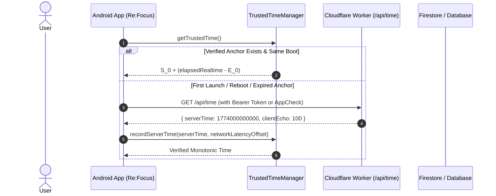

# Complete Line-by-Line Time Architecture Audit & Server-Authoritative Migration Plan

## 1. Executive Summary & Current Architecture

### 1.1 Overview
This audit inspects every time, date, timestamp, and duration source across the entire **Re:Focus Android application**, **Room database**, **Preferences DataStore**, **Cloudflare Worker**, **Razorpay webhook integration**, and **Firebase Firestore schema**.

The application currently operates on a **hybrid time model**:
1. **Subscription & Entitlement Access:** Managed by `TrustedTimeManager.kt`, which establishes an in-memory monotonic anchor `(serverAnchorTime S_0, elapsedRealtimeAnchor E_0)` when receiving Firestore documents, and advances `maxObservedTrustedTime` monotonically. Fallback mode uses `Math.max(maxObservedTrustedTime, wallTime)`.
2. **Daily Tracking & Midnight Rollover:** Managed by `DayManager.kt` and `DashboardViewModel.kt`, which currently derive today's date (`YYYY-MM-DD`) and epoch day directly from device `LocalDate.now()` and device broadcasts (`ACTION_DATE_CHANGED`, `ACTION_TIME_CHANGED`, `ACTION_TIMEZONE_CHANGED`).
3. **Detection Ledger & Sessions:** `DetectionSnapshot.kt` and `SessionManager.kt` record timestamps via `System.currentTimeMillis()`.
4. **Backend Edge (Cloudflare Worker):** Runs on V8 isolates using `Date.now()`, verifying JWT expirations, managing 7-day trials, 7-day account deletion grace periods, and Razorpay webhook timestamps.

---

## 2. Inventory & Classification of Every Current Time Source

### 2.1 Direct `System.currentTimeMillis()` Usage Inventory

| File / Class / Line | Code Snippet / Context | Current Purpose | Classification | Target Migration Behavior |
| :--- | :--- | :--- | :--- | :--- |
| **`TrustedTimeManager.kt:147`** | `val wallTime = System.currentTimeMillis()` | Fallback when no verified server anchor exists | **1. Security-Sensitive** | Retain as unverified fallback; replace default anchor with Worker `/api/time`. |
| **`SubscriptionRepositoryImpl.kt:92`** | `?: System.currentTimeMillis()` | Fallback when Firestore snapshot has no timestamp | **2. Subscription-Sensitive** | Discard fallback to wall clock; use verified Worker time. |
| **`SubscriptionRepositoryImpl.kt:216`** | `?: System.currentTimeMillis()` | Fallback during manual `refreshSubscription()` | **2. Subscription-Sensitive** | Discard fallback to wall clock; query Worker `/api/time`. |
| **`CloudSubscriptionDto.kt:93`** | `fun toDomain(trustedNow: Long = System.currentTimeMillis())` | Default parameter value for domain conversion | **2. Subscription-Sensitive** | Enforce explicit `trustedNow` passed from `TrustedTimeManager`. |
| **`DayManager.kt:148, 197, 243, 274, 323, 361`** | `updatedAt = System.currentTimeMillis()` | Room record timestamp & sync conflict resolution | **3. Progression-Sensitive** | Transition `updatedAt` to trusted epoch milliseconds (`trustedTimeManager.getTrustedTime()`). |
| **`SessionManager.kt:37, 49, 50, 81, 97`** | `sessionStartTime = System.currentTimeMillis()` | Session duration calculation (`sessionDurationMs`) | **4. Analytics / Telemetry** | Safe to remain elapsedRealtime / local millisecond delta. |
| **`DetectionSnapshot.kt:40`** | `val timestamp: Long = System.currentTimeMillis()` | Timestamp for accessibility snapshot debounce | **5. Detection-Internal** | Safe to remain local `SystemClock.elapsedRealtime()`. |
| **`AccountRepositoryImpl.kt:191, 194`** | `System.currentTimeMillis() + (7L * 24 * 60 * 60 * 1000)` | Fallback grace period calculation | **1. Security-Sensitive** | Replace with server-authoritative response from `/api/account/request-deletion`. |
| **`OnboardingRepositoryImpl.kt:150`** | `"updatedAt" to System.currentTimeMillis()` | Firestore onboarding update timestamp | **4. Analytics / Metadata** | Use server-provided time or Firestore field server timestamp. |
| **`DashboardViewModel.kt:76`** | `preferencesRepository.setFirstRunDate(System.currentTimeMillis())` | Initial install baseline timestamp | **3. Progression-Sensitive** | Derive from trusted server time on first sync. |
| **`DashboardViewModel.kt:254`** | `preferencesRepository.setBadgeUnlockTime(milestone, System.currentTimeMillis())` | Badge milestone unlock timestamp | **4. Analytics / UI** | Use `trustedTimeManager.getTrustedTime()`. |
| **`LiveSessionCard.kt:43`** | `val elapsedMs = System.currentTimeMillis() - sessionStartTime` | UI live countdown for current active session | **5. UI-Only** | **SAFE TO KEEP** (Relative local duration). |
| **`SyncManager.kt:175, 308, 321`** | `updatedAt = System.currentTimeMillis()` | Room entity timestamp on cloud restore/merge | **3. Progression-Sensitive** | Use `trustedTimeManager.getTrustedTime()`. |
| **`DailyReelData.kt:18`** | `val updatedAt: Long = System.currentTimeMillis()` | Default Room entity constructor timestamp | **3. Progression-Sensitive** | Default to `0L` or initialize explicitly via `TrustedTimeManager`. |

---

### 2.2 `java.time` / `LocalDate` / `Instant` / `ZonedDateTime` Usage Inventory

| File / Class / Line | Usage | Purpose | Classification | Target Migration Behavior |
| :--- | :--- | :--- | :--- | :--- |
| **`DayManager.kt:114`** | `LocalDate.now().format(DateTimeFormatter.ISO_LOCAL_DATE)` | Determines `currentDateString` (`YYYY-MM-DD`) | **3. Progression-Sensitive** | Derive `LocalDate` from `Instant.ofEpochMilli(trustedTime).atZone(ZoneId.systemDefault())`. |
| **`DayManager.kt:235`** | `LocalDate.now().toEpochDay()` | Sets `goalSetDate` and `lastLimitChangeDate` | **3. Progression-Sensitive** | Derive epoch day from trusted server instant in user timezone. |
| **`DashboardViewModel.kt:89`** | `val todayEpoch = LocalDate.now().toEpochDay()` | Unlocks daily limit after midnight rollover | **3. Progression-Sensitive** | Evaluate against trusted server date in user timezone. |
| **`DashboardViewModel.kt:173`** | `val todayEpoch = LocalDate.now().toEpochDay()` | Generates 90-day habit tracker history grid | **4. History / UI** | Derive base date from trusted server instant. |
| **`GoalCalendar.kt:33`** | `val today = remember { LocalDate.now() }` | Highlights current day on UI calendar | **5. UI-Only** | **SAFE TO KEEP** (UI highlight). |
| **`WeeklyActivityGraph.kt`** | `LocalDate` / `DateTimeFormatter` | Formats day labels (`d MMM`) | **5. UI-Only** | **SAFE TO KEEP** (UI formatting). |
| **`SyncManager.kt:58, 99, 147, 276`** | `LocalDate.now().format(DateTimeFormatter.ISO_LOCAL_DATE)` | Excludes today's enforcement row from cloud restore/backup | **3. Progression-Sensitive** | Derive `todayStr` from trusted server instant in user timezone. |
| **`SyncWorker.kt:46`** | `LocalDate.now().format(DateTimeFormatter.ISO_LOCAL_DATE)` | Filters pending sync records `dateString != todayStr` | **3. Progression-Sensitive** | Derive `todayStr` from trusted server instant in user timezone. |
| **`LoginViewModel.kt:100, 375, 412`** | `LocalDate.now().format(DateTimeFormatter.ISO_LOCAL_DATE)` | Preserves today's local enforcement row across sign-out | **3. Progression-Sensitive** | Derive `todayStr` from trusted server instant in user timezone. |

---

## 3. Comprehensive Call-Graph of `TrustedTimeManager`

```mermaid
graph TD
    Worker["Cloudflare Worker (/api/time)"] -->|Authoritative Server Time| TTM["TrustedTimeManager"]
    FirestoreSnapshot["Firestore Subscription Status Snapshot"] -->|recordServerTime()| TTM
    
    TTM -->|getTrustedTime()| SubRepo["SubscriptionRepositoryImpl"]
    TTM -->|getTrustedTime()| SubMgr["SubscriptionManager"]
    TTM -->|getTrustedTime()| DTO["CloudSubscriptionDto.toDomain()"]
    
    SubMgr -->|remainingSubscriptionDurationMs| SettingsVM["SettingsViewModel"]
    SubMgr -->|accessState (TRIAL, ACTIVE, LOCKED)| NavGraph["NavGraph / MainScreen"]
    SubMgr -->|isAppUnlocked| DayMgr["DayManager (Future Extension)"]
```

### Trace of Every Caller & Classification

1. **`SubscriptionRepositoryImpl.kt` (Lines 94, 97, 178, 218, 220)**
   - *Calls:* `recordServerTime(serverTime)` and `getTrustedTime()`.
   - *Classification:* **1. Security-Sensitive / 2. Subscription-Sensitive**.
   - *Decision:* Evaluates whether trial or subscription period has expired.
2. **`SubscriptionManager.kt` (Lines 71, 151, 159)**
   - *Calls:* `getTrustedTime()`.
   - *Classification:* **1. Security-Sensitive / 2. Subscription-Sensitive**.
   - *Decision:* Monotonic countdown ticker emitting remaining trial/subscription milliseconds. Immediately drops app into `AccessState.LOCKED` when countdown hits `0`.
3. **`CloudSubscriptionDto.kt` (Line 93)**
   - *Calls:* `toDomain(trustedNow)`.
   - *Classification:* **1. Security-Sensitive**.
   - *Decision:* Evaluates `trustedNow < endMillis` and `trustedNow < trialEndMillis`.

---

## 4. Security-Sensitive vs. Progression-Sensitive Time Decisions

### 4.1 Security-Sensitive Decisions (Must NEVER Trust Device Wall Clock)
1. **7-Day Free Trial Expiration:** If `trustedNow >= trialEnd`, user is locked.
2. **Monthly Subscription Billing Period End:** If `trustedNow >= currentPeriodEnd`, access transitions to `LOCKED` (or `PENDING` grace period).
3. **Account Deletion 7-Day Grace Period:** Worker enforces `Date.now() > scheduledForMs` before executing permanent purge of Firestore/Auth.
4. **Anti-Clock Tampering:** Device clock rollback must not extend trials or subscriptions.

### 4.2 Progression-Sensitive Decisions (Must Use Trusted Instant + Local Timezone)
1. **Midnight Daily Limit Reset:** Rollover from `2026-09-20` to `2026-09-21` must reset `totalReelsCount` to `0` and unlock daily limits.
2. **Daily Goal Lock:** Limits locked today cannot be changed until the next calendar day.
3. **Streak & Habit Calculations:** 7-day, 30-day, 50-day, 100-day, 365-day streaks rely on contiguous day records.
4. **Historical Sync Exclusion:** Device-local today row must never sync upstream to cloud.

---

## 5. Cloudflare Worker Backend Audit

### 5.1 Existing Endpoints & Time Usages

| Route | Method | Auth Required | App Check | Time Logic in Worker |
| :--- | :--- | :--- | :--- | :--- |
| **`/api/ensure-subscription`** | `POST` | Firebase Bearer JWT | Optional/Audit | Initializes `trialStart = now`, `trialEnd = now + 7 days`. Uses V8 isolate `new Date()`. |
| **`/api/create-subscription`** | `POST` | Firebase Bearer JWT | Optional/Audit | Creates Razorpay recurring subscription. |
| **`/api/verify-subscription`** | `POST` | Firebase Bearer JWT | Optional/Audit | Verifies Razorpay mandate activation. |
| **`/api/cancel-subscription`** | `POST` | Firebase Bearer JWT | Optional/Audit | Sets cancellation at end of cycle. |
| **`/api/razorpay-webhook`** | `POST` | HMAC-SHA256 Secret | None (Server-to-Server) | Processes webhook events; writes `current_start`, `current_end`, `charge_at`. |
| **`/api/account/request-deletion`**| `POST` | Firebase Bearer JWT | Optional/Audit | Schedules deletion at `Date.now() + 7 days`. |
| **`/api/account/cancel-deletion`** | `POST` | Firebase Bearer JWT | Optional/Audit | Verifies `Date.now() < scheduledForMs` before restoring. |
| **`/api/account/status`** | `GET` | Firebase Bearer JWT | Optional/Audit | Compares `Date.now() > scheduledForMs` to trigger lazy purge. |
| **`/health`** | `GET` | None | None | Public health check. |

### 5.2 Finding on `/api/time`
- **Current State:** `/api/time` **DOES NOT EXIST** in the Cloudflare Worker.
- **Current Time Anchor Ingestion:** Android only syncs server time indirectly if a Firestore subscription document is read (`snapshot.getDate("updatedAt")`). If a user is offline on launch or has never synced Firestore, Android is forced to use unverified wall clock fallback.

---

## 6. Detailed Analysis of Edge Cases

### 6.1 Reboot Behavior
- **Problem:** `SystemClock.elapsedRealtime()` resets to `0` upon device reboot.
- **Current Mitigation (BUG-HIGH-03):** `TrustedTimeManager.loadPersistedAnchor()` detects `currentElapsed < savedElapsed` and zeros out `serverAnchorTime` and `elapsedRealtimeAnchor` while preserving `maxObservedTrustedTime` for anti-rollback.
- **Migration Enhancement:** Upon reboot detection, Android will immediately schedule a background sync against `/api/time` on first network connectivity.

### 6.2 Offline Behavior
- **Problem:** Device has no internet connection for hours or days.
- **Behavior:**
  - If a valid server anchor `(S_0, E_0)` was established before going offline and device has NOT rebooted, time advances monotonically via `S_0 + (currentElapsed - E_0)`.
  - Anti-tamper guarantees remain 100% effective offline. Changing device wall clock has zero effect on monotonic calculation.

### 6.3 Account Switch Isolation
- **Device-Scoped vs. Account-Scoped Time:**
  - Real-world physical time is a **device-level physical invariant** (the universe doesn't change time when User A logs out and User B logs in).
  - Therefore, `(serverAnchorTime, elapsedRealtimeAnchor)` and `maxObservedTrustedTime` MUST remain **device-scoped** (in `timeDataStore`) so User B cannot roll back the device clock to bypass trial periods or subscription checks.
  - However, account entitlements (subscription status, grace periods, account status) remain strictly **account-scoped** in Firestore and memory.

### 6.4 Timezone & Day-Boundary Calculation
- **Authoritative Epoch Instant:** Universal UTC timestamp in milliseconds obtained from `TrustedTimeManager.getTrustedTime()`.
- **Local Day Representation:**
  ```kotlin
  fun getTrustedLocalDate(zoneId: ZoneId = ZoneId.systemDefault()): LocalDate {
      val trustedEpochMs = trustedTimeManager.getTrustedTime()
      return Instant.ofEpochMilli(trustedEpochMs).atZone(zoneId).toLocalDate()
  }
  ```
  This guarantees that midnight rollover occurs in the user's local timezone, but the underlying timeline is anchored to verified server time.

---

## 7. Vulnerabilities & Loopholes in Current Code

1. **Lack of Dedicated Time Synchronization Endpoint:** Android relies on reading Firestore documents (`updatedAt`) to capture server time. If Firestore is cached or untouched, no server anchor is recorded.
2. **`DayManager` Directly Reads `LocalDate.now()`:** If user changes device date forward by 1 day, `DayManager` immediately creates a new day row and resets daily counters, even if the server time has not crossed midnight.
3. **`DashboardViewModel` Initial `firstRunDate`:** Reads `System.currentTimeMillis()` directly on first run before server sync occurs.
4. **Account Deletion Fallback:** If Worker fails to respond with JSON, `AccountRepositoryImpl` computes fallback grace period from local `System.currentTimeMillis()`.

---

## 8. Proposed Target Architecture



### 8.1 Proposed `/api/time` Contract
- **HTTP Method:** `GET`
- **Path:** `/api/time`
- **Security:**
  - Public or Bearer Authenticated (Supports lightweight time fetch before full user sign-in).
  - Protected by App Check (Audit/Enforced) and IP Rate Limiting (120 req / min per IP).
- **Request Headers:**
  - `X-Client-Timestamp: <SystemClock.elapsedRealtime()>`
- **Response Format (`application/json`):**
  ```json
  {
    "serverTime": 1774000000000,
    "iso": "2026-03-20T13:46:40.000Z",
    "clientEcho": 100
  }
  ```
- **Round-Trip Latency Compensation:**
  $$\Delta t_{\text{RTT}} = \frac{E_{\text{response}} - E_{\text{request}}}{2}$$
  $$S_0 = \text{serverTime} + \Delta t_{\text{RTT}}$$

---

## 9. Comprehensive Classification of Code Artifacts

### 🔴 MUST CHANGE (During Server-Authoritative Migration)
1. **`worker/src/index.js`**: Add lightweight, rate-limited `GET /api/time` endpoint.
2. **`app/src/main/java/com/reeltrak/app/core/time/TrustedTimeManager.kt`**:
   - Add network sync capability against `/api/time`.
   - Implement round-trip latency compensation.
   - Add `getTrustedLocalDate(zoneId)` helper.
3. **`app/src/main/java/com/reeltrak/app/services/tracking/DayManager.kt`**:
   - Inject `TrustedTimeManager`.
   - Replace `LocalDate.now()` with `trustedTimeManager.getTrustedLocalDate()`.
   - Replace `System.currentTimeMillis()` in `DailyReelData.updatedAt` with `trustedTimeManager.getTrustedTime()`.
4. **`app/src/main/java/com/reeltrak/app/core/sync/SyncManager.kt`**:
   - Replace direct `LocalDate.now()` queries with trusted date from `TrustedTimeManager`.
5. **`app/src/main/java/com/reeltrak/app/core/sync/SyncWorker.kt`**:
   - Replace `LocalDate.now()` with trusted date from `TrustedTimeManager`.
6. **`app/src/main/java/com/reeltrak/app/features/auth/LoginViewModel.kt`**:
   - Replace `LocalDate.now()` today string preservation with trusted date.
7. **`app/src/main/java/com/reeltrak/app/features/dashboard/viewmodel/DashboardViewModel.kt`**:
   - Replace `LocalDate.now().toEpochDay()` with trusted epoch day.
8. **`app/src/main/java/com/reeltrak/app/data/repository/SubscriptionRepositoryImpl.kt`**:
   - Trigger `/api/time` sync when stale or after reboot.

### 🟡 SHOULD CHANGE (For Consistency & Hardening)
1. **`app/src/main/java/com/reeltrak/app/data/repository/AccountRepositoryImpl.kt`**:
   - Use `trustedTimeManager.getTrustedTime()` instead of `System.currentTimeMillis()` in fallback grace calculations.
2. **`app/src/main/java/com/reeltrak/app/data/local/entity/DailyReelData.kt`**:
   - Remove `System.currentTimeMillis()` default value from entity constructor.
3. **`app/src/main/java/com/reeltrak/app/data/repository/OnboardingRepositoryImpl.kt`**:
   - Replace `System.currentTimeMillis()` with trusted server time.

### 🟢 SAFE TO KEEP (Harmless Local Durations / UI Formatting)
1. **`app/src/main/java/com/reeltrak/app/services/tracking/SessionManager.kt`**:
   - Local session duration calculation (`System.currentTimeMillis() - sessionStartTime`).
2. **`app/src/main/java/com/reeltrak/app/features/dashboard/ui/components/LiveSessionCard.kt`**:
   - UI elapsed minutes ticker (`System.currentTimeMillis() - sessionStartTime`).
3. **`app/src/main/java/com/reeltrak/app/services/tracking/engine/model/DetectionSnapshot.kt`**:
   - Internal detector snapshot timestamp (`timestamp = System.currentTimeMillis()`).
4. **`app/src/main/java/com/reeltrak/app/features/dashboard/ui/components/GoalCalendar.kt`**:
   - UI calendar month navigation (`YearMonth.now()`, `LocalDate.now()`).
5. **`app/src/main/java/com/reeltrak/app/features/dashboard/ui/components/WeeklyActivityGraph.kt`**:
   - Visual date formatters and day labels.

### ⛔ DO NOT CHANGE (Protected Architecture & Core Engines)
1. **`app/src/main/java/com/reeltrak/app/services/tracking/engine/detector/`**: Reel detection algorithms and accessibility tree traversal.
2. **`app/src/main/java/com/reeltrak/app/services/FloatingCounterManager.kt`**: Floating overlay window layout and touch tracking.
3. **`BUG-CRIT-02` Implementation in `LoginViewModel.kt`**: ApplicationScope coroutine isolation on sign-out/delete.
4. **`BUG-HIGH-02` Implementation in `SyncManager.kt`**: Deterministic safe merge preserving unsynced offline history (`syncStatus = 1`).
5. **`BUG-HIGH-03` Anti-Tamper Core in `TrustedTimeManager.kt`**: Prohibition of unverified wall-clock time from advancing `maxObservedTrustedTime`.

---

## 10. Phased Implementation Roadmap

```
Phase 1: Worker Edge Endpoint
  ├── Implement GET /api/time in worker/src/index.js
  └── Deploy & verify latency and rate limiting

Phase 2: Android Core Time Engine
  ├── Extend TrustedTimeManager with /api/time network sync & RTT compensation
  ├── Add getTrustedLocalDate() helper
  └── Add unit tests for network anchor sync and reboot recovery

Phase 3: Domain & Repository Integration
  ├── Update DayManager to consume trusted date & epoch time
  ├── Update SyncManager and SyncWorker to use trusted date for today exclusion
  └── Update LoginViewModel sign-out date preservation

Phase 4: ViewModel & Presentation Alignment
  ├── Update DashboardViewModel midnight unlock & streak computation
  └── Retain UI-only relative timers (LiveSessionCard, GoalCalendar)

Phase 5: Comprehensive Verification & Stress Testing
  ├── Forward clock jump (+1 year) offline & online test
  ├── Clock rollback (-30 days) offline & online test
  ├── Reboot without network test
  ├── Offline 48-hour continuous progression test
  └── Full Gradle unit tests, lintDebug, assembleDebug
```
