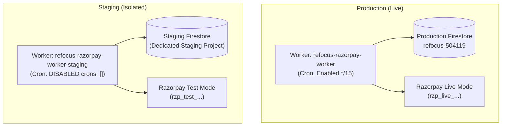

# Re:Focus Cloudflare Worker — Staging Setup & Isolation Guide

---

## 1. Overview & Isolation Architecture

To validate backend updates, subscription webhooks, and trial eligibility without risking production users or live revenue, a dedicated staging Worker (`refocus-razorpay-worker-staging`) is configured via Cloudflare Wrangler environments (`env.staging`).



### Key Isolation Boundaries
1. **Dedicated Worker Name:** `refocus-razorpay-worker-staging` runs in a separate Cloudflare Worker namespace. Deployments to staging do not alter or touch the production script `refocus-razorpay-worker`.
2. **Cron Triggers Disabled:** The production purge sweep runs every 15 minutes. In staging, cron triggers are explicitly disabled (`crons: []`) so background sweeps never execute automatically.
3. **Dedicated Staging Secrets:** Staging secrets are stored exclusively in the staging environment vault (`--env staging`). Production secrets cannot be accessed by the staging worker.
4. **Razorpay Test Segregation:** Uses Razorpay Test Mode credentials (`rzp_test_...`) and test plans. Live subscriptions and customer credit cards are never touched.
5. **No Production Android Changes:** Android production code (`NetworkConstants.kt`) and production test assertions remain 100% untouched.

---

## 2. Configuration Placeholders (`worker/wrangler.jsonc`)

The `env.staging` section in `worker/wrangler.jsonc` uses strict placeholders. Real deployment requires replacing these placeholders with dedicated staging resource identifiers:

| Variable | Placeholder | Description | How to Obtain / Configure |
| :--- | :--- | :--- | :--- |
| `FIREBASE_PROJECT_ID` | `PLACEHOLDER_STAGING_FIREBASE_PROJECT_ID` | Dedicated Staging Firebase Project ID | Create a separate project in Firebase Console (e.g., `refocus-staging-504119`). |
| `FIREBASE_PROJECT_NUMBER` | `PLACEHOLDER_STAGING_FIREBASE_PROJECT_NUMBER` | Dedicated Staging Project Number | Found in Firebase Console -> Project Settings -> General. |
| `APP_CHECK_ENFORCEMENT_MODE` | `"audit"` | App Check policy | Kept in `"audit"` mode to log attestation without blocking development clients. |
| `RAZORPAY_PLAN_ID` | `PLACEHOLDER_STAGING_RAZORPAY_TEST_PLAN_ID` | Razorpay Test Mode Subscription Plan ID | Created in Razorpay Dashboard (Test Mode) -> Subscriptions -> Plans (e.g., ₹79/month). |

---

## 3. Least-Privilege Google Service Account Roles

A dedicated Service Account must be generated for staging inside the staging Google Cloud project.

### Recommended Least-Privilege IAM Roles
- **Cloud Datastore User (`roles/datastore.user`):** Grants read and write access to Firestore documents without project-level administrator permissions.
- **Firebase Authentication Admin (`roles/firebaseauth.admin`):** Required exclusively for user account purge testing (`/v1/projects/{projectId}/accounts:delete` via Identity Toolkit API).

### Required GCP APIs
Enable the following APIs in the staging Google Cloud project:
- `firestore.googleapis.com` (Cloud Firestore API)
- `identitytoolkit.googleapis.com` (Google Identity Toolkit API)

---

## 4. Required Staging Secrets Inventory

The following secrets must be uploaded to Cloudflare using `npx wrangler secret put <NAME> --env staging`. Never commit values to version control.

| Secret Name | Description | Staging Source / Generation |
| :--- | :--- | :--- |
| `FIREBASE_SERVICE_ACCOUNT_KEY` | Google Service Account credentials JSON | Downloaded from Staging GCP Console -> IAM -> Service Accounts -> Keys. |
| `RAZORPAY_KEY_ID` | Razorpay Test Key ID | Generated in Razorpay Dashboard -> Settings -> API Keys (starts with `rzp_test_`). |
| `RAZORPAY_KEY_SECRET` | Razorpay Test Secret Key | Associated secret for the Test Key ID. |
| `RAZORPAY_WEBHOOK_SECRET` | Secret for verifying webhook HMAC signatures | Defined when adding the Staging Webhook in Razorpay Test Mode settings. |
| `LEASE_PRIVATE_KEY_PKCS8` | Base64-encoded PKCS#8 DER ECDSA P-256 private key | Staging key matching the verification public key. |
| `TRIAL_SECRET_KEY` | Dedicated HMAC-SHA256 secret for trial identities | Random 64-character high-entropy hex or base64 string. |
| `TRIAL_PREVIOUS_SECRET_KEY` | Previous secret for key rotation | Optional initially; set only when simulating secret rotation. |

---

## 5. Deployment & Teardown Protocol

### Step 1: Pre-Deployment Placeholder Replacement
Once external staging resources exist, replace the placeholders in `worker/wrangler.jsonc` under `env.staging.vars`.

### Step 2: Upload Staging Secrets
```bash
npx wrangler secret put FIREBASE_SERVICE_ACCOUNT_KEY --env staging
npx wrangler secret put RAZORPAY_KEY_ID --env staging
npx wrangler secret put RAZORPAY_KEY_SECRET --env staging
npx wrangler secret put RAZORPAY_WEBHOOK_SECRET --env staging
npx wrangler secret put LEASE_PRIVATE_KEY_PKCS8 --env staging
npx wrangler secret put TRIAL_SECRET_KEY --env staging
```

### Step 3: Deploy Staging Worker
```bash
npx wrangler deploy --env staging
```

### Step 4: Stream Real-Time Logs
```bash
npx wrangler tail --env staging
```

---

## 6. Safe Teardown & Initial-Deployment Cleanup

> [!IMPORTANT]
> **Initial-Deployment Cleanup:** `wrangler rollback` requires an existing deployment history. On a freshly deployed staging Worker with only one version, `wrangler rollback` will fail with `Cannot rollback: No previous deployment found.`

### Complete Teardown (Initial or Failed Deployments)
To completely delete the staging Worker script, routes, and deployments:
```bash
npx wrangler delete --env staging
```

### Rollback (Only When Prior Deployment History Exists)
If multiple versions have been deployed to staging and you need to revert to the previous version:
```bash
npx wrangler rollback --env staging
```

---

## 7. Staging Smoke-Test Protocol

Execute the following test sequence against `https://refocus-razorpay-worker-staging.<subdomain>.workers.dev`:

1. **Health Check:** `GET /health` $\rightarrow$ Expect `200 OK`, `{"status":"healthy","service":"Re:Focus Edge Worker",...}`.
2. **Server Time:** `GET /api/time` $\rightarrow$ Expect `200 OK` with server UTC milliseconds.
3. **Unauthenticated Gate:** `POST /api/ensure-subscription` $\rightarrow$ Expect `401 Unauthorized`.
4. **Trial Initialization:** `POST /api/ensure-subscription` (with Staging Google ID Token) $\rightarrow$ Expect `201 Created`, `subscriptionStatus: "TRIAL"`.
5. **Trial Idempotency:** Repeat `POST /api/ensure-subscription` $\rightarrow$ Expect `200 OK`, `trialAlreadyClaimed: true`.
6. **Mandate Creation:** `POST /api/create-subscription` $\rightarrow$ Expect `200 OK`, `{"subscriptionId":"sub_...","keyId":"rzp_test_..."}`.
7. **Signature Verification Guard:** `POST /api/verify-subscription` with invalid signature $\rightarrow$ Expect `400 Bad Request`.
8. **Razorpay Webhook Delivery:** Trigger `subscription.activated` from Razorpay Test Dashboard $\rightarrow$ Expect `200 OK`, `status: "processed"`.
9. **Cancellation Flow:** `POST /api/cancel-subscription` $\rightarrow$ Expect `200 OK`, `cancelAtPeriodEnd: true`.
10. **Account Deletion:** `POST /api/account/request-deletion` $\rightarrow$ Expect `200 OK`, `accountStatus: "PENDING_DELETION"`.
