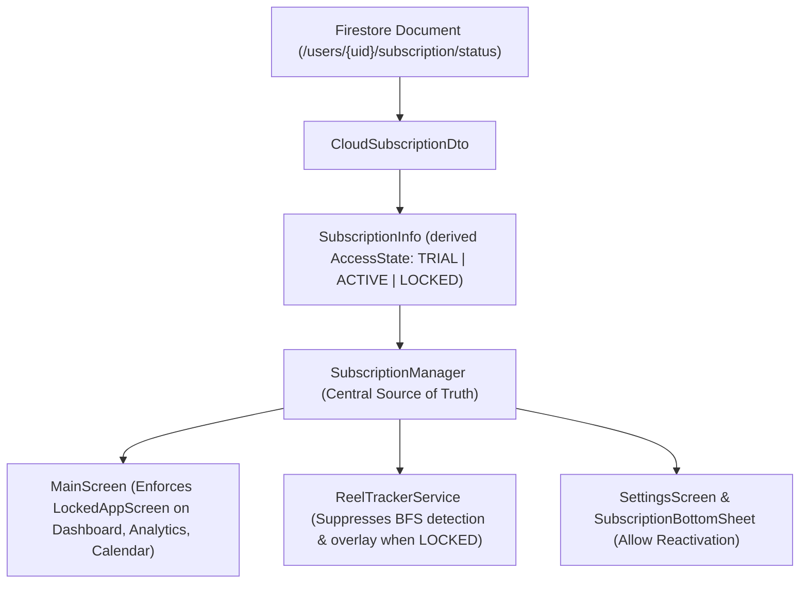

# Whole-App Subscription & Access Model Architecture

This document provides a comprehensive specification and developer reference for the **whole-app subscription-gated access model** in ReelTrak.

---

## 1. Product Rules & Access Model Overview

There is **no separate "premium tier"** in ReelTrak. The entire app is gated behind an active trial or valid subscription:

| Access State | Condition | App Access Behavior |
| :--- | :--- | :--- |
| **`TRIAL`** | User is within their **7-day free trial** after activation (`now <= trialEnd`). | **Full Unrestricted Access** to all features, tracking, overlay, analytics, strict mode, and history. |
| **`ACTIVE`** | User has an active paid subscription or a cancelled subscription before `currentPeriodEnd` (`now <= currentPeriodEnd`). | **Full Unrestricted Access** to all features, tracking, overlay, analytics, strict mode, and history. |
| **`LOCKED`** | Trial ended without subscription, paid subscription expired, or payment failed (`now > trialEnd && now > currentPeriodEnd`). | **Global Lock Enforced**. All core features disabled. Only **Settings** and the **Subscription Management Sheet** remain accessible. |

---

## 2. Centralized Access Control Architecture

Access control is enforced **centrally** across the presentation and background service layers:

### Key Components

1. **Domain Model: [`SubscriptionInfo.kt`](file:///c:/Users/pavan/OneDrive/Documents/REEL/app/src/main/java/com/reeltrak/app/domain/models/SubscriptionInfo.kt)**
   - Exposes `accessState: AccessState` (`TRIAL`, `ACTIVE`, `LOCKED`).
   - Exposes `isUnlocked: Boolean` (`accessState != AccessState.LOCKED`).

2. **DTO Derivation: [`CloudSubscriptionDto.kt`](file:///c:/Users/pavan/OneDrive/Documents/REEL/app/src/main/java/com/reeltrak/app/data/remote/dto/CloudSubscriptionDto.kt)**
   - Computes `accessState` based on `trialEnd`, `currentPeriodEnd`, and `subscriptionStatus`.
   - Guaranteed server-authoritative logic.

3. **Central Manager: [`SubscriptionManager.kt`](file:///c:/Users/pavan/OneDrive/Documents/REEL/app/src/main/java/com/reeltrak/app/domain/managers/SubscriptionManager.kt)**
   - Exposes `val accessState: StateFlow<AccessState>` and `fun isAppUnlockedNow(): Boolean`.

4. **UI Lock Enforcement: [`MainScreen.kt`](file:///c:/Users/pavan/OneDrive/Documents/REEL/app/src/main/java/com/reeltrak/app/features/main/ui/MainScreen.kt) & [`LockedAppScreen.kt`](file:///c:/Users/pavan/OneDrive/Documents/REEL/app/src/main/java/com/reeltrak/app/features/subscription/ui/LockedAppScreen.kt)**
   - If `!isUnlocked`, the `Dashboard`, `Analytics`, and `Calendar` routes render `LockedAppScreen` with a pulse animation and CTAs to subscribe or visit settings.
   - `Settings` route remains open so users can sign out, view account status, or open the subscription bottom sheet.

5. **Background Tracking Enforcement: [`ReelTrackerService.kt`](file:///c:/Users/pavan/OneDrive/Documents/REEL/app/src/main/java/com/reeltrak/app/services/ReelTrackerService.kt)**
   - If `!subscriptionManager.isAppUnlockedNow()`, BFS reel detection, overlay visibility, and increments are suppressed immediately.

---

## 3. Testing Guide: Development Mock Portal

In `debug` builds, access the **Subscription & Dev Simulator** from:
**Settings $\rightarrow$ DATA & SUPPORT $\rightarrow$ Subscription & Dev Simulator**

### Step-by-Step Test Scenarios

| Scenario | Simulator Button / Action | Expected `AccessState` | Expected UI & App Behavior |
| :--- | :--- | :--- | :--- |
| **1. Start 7-Day Trial** | Click **"Start 7-Day Trial"** | `TRIAL` | App unlocks immediately. Dashboard, Analytics, and tracking overlay work fully. |
| **2. Active Trial** | Verify while trial days remain | `TRIAL` | App remains fully unlocked. |
| **3. Trial Expired** | Click **"Expire Trial"** | `LOCKED` | Global lock takes effect immediately. Full-screen `LockedAppScreen` appears. Tracking stops. |
| **4. Activate Monthly Plan** | Click **"Activate Monthly Subscription"** | `ACTIVE` | App unlocks. Current plan shows "ReelTrak Monthly" with 30-day validity. |
| **5. Activate Annual Plan** | Click **"Activate Annual Subscription"** | `ACTIVE` | App unlocks. Current plan shows "ReelTrak Annual" with 365-day validity. |
| **6. Cancel Active Subscription** | Click **"Cancel Recurring"** | `ACTIVE` | Status becomes `CANCELLED`, but because `currentPeriodEnd` is in the future, access remains `ACTIVE`. |
| **7. Paid Period Expiration** | Click **"Expire Paid Period"** | `LOCKED` | Status is `EXPIRED` and timestamp is in the past. Global lock takes effect immediately. |
| **8. Simulate Payment Failure** | Click **"Simulate Payment Failure"** | `LOCKED` | Payment authorization fails. Access remains `LOCKED`. |
| **9. Reactivate Subscription** | Click **"Start Subscription"** on Locked screen or activate in portal | `ACTIVE` | Global lock disappears instantly and all tabs are restored. |
| **10. Reset Account** | Click **"Reset (Lock)"** | `LOCKED` | Clears trial and subscription, returning user to initial locked state. |

---

## 4. Production Security & Release Safety

- **Release Strip**: `BuildConfig.DEBUG` guards ensure `MockSubscriptionController` and test actions fail-safe in production builds.
- **Firestore Security Rules**: In production, clients have read-only access to `/users/{uid}/subscription/status`. Writes are strictly reserved for server webhooks / Cloud Functions.
- **No Razorpay SDK yet**: Cleanly isolated abstraction ready for gateway integration.
