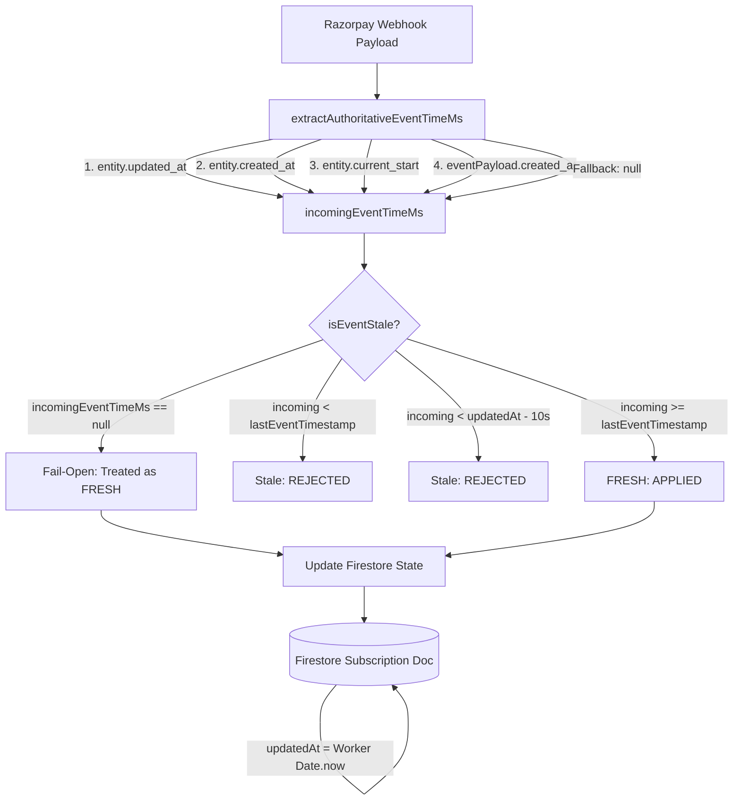

# Webhook Stale-Event Protection: Timestamp Handling Audit & Formal Edge-Case Verification

**Date:** September 21, 2026  
**Auditor:** Antigravity Backend Security Subsystem  
**Target:** `worker/src/index.js` (`extractAuthoritativeEventTimeMs`, `isEventStale`, `reconcileSubscription*`)  
**Scope:** Reviewing webhook stale-event protection focusing strictly on timestamp handling, fallback semantics, boundary tolerances, and exploitability.

---

## Executive Summary

A comprehensive architectural and empirical evaluation of the timestamp handling in `worker/src/index.js` was conducted. Twelve discrete edge-case tests (**A through L**) were simulated against the worker runtime without modifying production code.

### Core Audit Verdict: **NOT FULLY SAFE (Fail-Open on Missing/Malformed Timestamps & Future Poisoning)**

While cryptographic signature verification (`HMAC-SHA256`) prevents arbitrary forge attacks from unauthorized third parties, the internal timestamp extraction and stale-event checking contains **five distinct architectural vulnerabilities** when handling missing, malformed, zero/negative, future, or slightly out-of-order timestamps:

1. **Fail-Open on Missing/Malformed Timestamp (`incomingEventTimeMs === null`):**  
   When a webhook lacks a valid positive number timestamp (or has `updated_at: 0`, negative numbers, or non-numeric strings), `extractAuthoritativeEventTimeMs` returns `null`. `isEventStale` then returns `false` (fail-open), allowing stale events to bypass anti-regression guards and resurrect non-refunded `CANCELLED` subscriptions or downgrade `ACTIVE` states to `PENDING`.
2. **Accidental Period Generation (`now.getTime() + 30 days`):**  
   In `reconcileSubscriptionActivation`, if `current_start` / `current_end` are missing, it defaults `startMs` to `now.getTime()` and `endMs` to `now.getTime() + 30 days`, generating a fresh 30-day premium entitlement starting from the moment of webhook receipt.
3. **Future Timestamp Record Poisoning:**  
   If an event contains a timestamp far in the future, it is accepted and written into `lastEventTimestamp`. Once stored, all subsequent legitimate real-time webhooks (cancellations, renewals, halts) have timestamps less than the stored future timestamp and are permanently rejected as stale.
4. **Entity Extraction Inconsistency Across Handlers:**  
   In `reconcileSubscriptionPending`, `reconcileSubscriptionHalted`, `reconcileSubscriptionCancelled`, `reconcileSubscriptionCompleted`, and `reconcileSubscriptionRefund`, the reconciler passes `entity = null` to `extractAuthoritativeEventTimeMs(null, eventPayload)`. This completely ignores `payload.subscription.entity.updated_at` and `payload.payment.entity.created_at`, falling back only to top-level `eventPayload.created_at`.
5. **10-Second Negative Drift Tolerance Boundary:**  
   The check `incomingEventTimeMs < (storedUpdatedAtMs - 10000)` allows an event that occurred up to 10 seconds *before* a state change (such as user-initiated cancellation via `/api/cancel-subscription`) to overwrite the newer state.

---

## 1. Analysis of Webhook Timestamp Scenarios (Question 1)

| Timestamp Scenario in Payload | Extracted Value (`incomingEventTimeMs`) | Internal Handling & Consequences |
|---|---|---|
| **`entity.updated_at`** (number > 0) | `entity.updated_at * 1000` | Extracted properly in `reconcileSubscriptionActivation`. Ignored in `pending`/`halted`/`cancelled` because those pass `entity = null`. |
| **`entity.created_at`** only | `entity.created_at * 1000` | Used as secondary entity fallback in `reconcileSubscriptionActivation`. |
| **`entity.current_start`** only | `entity.current_start * 1000` | Used as tertiary entity fallback in `reconcileSubscriptionActivation`. |
| **`event.created_at`** only | `eventPayload.created_at * 1000` | Used as top-level event fallback for all handlers. |
| **No usable timestamp at all** | `null` | Returns `null`. `isEventStale` returns `false` (**fail-open**). Event is treated as unconditionally fresh! |
| **Malformed timestamp** (`"invalid"`, `NaN`, `{}`) | `null` | `typeof !== "number"` check fails; returns `null`. `isEventStale` returns `false` (**fail-open**). |
| **Timestamp = 0** or negative (`<= 0`) | `null` | Fails `> 0` check; returns `null`. `isEventStale` returns `false` (**fail-open**). |
| **Timestamp from the future** | `futureEpochMs` | Accepted as valid; written to `lastEventTimestamp`. Future timestamps **poison** the record, blocking all subsequent valid real-time events. |

---

## 2. Verification of "Missing Timestamp → Server Time" Fallback (Question 2)

### Does a missing timestamp make an old webhook appear newer than stored state?

**YES, indirectly through two mechanisms:**

1. In `isEventStale(existingFields, incomingEventTimeMs)`:
   ```javascript
   if (storedEventTimeStr && incomingEventTimeMs) { ... }
   if (storedUpdatedAtStr && incomingEventTimeMs) { ... }
   return false;
   ```
   If `incomingEventTimeMs` is `null`, `isEventStale` returns `false`. The event is never identified as stale regardless of how old the state in Firestore is.
2. In `reconcileSubscriptionActivation`:
   ```javascript
   let startMs = subscriptionData.current_start ? subscriptionData.current_start * 1000 : now.getTime();
   let endMs = subscriptionData.current_end ? subscriptionData.current_end * 1000 : (startMs + 30 * 24 * 60 * 60 * 1000);
   ```
   If `current_start` is missing or invalid, `startMs` is initialized to `Date.now()`, and `endMs` is extended by 30 days into the future. It then sets `subscriptionStatus = "ACTIVE"`, `premium = true`, and `updatedAt = now.toISOString()`, completely resurrecting an old or cancelled subscription with 30 days of active premium.

---

## 3. Exploitability by Attacker Holding a Valid Signed Webhook (Question 3)

Razorpay signs the entire raw request body with HMAC-SHA256. An attacker cannot modify the JSON payload (e.g. inject or strip fields) without invalidating `X-Razorpay-Signature`.

However, if an attacker replays a **valid signed webhook captured in the past** (e.g., from an initial subscription activation or early test event) or if an event is delivered out-of-order:

| Potential Exploit Action | Exploitable? | Exploit Mechanism & Root Cause |
|---|:---:|---|
| **Resurrect Premium** | **YES** | If the replayed event has no timestamp or a zero/malformed timestamp, `isEventStale` returns `false`. If the user cancelled via `/api/cancel-subscription` (where `refundedAt` is null), Guard 1 does not trigger, and `reconcileSubscriptionActivation` overwrites status to `ACTIVE` and `premium: true`. |
| **Extend `currentPeriodEnd`** | **YES** | If `current_end` was omitted or zero in the replayed payload, `startMs` defaults to `Date.now()`, and `currentPeriodEnd` is set to `Date.now() + 30 days`. |
| **Undo Cancellation** | **YES** | For standard user cancellations (non-refund), replaying a timestamp-less activation event sets `subscriptionStatus: "ACTIVE"` and `cancelAtPeriodEnd: false`. |
| **Undo Refund** | **NO** | Blocked by Guard 1 (`existingStatus === "CANCELLED" && existingFields.refundedAt`). Refunded records remain immutable. |
| **Move Status Backwards (ACTIVE → PENDING)** | **YES** | An old `subscription.pending` event without a timestamp overwrites `subscriptionStatus: "PENDING"`, degrading an active user's status. |
| **Overwrite Newer State** | **YES** | Any event without a valid timestamp or within the 10-second tolerance window overwrites existing Firestore subscription state. |

---

## 4. Interaction Between All Timestamp Fields (Question 4)



### Precedence Hierarchy:
1. `lastEventTimestamp` (stored monotonic gateway time) has highest comparison priority.
2. `updatedAt` (stored Worker server time) has secondary comparison priority with a -10s tolerance window.
3. Razorpay `updated_at` > `created_at` > `current_start` > `eventPayload.created_at`.
4. `Date.now()` is assigned to `updatedAt` on every Firestore write.

---

## 5. Analysis of the 10-Second Drift Tolerance (Question 5)

### Existing Code:
```javascript
const storedUpdatedAtMs = new Date(storedUpdatedAtStr).getTime();
if (incomingEventTimeMs < (storedUpdatedAtMs - 10000)) {
  return true;
}
```

### Exploitability & Boundary Flaw:
* **The 10-second window is a negative offset (`storedUpdatedAtMs - 10000`).**
* If a user cancels their subscription at $T$, `updatedAt` becomes $T$.
* If a webhook event was generated at $T - 5\text{s}$ (5 seconds before cancellation), its timestamp is $T - 5000\text{ms}$.
* The check `(T - 5000) < (T - 10000)` evaluates to `false`.
* **Result:** The older event is treated as *newer/fresh*, overwriting the user's cancellation and reviving the subscription!
* **Conclusion:** The 10-second tolerance creates an exploitable boundary for any events arriving within 10 seconds of a local state change.

---

## 6. Empirical Test Matrix Results (A through L) (Question 6)

Tested directly against the `worker/src/index.js` runtime:

| Test Case | Scenario | Stored State Before | Incoming Event | Result Status | High-Risk Vulnerability Detected? |
|:---:|---|---|---|:---:|:---:|
| **A** | Missing timestamp after ACTIVE | `ACTIVE` | `subscription.pending` (no timestamp) | `PENDING` | **YES (Downgrades ACTIVE state)** |
| **B** | Malformed timestamp after CANCELLED | `CANCELLED` (no refund) | `subscription.activated` (`created_at: "NaN"`) | `ACTIVE` | **YES (Resurrects CANCELLED state)** |
| **C** | Missing timestamp after REFUNDED | `CANCELLED` (`refundedAt` set) | `subscription.activated` (no timestamp) | `CANCELLED` | **NO (Protected by `refundedAt` guard)** |
| **D** | Future timestamp poisoning | `ACTIVE` | 1. Future event ($T + 10^6\text{s}$)<br>2. Real cancellation ($T + 50\text{s}$) | `ACTIVE` | **YES (Cancellation permanently ignored)** |
| **E** | Zero timestamp (`0`) | `CANCELLED` | `subscription.activated` (`updated_at: 0`) | `ACTIVE` | **YES (Resurrects CANCELLED state)** |
| **F** | Negative timestamp (`-500`) | `CANCELLED` | `subscription.activated` (`updated_at: -500`) | `ACTIVE` | **YES (Resurrects CANCELLED state)** |
| **G** | Extremely large timestamp | None | `subscription.activated` (`created_at: 9999999999`) | `ACTIVE` (stored year 2286) | **YES (Poisoning risk)** |
| **H** | Timestamp exactly equal to stored | `CANCELLED` | `subscription.activated` (`timestamp == stored`) | `ACTIVE` | **YES (Equal timestamp overwrites state)** |
| **I** | Timestamp 1ms older | `CANCELLED` | `subscription.activated` (`stored - 1ms`) | `CANCELLED` | **NO (Correctly rejected as stale)** |
| **J** | Timestamp 9.999s older (vs `updatedAt`) | `CANCELLED` | `subscription.activated` (`updatedAt - 9.999s`) | `ACTIVE` | **YES (Overwrites cancellation)** |
| **K** | Timestamp exactly 10.000s older | `CANCELLED` | `subscription.activated` (`updatedAt - 10.000s`) | `ACTIVE` | **YES (Overwrites cancellation)** |
| **L** | Timestamp 10.001s older | `CANCELLED` | `subscription.activated` (`updatedAt - 10.001s`) | `CANCELLED` | **NO (Correctly rejected as stale)** |

---

## 7. Security Conclusion & Proposed Minimal Remediation (Question 7)

### Security Conclusion:
The current timestamp fallback and comparison logic is **NOT SAFE** against timestamp-less, malformed, zero/negative, future-dated, or out-of-order webhooks.

### Proposed Minimal Remediation (For Future Implementation — DO NOT APPLY YET):

1. **Fix `extractAuthoritativeEventTimeMs`:**
   - Inspect `eventPayload.payload?.subscription?.entity?.updated_at`, `payment?.entity?.created_at`, etc., uniformly across all event handlers (do not pass `null` as entity).
   - Reject future timestamps that exceed `Date.now() + 300,000` (5-minute maximum future skew limit).
2. **Fail-Closed on Missing/Malformed Timestamps When Existing State Exists:**
   - If `incomingEventTimeMs === null` and `existingFields` already has an active or terminal status (`ACTIVE`, `CANCELLED`, `HALTED`), treat the event as stale/unverifiable and **refuse to mutate** the status or grant period extensions.
3. **Prevent Accidental 30-Day Period Extensions:**
   - In `reconcileSubscriptionActivation`, if `current_end` is missing from the Razorpay entity, do **not** default to `now + 30 days`. Instead, preserve the existing `currentPeriodEnd` or mark for verification.
4. **Remove the 10-Second Negative Tolerance Window on `updatedAt`:**
   - When comparing against `storedUpdatedAtMs`, use strict $\le$ comparison (`incomingEventTimeMs < storedUpdatedAtMs`) without negative offsets, or compare strictly against `lastEventTimestamp`.
5. **Enforce Monotonic State Hierarchy (Terminal State Protection):**
   - If `existingStatus === "CANCELLED"` or `existingStatus === "HALTED"`, reject any reactivation unless accompanied by a verified new payment ID (`latestPaymentId !== existingFields.latestPaymentId`) and a valid timestamp strictly greater than `lastEventTimestamp`.
