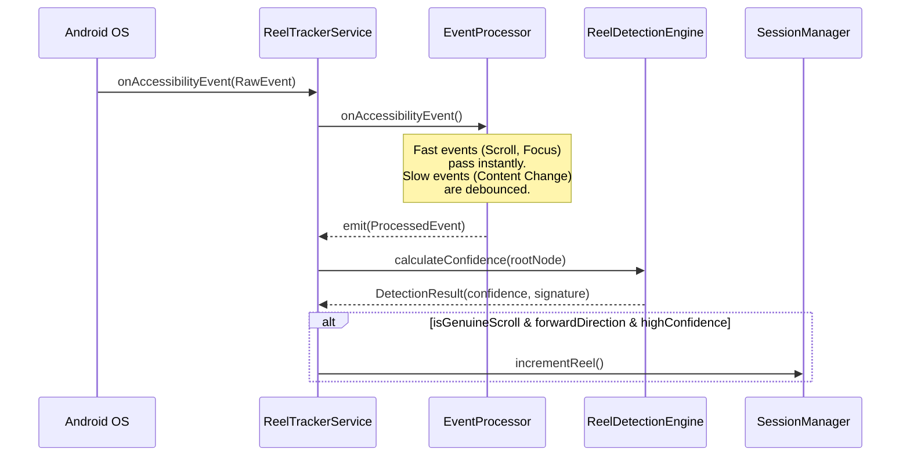

# Accessibility Service Engine

The core magic of REEL relies on Android's `AccessibilityService`. The app parses the structural UI hierarchy of third-party apps (Instagram, YouTube) in real-time to detect infinite scrolling feeds without requiring root access or screen recording.

## 1. Lifecycle

1. **`onCreate()`**: Instantiates the `ReelDetectionEngine`, `EventProcessor`, and `SessionManager`. Begins collecting processed events.
2. **`onServiceConnected()`**: Called by Android when permissions are granted. Initializes the Database, DataStore variables, and the `FloatingCounterManager`.
3. **`onAccessibilityEvent()`**: The raw entry point for all OS events.
4. **`onDestroy()`**: Disconnects from the overlay and tears down coroutines.

## 2. Event Pipeline Diagram

## 3. Event Filtering & Debouncing (`EventProcessor.kt`)

Accessibility events fire dozens of times per second. `EventProcessor` prevents CPU starvation:
- **Instant Propagation**: `TYPE_WINDOW_STATE_CHANGED`, `TYPE_VIEW_SCROLLED`.
- **Debounced Propagation**: `TYPE_WINDOW_CONTENT_CHANGED` (300ms), `TYPE_WINDOWS_CHANGED` (500ms).
- *Optimization Note*: As documented in `performance_baseline.md`, the current implementation spawns a new coroutine for every single event. This should be migrated to a `Channel` or `tryEmit`.

## 4. Reel Detection Engine (`ReelDetectionEngine.kt`)

The engine takes the active window's `AccessibilityNodeInfo` tree and calculates a probability score that the screen is a "Short-Form Video Feed."

### Breadth-First Search (BFS) Traversal
It traverses the entire UI tree looking for structural heuristics:
1. **Target Packages**: Only analyzes `com.instagram.android`, `com.google.android.youtube`, `com.zhiliaoapp.musically`.
2. **Explicit IDs**: Looks for known `viewIdResourceName`s (e.g., `clips_viewer`, `shorts_player`). (+50 confidence).
3. **List Containers**: Identifies `RecyclerView` or `ViewPager` that occupy > 1000 pixels vertically. (+15 confidence).
4. **Fullscreen Children**: Checks if list children consume the full screen height (typical of Reels). (+25 confidence).
5. **Screen Reader Text**: Checks `contentDescription` for keywords like "reel" or "short". (+30 confidence).

**Threshold**: A combined score >= 106 triggers a "Positive Detection".

### Signature Generation
To prevent double-counting when UI elements slightly shift, the engine generates a deterministic `signature`. It concatenates the visible `.text` and `.contentDescription` of all nodes. 
If the `signature` mutates, the user has scrolled to a fundamentally new piece of content.

## 5. Scroll Direction Gating (`ReelTrackerService.kt`)

To prevent incrementing the counter when a user scrolls backward to a previous reel, the service inspects the event delta:
- **API 28+**: Uses `event.scrollDeltaY < 0`.
- **Fallback**: Compares `event.fromIndex < lastScrollFromIndex`.
If a backward scroll is detected, the event is immediately discarded.

## 6. YouTube Shorts State Machine

YouTube's UI architecture causes `AccessibilityNodeInfo` to rapidly mutate during the scroll animation, generating false signatures.
- **Solution**: The `YouTubeState` machine delays counting until the signature remains absolutely identical for 3 consecutive scroll events (`ytStableCount >= 3`). Once stable, it compares against the last known `ytStableSignature` before incrementing.
