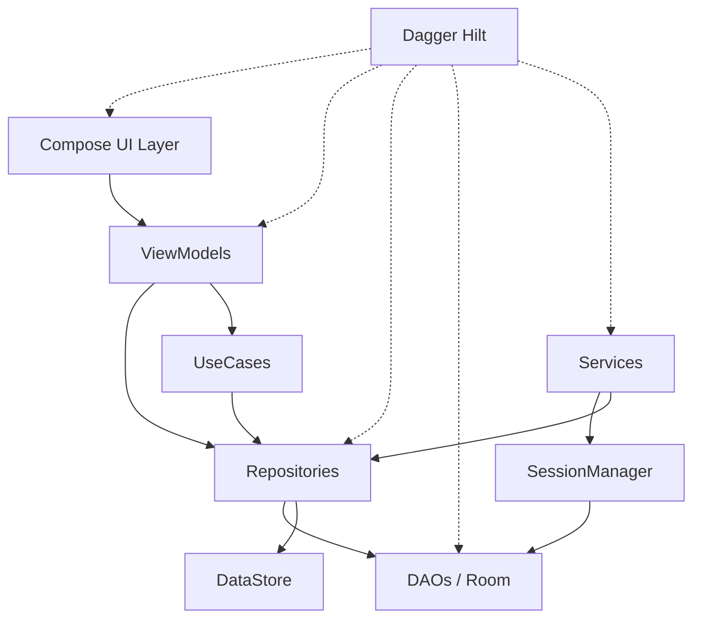
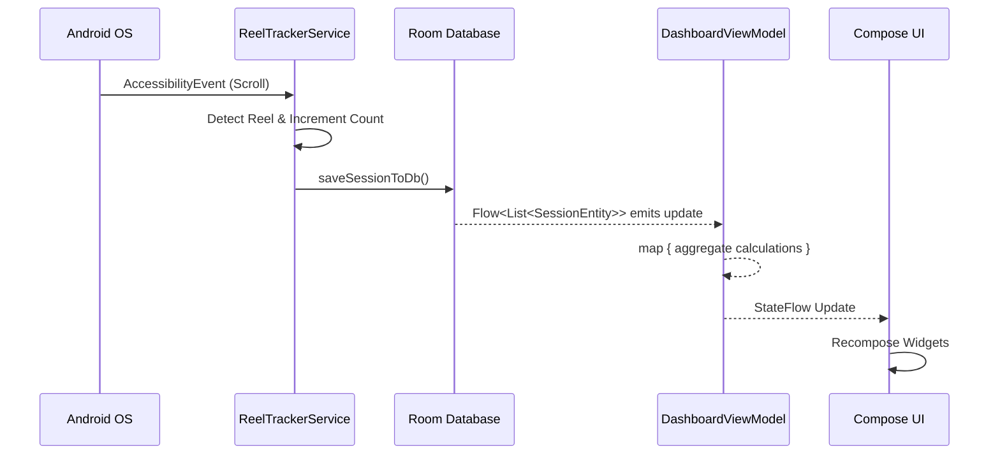

# Application Architecture

REEL employs a modern Android architecture based on the Unidirectional Data Flow (UDF) pattern, Clean Architecture, and Dependency Injection.

## 1. Dependency Graph

## 2. Layer Documentation

### UI Layer
The UI is built exclusively using Jetpack Compose.
- **Responsibility**: Render state emitted by ViewModels and pass user intents (events) back up.
- **Components**: `DashboardScreen`, `SettingsScreen`, `AnalyticsScreen`, and modular components (e.g., `WeeklyActivityGraph`).
- **Data Ownership**: The UI owns *no* business data. It strictly consumes `StateFlow` from the ViewModel.

### ViewModels
- **Responsibility**: Bridge the UI and the data layer. They transform repository flows into UI state.
- **Components**: `DashboardViewModel`, `SettingsViewModel`, `OnboardingViewModel`.
- **Thread Ownership**: Computations inside flows (e.g., aggregations) should run on `Dispatchers.Default` via `.flowOn(Dispatchers.Default)`, but the resulting `StateFlow` is consumed by the UI on the Main thread.

### Repository Layer
- **Responsibility**: Mediate between the domain and data sources.
- **Components**: `PreferencesRepositoryImpl`.
- **Data Ownership**: Owns the fetch strategy and data mapping. Repositories return Kotlin `Flow`s, acting as the Single Source of Truth for the rest of the application.

### Database Layer
- **Responsibility**: Local data persistence using Room Database.
- **Components**: `ReelTrakDatabase`, `SessionDao`, `DailyStatisticsDao`.
- **Lifecycle**: Initialized via Hilt singleton `DatabaseModule`. Lives for the lifetime of the application.

### Accessibility Layer (Service)
- **Responsibility**: Monitor screen events autonomously.
- **Components**: `ReelTrackerService` (the Android Service entry point), `EventProcessor`, `ReelDetectionEngine`.
- **Lifecycle**: Bound by the Android OS when accessibility permission is granted. Runs permanently in the background.

### Background Processing
- **Responsibility**: Execute debouncing and session tracking logic without blocking the main UI.
- **Components**: `CoroutineScope(SupervisorJob() + Dispatchers.IO)` inside `ReelTrackerService`.

## 3. Object Lifecycle

- **Hilt Singletons (`@Singleton`)**: Repositories, DAOs, and the `OverlayStateManager` live for the entire process lifetime.
- **ViewModels (`@HiltViewModel`)**: Scoped to the Navigation Graph entry. They are destroyed when the user navigates completely away from a screen and it pops off the back stack.
- **Services**: `ReelTrackerService` lives as long as the OS keeps the accessibility service alive.

## 4. State Management (UDF)

