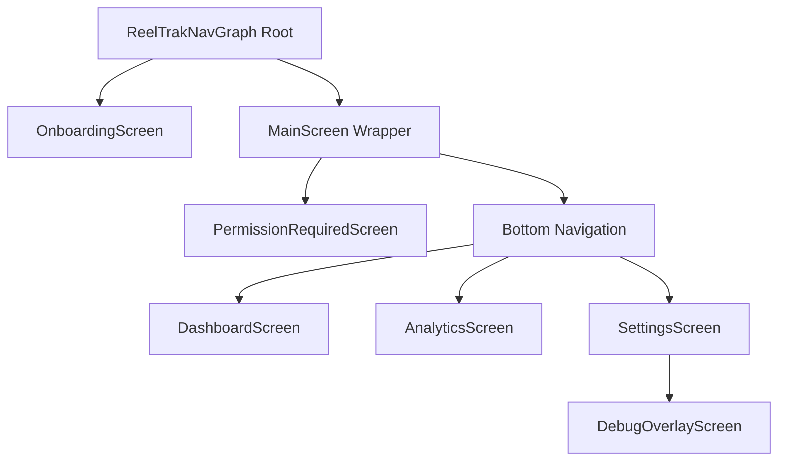

# Navigation

REEL uses Jetpack Compose Navigation (`navigation-compose`) to handle all screen transitions, back stack manipulation, and deep linking (if any). The navigation is strictly defined using a single `NavHostController` for the top level, and a nested `NavHostController` for the main bottom navigation.

## 1. Complete Navigation Graph

## 2. Screens and Entry Points

### Root Graph (`NavGraph.kt`)
- **`Routes.ONBOARDING`**: The initial setup screen for new users. (Checks `firstRunDate` or explicit setup intent).
- **`Routes.MAIN`**: The primary wrapper for the authenticated/setup user.

### Main Screen & Bottom Nav (`MainScreen.kt`)
The `MainScreen` is a dynamic wrapper. It listens to Android system settings for:
1. `Settings.canDrawOverlays` (SYSTEM_ALERT_WINDOW)
2. `isAccessibilityServiceEnabled` (Accessibility Service)

If permissions are missing, it hijacks the UI and forces `PermissionRequiredScreen`. Once granted, it renders `MainContent` which hosts the nested `NavHost`.

### Nested NavHost Routes
- **`Routes.DASHBOARD`**: The default landing page. Displays the `WeeklyActivityGraph`, `GoalCalendar`, and live session data.
- **`Routes.ANALYTICS`**: Deeper dive into historical trends (uses `DailyStatisticsEntity`).
- **`Routes.SETTINGS`**: User preferences, strict mode toggles, daily budgets.
- **`Routes.DEBUG_OVERLAY`**: Hidden debug screen accessible from Settings to mock overlay states.

## 3. Back Stack Behavior

REEL uses standard Material 3 Bottom Navigation behavior:
- **`popUpTo(findStartDestination().id) { saveState = true }`**: When switching tabs (e.g., from Dashboard to Analytics), the back stack is popped up to the start destination (Dashboard) to prevent an endless stack of tabs. 
- **`restoreState = true` / `launchSingleTop = true`**: When re-selecting a tab, the previous state (scroll position, expanded cards) is instantly restored without recomposing the entire screen from scratch.
- **Onboarding to Main**: `popUpTo(Routes.ONBOARDING) { inclusive = true }`. The onboarding screen is permanently erased from the back stack once setup is complete so the user cannot press the hardware back button to return to it.

## 4. State Restoration

Because the Bottom Navigation uses `saveState = true`, all ViewModels scoped to the `NavBackStackEntry` (via `hiltViewModel()`) are paused and their state is cached. When the user navigates back to a tab, the ViewModel is resumed and emits the latest state from the Repository, ensuring data is never stale.
