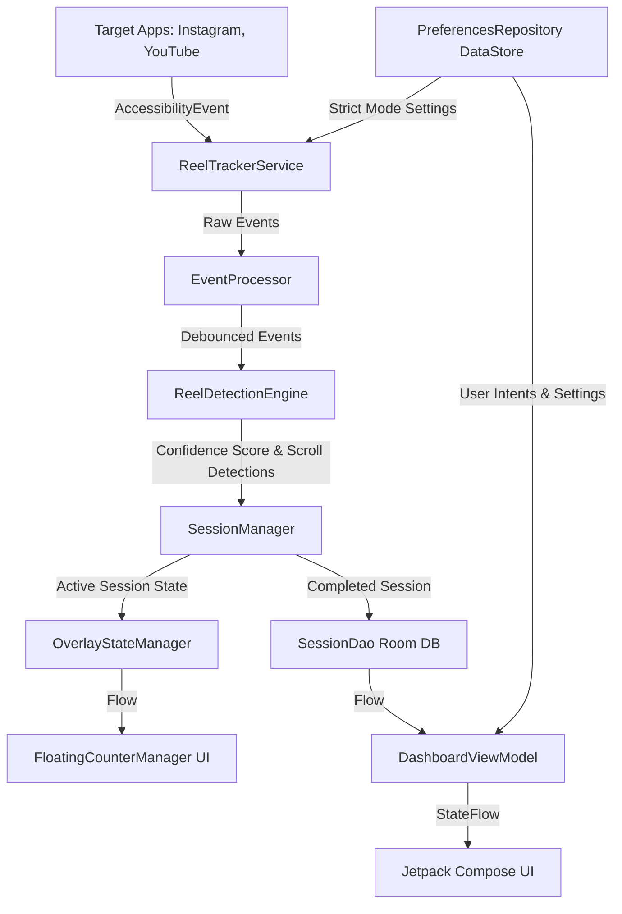

# REEL - Project Overview

## 1. Complete Architecture Overview

REEL is an Android application designed to track, monitor, and regulate the time users spend scrolling through short-form video content (e.g., Instagram Reels, YouTube Shorts, TikTok). It operates primarily as a background utility that leverages Android's Accessibility Services to intercept scroll events, analyze on-screen content, and intelligently calculate "Reels scrolled."

The architecture follows a strict **Unidirectional Data Flow (UDF)** using **Clean Architecture** principles, heavily relying on **Kotlin Coroutines and Flow** for reactive programming. It is built entirely with **Jetpack Compose** for the UI, **Room** for local persistence, and **Dagger Hilt** for Dependency Injection.

## 2. Design Philosophy

- **Invisible Until Needed**: The app runs silently in the background. The floating overlay only appears when the user is actively on a short-form video surface.
- **Privacy First**: The accessibility engine operates entirely locally. Content is analyzed on-device without screen recording or network requests.
- **Reactive UI**: The entire user interface reflects the state of the local database and active tracking service in real-time. There are no manual "refresh" buttons; the UI updates instantly as the user scrolls a reel.
- **Frictionless Tracking**: Users don't need to manually start a timer. The app autonomously detects when they enter a scrolling session and records it.

## 3. High-Level System Diagram



## 4. Module Interactions

1. **Accessibility Layer (`services.accessibility`)**: Monitors the OS for window state changes and scroll events. It filters out system noise and debounces valid input.
2. **Tracking Layer (`services.tracking`)**: Processes the debounced events through a heuristics engine (`ReelDetectionEngine`) to assign a confidence score. If confidence is high, `SessionManager` begins tracking scroll deltas and increments the counter.
3. **Database Layer (`data.local`)**: Stores completed sessions and daily aggregated statistics. It acts as the Single Source of Truth (SSOT) for all historical data.
4. **UI Layer (`features.dashboard`, `features.settings`)**: Subscribes to the Database Layer and DataStore preferences to render graphs, charts, and statistics.
5. **Overlay Layer (`services.overlay`)**: Subscribes to the active tracking state and draws a floating widget directly on the screen using `WindowManager` and Compose.

## 5. Feature Breakdown

- **Autonomous Session Tracking**: Detects when short-form video surfaces are opened and closed.
- **Intelligent Scroll Detection**: Identifies genuine reels scrolled, ignoring backwards scrolls or UI adjustments.
- **Floating Counter Overlay**: A minimalist, pill-shaped overlay that displays real-time reel counts.
- **Strict Mode Enforcement**: Automatically kicks the user to the home screen if they exceed their daily budget.
- **Weekly Activity Graph**: A bespoke 2D horizontally and vertically scrolling graph visualizing active scrolling blocks throughout the week.
- **Goal Heatmap**: An 84-day GitHub-style heatmap tracking adherence to daily goals.

## 6. Folder Structure

```
com/reeltrak/app/
│
├── core/                       # App-wide configurations
│   ├── di/                     # Dagger Hilt Modules (Database, State, Preferences)
│   ├── navigation/             # Compose Navigation graph and Routes
│   └── ui/theme/               # Material 3 Genesis Theme, Colors, Typography
│
├── data/                       # Data layer (SSOT)
│   ├── local/                  # Room DB
│   │   ├── dao/                # Data Access Objects (SessionDao, DailyStatisticsDao)
│   │   ├── database/           # ReelTrakDatabase instance
│   │   └── entity/             # Room Entities (SessionEntity, DailyStatisticsEntity)
│   └── preferences/            # DataStore implementations
│
├── domain/                     # Business logic contracts
│   ├── repository/             # Interfaces for repositories
│   └── usecases/               # Isolated business logic classes (e.g., DeductDailyBudget)
│
├── features/                   # UI Layer grouped by feature
│   ├── analytics/              # Deep analytics screens
│   ├── dashboard/              # Main Dashboard (Graphs, Timelines, Summaries)
│   ├── main/                   # Bottom Navigation wrapper
│   ├── onboarding/             # First-run experience and permissions
│   └── settings/               # App configuration
│
└── services/                   # Background & System integration
    ├── accessibility/          # Event routing, processing, and debouncing
    ├── overlay/                # Floating widget state and layout models
    └── tracking/               # Detection algorithms and Session state machine
```

## 7. Overall Application Lifecycle & Startup Sequence

1. **`ReelTrakApplication.kt`**: Hilt is initialized. Singletons are instantiated.
2. **`MainActivity.kt`**: The host activity launches, setting the Compose content to `ReelTrakNavGraph`.
3. **First Run Check**: `DashboardViewModel` checks `firstRunDate` in DataStore. If missing, it queries the earliest DB session and sets it.
4. **Service Activation**: If the user grants Accessibility permissions, Android binds `ReelTrackerService`.
5. **Service Initialization**: `ReelTrackerService` spins up `EventProcessor`, `ReelDetectionEngine`, and the `SessionManager`.
6. **Overlay Attachment**: `FloatingCounterManager` attaches a detached Compose tree directly to the `WindowManager` with zero visibility, awaiting state updates.
7. **Standby**: The app remains idle, listening to the OS accessibility event stream.
