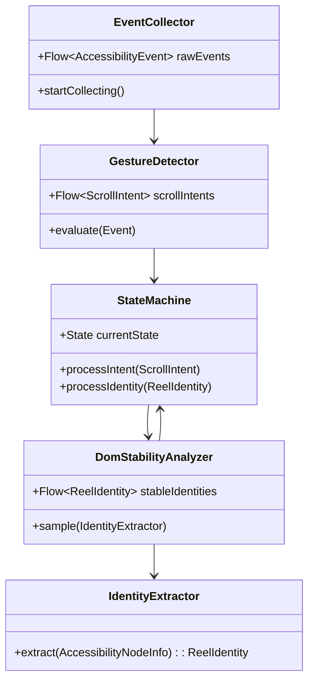
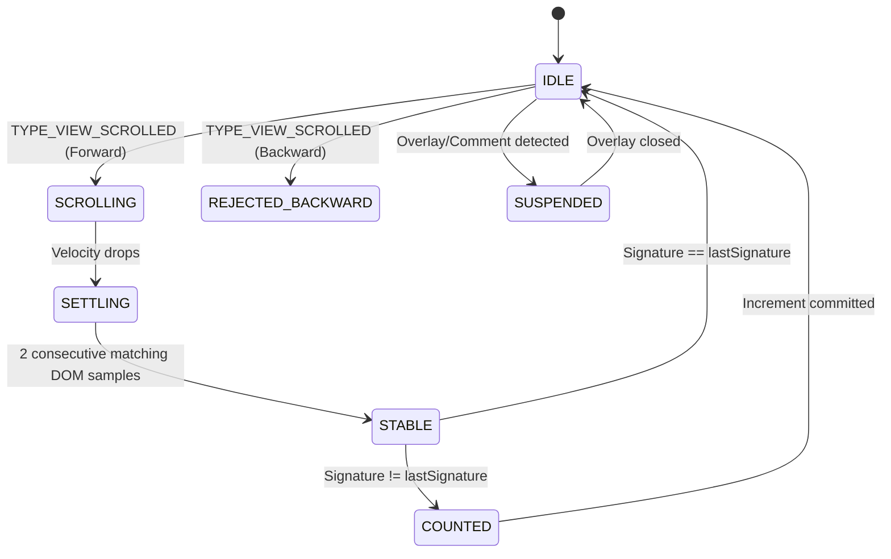
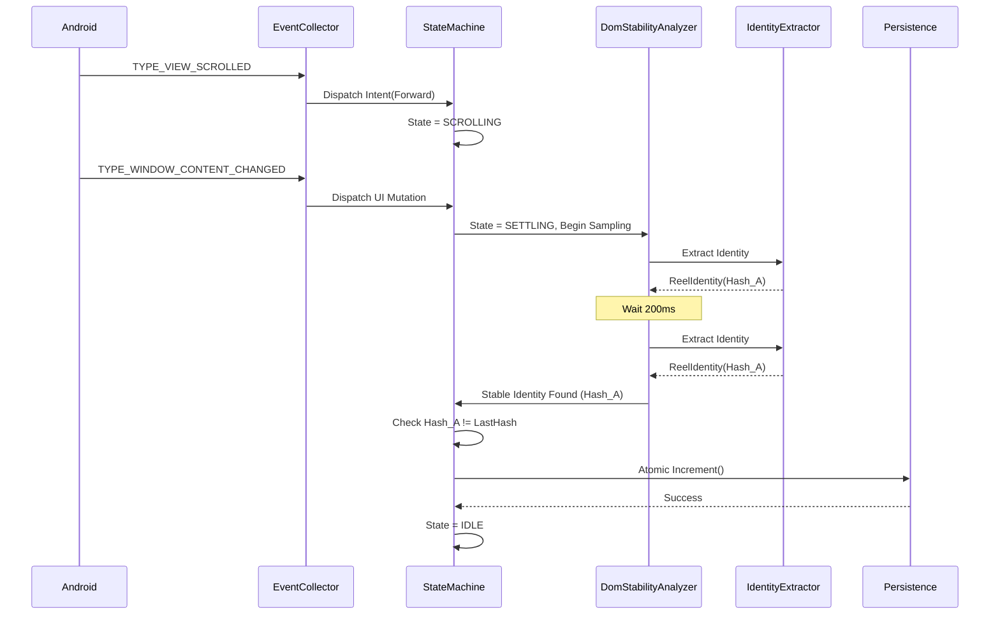

# Production-Grade Accessibility Reel Counter: Architectural Redesign

## Executive Summary
This document outlines the complete architectural redesign of the Accessibility-based Reel Counter. Discarding previous fragile heuristics, this new architecture is built on absolute robustness. It separates concerns into isolated modules, replaces time-based gates with empirical DOM stability sampling, anchors signatures to invariant UI elements, and guarantees crash-proof, atomic persistence.

---

## 1. Complete Production Architecture

The system is divided into strict, unidirectional data flow layers:

- **Ingress Layer:** Captures raw OS events, normalizes them, and drops noise.
- **Evaluation Layer:** Parses the DOM, extracting purely stable structural anchors.
- **State Machine Layer:** Manages gesture intent, DOM stability, and transition locks.
- **Action Layer:** Handles deduplication and triggers counter increments.
- **Persistence Layer:** Safely commits data to disk and synchronizes the UI.

---

## 2. Package Structure

```text
com.reeltrak.app
├── core
│   ├── di (Hilt Modules)
│   ├── logging (Structured Telemetry)
│   └── persistence (Room DB, DataStore)
├── services
│   ├── accessibility
│   │   ├── ReelAccessibilityService.kt
│   │   ├── EventCollector.kt
│   │   └── GestureDetector.kt
│   ├── overlay
│   │   ├── WidgetManager.kt
│   │   └── OverlayRenderer.kt
├── domain
│   ├── models
│   │   ├── ReelIdentity.kt
│   │   ├── TransitionEvent.kt
│   │   └── EngineState.kt
│   ├── engine
│   │   ├── ReelDetectionEngine.kt
│   │   ├── IdentityExtractor.kt
│   │   ├── DomStabilityAnalyzer.kt
│   │   └── StateMachine.kt
│   └── usecase
│       ├── IncrementCounterUseCase.kt
│       └── GetDailyGoalUseCase.kt
```

---

## 3. Class Diagram (Core Engine)



---

## 4. State Machine Diagram



---

## 5. Sequence Diagram



---

## 6. Accessibility Pipeline
1. **Raw Event:** Service receives event.
2. **Filter:** Drops all events except `SCROLLED` and `CONTENT_CHANGED`.
3. **Gesture Triage:** `SCROLLED` computes Y-delta. If `< -threshold`, flags as backward. If `> threshold`, flags as forward. Emits to `GestureDetector`.
4. **Content Triage:** `CONTENT_CHANGED` triggers the `DomStabilityAnalyzer` if the state is `SETTLING`.

---

## 7. Identity Pipeline
The identity system abandons full-DOM hashing (which breaks on caption expansions).
- **Targeting:** Finds the main `ViewPager2` or `RecyclerView` child.
- **Anchors:** Extracts **ONLY**:
  1. Username (regex `@username` or structural index).
  2. Audio Track (structural ID or scrolling text heuristic).
- **Normalization:** Converts to lowercase, strips unicode variants, trailing spaces, and zero-width joiners.
- **Output:** `ReelIdentity(usernameHash, audioHash)`

---

## 8. Transition Pipeline
- **Decoupling:** Swipes do not trigger timeouts. They alter the State Machine to `SCROLLING`.
- **Sampling:** When `CONTENT_CHANGED` stops firing rapidly (or after a 100ms debounce), the Engine enters `SETTLING`.
- **Confirmation:** It takes two identical DOM snapshots spaced 200ms apart. If they match, the transition is confirmed complete.

---

## 9. Recovery Pipeline
- **Lifecycle Death:** `lastSeenSignature` and `DailyCount` are persisted to `DataStore` synchronously on every increment.
- **Dropped Swipes:** If the OS drops a swipe but fires a `CONTENT_CHANGED`, the State Machine checks if the new stable signature matches the last. If it doesn't, it queues it for a forced increment, assuming the swipe was lost.

---

## 10. Persistence Pipeline
- **Atomicity:** SQLite Transactions ensure no read-after-write errors.
- **Supervision:** All IO operations run on `Dispatchers.IO` wrapped in a `CoroutineExceptionHandler`.
- **UI Sync:** The UI observes a conflated `StateFlow` backed directly by the Room Database, ensuring the Widget never desyncs from the disk.

---

## 11. Threading Model
- **Main Thread:** UI updates, Widget animations.
- **Default Dispatcher (CPU):** State Machine, DOM BFS Traversals, String Normalization, Signature Hashing.
- **IO Dispatcher:** Room Database, DataStore reads/writes, Logging file I/O.

---

## 12. Coroutine Model
- **Scope:** A dedicated `@Singleton EngineScope` tied to the Application lifecycle, explicitly injected.
- **Job Hierarchy:** Background tickers (like `DomStabilityAnalyzer`) use `SupervisorJob` so a failure in one traversal doesn't crash the entire engine pipeline.

---

## 13. Flow Architecture
- `MutableSharedFlow<AccessibilityEvent>` (Buffer 64, DROP_OLDEST) -> `EventCollector`
- `MutableStateFlow<EngineState>` -> `StateMachine`
- `Flow<ReelIdentity>` -> `DomStabilityAnalyzer`
- `StateFlow<Int>` -> `WidgetManager`

---

## 14. Error Handling Strategy
- **BFS Exceptions:** `DeadObjectException` and `NullPointerException` during node recycling are caught at the `IdentityExtractor` boundary. It yields a `null` signature, which the `DomStabilityAnalyzer` ignores, waiting for the next ticker sample.
- **IO Exceptions:** Database locks trigger a retry with exponential backoff (e.g., 50ms, 100ms, 200ms) before flagging a fatal `PersistentError`.

---

## 15. Logging Strategy
**Structured JSON Lines (`.jsonl`) Telemetry:**
```json
{"traceId": "abc-123", "timestamp": 1690000000, "event": "SCROLL_DETECTED", "direction": "FORWARD"}
{"traceId": "abc-123", "timestamp": 1690000050, "event": "DOM_SAMPLING_STARTED"}
{"traceId": "abc-123", "timestamp": 1690000250, "event": "DOM_STABLE", "identity": "hash123"}
{"traceId": "abc-123", "timestamp": 1690000260, "event": "INCREMENT_COMMITTED"}
```
Silent drops are forbidden. Every rejected state must log an explicit `REJECTION_REASON`.

---

## 16. Testing Strategy
- **Unit Tests:** Mocked `AccessibilityNodeInfo` trees to verify Identity Extraction immunity to caption expansions.
- **Integration Tests:** Simulated `AccessibilityEvent` flows (rapid swipes, slow networks) fed into the State Machine.
- **Stress Tests:** Firing 1,000 `CONTENT_CHANGED` events per second to verify Flow debounce doesn't leak memory.

---

## 17. Performance Optimization Plan
- **Allocation Reduction:** Pre-allocate lists for BFS traversals. Avoid creating new strings unless necessary for normalization.
- **Early Exit:** Abort BFS immediately if the bounds indicate a comment bottom-sheet is open.
- **Node Recycling:** Enforce strict `.recycle()` calls in `finally` blocks for every node touched by the `IdentityExtractor`.

---

## 18. Migration Plan
1. **Phase 1:** Build the new Engine alongside the old one. Run it in "Shadow Mode" (calculating but not writing to the DB).
2. **Phase 2:** Implement logging to compare the Shadow Engine's accuracy against the Legacy Engine.
3. **Phase 3:** Swap the Dependency Injection bindings to route `EventProcessor` to the new `StateMachine`.
4. **Phase 4:** Delete legacy `ReelDetectionEngine` and `EventProcessor` code.

---

## 19. Risk Analysis
- **Instagram Obfuscating Usernames:** If Instagram removes `@` handles or moves the username to a custom Canvas view, the anchored signature fails. *Mitigation:* Fallback to video frame hash (requires MediaProjection, high battery drain, currently out of scope).
- **OEM Battery Restrictions:** Aggressive OEMs killing the background Coroutine tickers. *Mitigation:* Bind the EngineScope to the Foreground Notification lifecycle.

---

## 20. Final Implementation Roadmap

- **Week 1: Foundations**
  - Implement `ReelIdentity` model and `IdentityExtractor` (Anchored BFS).
  - Implement `EventCollector` and `GestureDetector` (Velocity based).
- **Week 2: Engine & State Machine**
  - Build `DomStabilityAnalyzer` (200ms Polling).
  - Build the decoupled `StateMachine`.
- **Week 3: Persistence & Safety**
  - Refactor `DayManager` into a robust `CounterRepository` with supervised IO.
  - Implement Structured Telemetry Logging.
- **Week 4: QA & Rollout**
  - Write Mock DOM Unit Tests.
  - Execute Shadow Mode profiling.
  - Final Production Cutover.
